# คู่มือการใช้งานโปรแกรม โชคชัย 4 ยางยนต์ 2002 ERP

**Chokchai 4 Yangyont 2002 ERP · เวอร์ชัน 0.1.0**

โปรแกรมจัดการร้าน ยาง · ช่วงล่าง · แบตเตอรี่ สำหรับเครื่อง Mac และ Windows (ใช้งานออฟไลน์ ไม่ต้องใช้อินเทอร์เน็ต)

ฉบับเดือนกันยายน 2569

> **เกี่ยวกับภาพในคู่มือ:** ภาพหน้าจอทั้งหมดถ่ายจากโปรแกรมที่ใส่ข้อมูลตัวอย่างไว้ ชื่อลูกค้า สินค้า ราคา และตัวเลขต่าง ๆ เป็นข้อมูลสมมติ หน้าจอจริงของร้านจะแสดงข้อมูลของร้านเอง

## สารบัญ

<!-- toc -->

- [วิธีอ่านคู่มือนี้](#วิธีอ่านคู่มือนี้)
- [1. รู้จักโปรแกรม](#1-รู้จักโปรแกรม)
   - [1.1 โปรแกรมนี้ทำอะไรได้บ้าง](#11-โปรแกรมนี้ทำอะไรได้บ้าง)
   - [1.2 ลักษณะสำคัญที่ควรรู้](#12-ลักษณะสำคัญที่ควรรู้)
   - [1.3 คำศัพท์ที่ใช้ในโปรแกรม](#13-คำศัพท์ที่ใช้ในโปรแกรม)
- [2. ติดตั้งและเริ่มใช้งานครั้งแรก](#2-ติดตั้งและเริ่มใช้งานครั้งแรก)
   - [2.1 เครื่องที่ใช้ได้](#21-เครื่องที่ใช้ได้)
   - [2.2 ติดตั้งบนเครื่อง Mac](#22-ติดตั้งบนเครื่อง-mac)
   - [2.3 ติดตั้งบนเครื่อง Windows](#23-ติดตั้งบนเครื่อง-windows)
   - [2.4 เปิดโปรแกรมครั้งแรก: สร้างบัญชีเจ้าของร้าน](#24-เปิดโปรแกรมครั้งแรก-สร้างบัญชีเจ้าของร้าน)
   - [2.5 รหัสกู้คืน (สำคัญมาก)](#25-รหัสกู้คืน-สำคัญมาก)
   - [2.6 สิ่งที่ควรตั้งค่าก่อนเริ่มขาย](#26-สิ่งที่ควรตั้งค่าก่อนเริ่มขาย)
- [3. เข้าสู่ระบบและหน้าจอหลัก](#3-เข้าสู่ระบบและหน้าจอหลัก)
   - [3.1 เข้าสู่ระบบ](#31-เข้าสู่ระบบ)
   - [3.2 ลืมรหัสผ่าน](#32-ลืมรหัสผ่าน)
   - [3.3 ส่วนประกอบของหน้าจอหลัก](#33-ส่วนประกอบของหน้าจอหลัก)
   - [3.4 เมนูผู้ใช้: เปลี่ยนรหัสผ่านและออกจากระบบ](#34-เมนูผู้ใช้-เปลี่ยนรหัสผ่านและออกจากระบบ)
   - [3.5 เปลี่ยนภาษา ธีม และขนาดตัวอักษร](#35-เปลี่ยนภาษา-ธีม-และขนาดตัวอักษร)
   - [3.6 เมื่อไม่มีสิทธิ์ใช้หน้านั้น](#36-เมื่อไม่มีสิทธิ์ใช้หน้านั้น)
   - [3.7 ปุ่มลัดบนแป้นพิมพ์](#37-ปุ่มลัดบนแป้นพิมพ์)
- [4. แดชบอร์ด (หน้าแรก)](#4-แดชบอร์ด-หน้าแรก)
- [5. ขายสินค้าและบริการ (เปิดบิลขาย)](#5-ขายสินค้าและบริการ-เปิดบิลขาย)
   - [5.1 ส่วนประกอบของหน้าขาย](#51-ส่วนประกอบของหน้าขาย)
   - [5.2 ขั้นตอนขายแบบย่อ](#52-ขั้นตอนขายแบบย่อ)
   - [5.3 เพิ่มสินค้าหรือบริการลงบิล](#53-เพิ่มสินค้าหรือบริการลงบิล)
   - [5.4 แก้จำนวน ราคา และส่วนลดของแต่ละรายการ](#54-แก้จำนวน-ราคา-และส่วนลดของแต่ละรายการ)
   - [5.5 รายการอื่น ๆ (พิมพ์ชื่อเอง)](#55-รายการอื่น-ๆ-พิมพ์ชื่อเอง)
   - [5.6 เลือกลูกค้า](#56-เลือกลูกค้า)
   - [5.7 ข้อมูลรถ](#57-ข้อมูลรถ)
   - [5.8 วิธีชำระเงินและสถานะ](#58-วิธีชำระเงินและสถานะ)
   - [5.9 ภาษีมูลค่าเพิ่ม (เฉพาะร้านที่จด VAT)](#59-ภาษีมูลค่าเพิ่ม-เฉพาะร้านที่จด-vat)
   - [5.10 ส่วนลดท้ายบิลและยอดสุทธิ](#510-ส่วนลดท้ายบิลและยอดสุทธิ)
   - [5.11 ช่วยคิดเงินทอน](#511-ช่วยคิดเงินทอน)
   - [5.12 วันที่และเวลาของบิล](#512-วันที่และเวลาของบิล)
   - [5.13 หมายเหตุ](#513-หมายเหตุ)
   - [5.14 บันทึกบิล](#514-บันทึกบิล)
   - [5.15 เมื่อบันทึกบิลขายแล้ว ระบบทำอะไรให้บ้าง](#515-เมื่อบันทึกบิลขายแล้ว-ระบบทำอะไรให้บ้าง)
- [6. บันทึกการซื้อสินค้าเข้าร้าน (บิลซื้อ)](#6-บันทึกการซื้อสินค้าเข้าร้าน-บิลซื้อ)
- [7. รายการซื้อ-ขาย: ค้นหา ดู รับชำระ แก้ไข ยกเลิก](#7-รายการซื้อ-ขาย-ค้นหา-ดู-รับชำระ-แก้ไข-ยกเลิก)
   - [7.1 หน้ารายการซื้อ-ขาย](#71-หน้ารายการซื้อ-ขาย)
   - [7.2 หน้ารายละเอียดบิล](#72-หน้ารายละเอียดบิล)
   - [7.3 รับชำระเงินบิลที่ค้างอยู่](#73-รับชำระเงินบิลที่ค้างอยู่)
   - [7.4 แก้ไขบิล](#74-แก้ไขบิล)
   - [7.5 ยกเลิกบิล](#75-ยกเลิกบิล)
   - [7.6 เปิดบิลใหม่จากบิลนี้](#76-เปิดบิลใหม่จากบิลนี้)
   - [7.7 ดูบิลทั้งหมดของลูกค้า](#77-ดูบิลทั้งหมดของลูกค้า)
- [8. พิมพ์ใบเสร็จ ใบแจ้งหนี้ และบันทึกเป็น PDF](#8-พิมพ์ใบเสร็จ-ใบแจ้งหนี้-และบันทึกเป็น-pdf)
   - [8.1 พิมพ์เอกสารของบิล](#81-พิมพ์เอกสารของบิล)
   - [8.2 ตัวอย่างเอกสาร](#82-ตัวอย่างเอกสาร)
   - [8.3 ใช้กับเครื่องพิมพ์ใบเสร็จความร้อน 80 มม.](#83-ใช้กับเครื่องพิมพ์ใบเสร็จความร้อน-80-มม)
- [9. สินค้าและสต็อก](#9-สินค้าและสต็อก)
   - [9.1 หน้ารายการสินค้า](#91-หน้ารายการสินค้า)
   - [9.2 เพิ่มสินค้าใหม่](#92-เพิ่มสินค้าใหม่)
   - [9.3 แก้ไขข้อมูลและราคาสินค้า](#93-แก้ไขข้อมูลและราคาสินค้า)
   - [9.4 หมวดหมู่สินค้า](#94-หมวดหมู่สินค้า)
   - [9.5 ปรับสต็อก](#95-ปรับสต็อก)
   - [9.6 หน้ารายละเอียดสินค้า](#96-หน้ารายละเอียดสินค้า)
   - [9.7 ปิดขายและลบสินค้า](#97-ปิดขายและลบสินค้า)
   - [9.8 สต็อกเปลี่ยนเมื่อไหร่](#98-สต็อกเปลี่ยนเมื่อไหร่)
- [10. บริการ](#10-บริการ)
   - [10.1 หน้ารายการบริการ](#101-หน้ารายการบริการ)
   - [10.2 เพิ่มหรือแก้ไขบริการ](#102-เพิ่มหรือแก้ไขบริการ)
   - [10.3 ประวัติราคาบริการ](#103-ประวัติราคาบริการ)
- [11. ลูกค้า](#11-ลูกค้า)
   - [11.1 รายชื่อลูกค้า](#111-รายชื่อลูกค้า)
   - [11.2 เพิ่มลูกค้า](#112-เพิ่มลูกค้า)
   - [11.3 ดูข้อมูลและประวัติการใช้บริการของลูกค้า](#113-ดูข้อมูลและประวัติการใช้บริการของลูกค้า)
   - [11.4 แก้ไขและลบลูกค้า](#114-แก้ไขและลบลูกค้า)
- [12. ข้อมูลพนักงาน](#12-ข้อมูลพนักงาน)
   - [12.1 รายชื่อพนักงาน](#121-รายชื่อพนักงาน)
   - [12.2 เพิ่มหรือแก้ไขพนักงาน](#122-เพิ่มหรือแก้ไขพนักงาน)
   - [12.3 หน้ารายละเอียดพนักงาน](#123-หน้ารายละเอียดพนักงาน)
   - [12.4 บันทึกเงินเบิกล่วงหน้า](#124-บันทึกเงินเบิกล่วงหน้า)
- [13. ลงเวลาเข้า-ออกงาน และจัดการเวลาทำงาน](#13-ลงเวลาเข้า-ออกงาน-และจัดการเวลาทำงาน)
   - [13.1 หน้าลงเวลา (สำหรับพนักงานทุกคน)](#131-หน้าลงเวลา-สำหรับพนักงานทุกคน)
   - [13.2 หน้าเวลาทำงาน (สำหรับผู้จัดการ)](#132-หน้าเวลาทำงาน-สำหรับผู้จัดการ)
   - [13.3 ดูและแก้ไขเวลารายวัน](#133-ดูและแก้ไขเวลารายวัน)
   - [13.4 บันทึกวันลา](#134-บันทึกวันลา)
   - [13.5 ระบบนับ มาสาย ขาดงาน และ OT อย่างไร](#135-ระบบนับ-มาสาย-ขาดงาน-และ-ot-อย่างไร)
- [14. เงินเดือน](#14-เงินเดือน)
   - [14.1 หน้าเงินเดือน](#141-หน้าเงินเดือน)
   - [14.2 ขั้นตอนทำเงินเดือนแบบย่อ](#142-ขั้นตอนทำเงินเดือนแบบย่อ)
   - [14.3 สร้างงวดเงินเดือน](#143-สร้างงวดเงินเดือน)
   - [14.4 หน้างวดเงินเดือน](#144-หน้างวดเงินเดือน)
   - [14.5 ตรวจและแก้ไขสลิปเงินเดือน](#145-ตรวจและแก้ไขสลิปเงินเดือน)
   - [14.6 บันทึกการจ่ายเงินเดือน](#146-บันทึกการจ่ายเงินเดือน)
   - [14.7 พิมพ์สลิปเงินเดือน](#147-พิมพ์สลิปเงินเดือน)
   - [14.8 วิธีคำนวณรายการอัตโนมัติในสลิป](#148-วิธีคำนวณรายการอัตโนมัติในสลิป)
- [15. รายงาน](#15-รายงาน)
   - [15.1 เลือกช่วงเวลา](#151-เลือกช่วงเวลา)
   - [15.2 ตัวเลขสรุป](#152-ตัวเลขสรุป)
   - [15.3 กราฟและตาราง](#153-กราฟและตาราง)
- [16. ประวัติการแก้ไข](#16-ประวัติการแก้ไข)
- [17. ตั้งค่า](#17-ตั้งค่า)
   - [17.1 ข้อมูลร้าน](#171-ข้อมูลร้าน)
   - [17.2 ภาษี (VAT)](#172-ภาษี-vat)
   - [17.3 เลขที่เอกสาร](#173-เลขที่เอกสาร)
   - [17.4 การพิมพ์](#174-การพิมพ์)
   - [17.5 สต็อก](#175-สต็อก)
   - [17.6 เวลางาน & เงินเดือน](#176-เวลางาน--เงินเดือน)
   - [17.7 ผู้ใช้งาน](#177-ผู้ใช้งาน)
   - [17.8 สำรองข้อมูล](#178-สำรองข้อมูล)
   - [17.9 การแสดงผล](#179-การแสดงผล)
   - [17.10 เกี่ยวกับโปรแกรม](#1710-เกี่ยวกับโปรแกรม)
- [18. ผู้ใช้งานและสิทธิ์การใช้งาน](#18-ผู้ใช้งานและสิทธิ์การใช้งาน)
   - [18.1 เจ้าของร้านกับพนักงานต่างกันอย่างไร](#181-เจ้าของร้านกับพนักงานต่างกันอย่างไร)
   - [18.2 เพิ่มผู้ใช้งาน](#182-เพิ่มผู้ใช้งาน)
   - [18.3 แก้ไขผู้ใช้ ตั้งรหัสผ่านใหม่ ปิดใช้งาน และลบ](#183-แก้ไขผู้ใช้-ตั้งรหัสผ่านใหม่-ปิดใช้งาน-และลบ)
   - [18.4 ล็อกหน้าจออัตโนมัติ](#184-ล็อกหน้าจออัตโนมัติ)
   - [18.5 รหัสกู้คืนของเจ้าของร้าน](#185-รหัสกู้คืนของเจ้าของร้าน)
   - [18.6 ตารางสิทธิ์](#186-ตารางสิทธิ์)
- [19. สำรองข้อมูลและกู้คืน](#19-สำรองข้อมูลและกู้คืน)
   - [19.1 ข้อมูลเก็บอยู่ที่ไหน](#191-ข้อมูลเก็บอยู่ที่ไหน)
   - [19.2 สำรองข้อมูลอัตโนมัติ](#192-สำรองข้อมูลอัตโนมัติ)
   - [19.3 สำรองข้อมูลเก็บนอกเครื่อง (แนะนำอย่างน้อยสัปดาห์ละครั้ง)](#193-สำรองข้อมูลเก็บนอกเครื่อง-แนะนำอย่างน้อยสัปดาห์ละครั้ง)
   - [19.4 กู้คืนข้อมูล (เฉพาะเจ้าของร้าน)](#194-กู้คืนข้อมูล-เฉพาะเจ้าของร้าน)
   - [19.5 ย้ายโปรแกรมไปเครื่องใหม่](#195-ย้ายโปรแกรมไปเครื่องใหม่)
- [20. งานประจำที่แนะนำ](#20-งานประจำที่แนะนำ)
   - [20.1 เปิดร้าน](#201-เปิดร้าน)
   - [20.2 ระหว่างวัน](#202-ระหว่างวัน)
   - [20.3 ปิดร้าน](#203-ปิดร้าน)
   - [20.4 ทุกสัปดาห์](#204-ทุกสัปดาห์)
   - [20.5 ทุกเดือน](#205-ทุกเดือน)
- [21. คำถามที่พบบ่อยและการแก้ปัญหา](#21-คำถามที่พบบ่อยและการแก้ปัญหา)

<!-- /toc -->

## วิธีอ่านคู่มือนี้

- **ตัวหนา** คือชื่อปุ่ม เมนู หรือช่องที่เห็นบนหน้าจอ เช่น กดปุ่ม **บันทึก**
- เครื่องหมาย → คือลำดับการกดเมนู เช่น **ตั้งค่า → ข้อมูลร้าน** หมายถึงกดเมนู **ตั้งค่า** แล้วเลือกหัวข้อ **ข้อมูลร้าน**
- ปุ่ม ⌘ (Command) บนเครื่อง Mac ใช้แทนปุ่ม Ctrl บนเครื่อง Windows เช่น ⌘S บน Mac เท่ากับ Ctrl+S บน Windows
- กล่อง **เคล็ดลับ** คือวิธีใช้งานที่ช่วยให้ทำงานเร็วขึ้น กล่อง **ข้อควรระวัง** คือเรื่องที่ทำแล้วย้อนกลับได้ยาก ควรอ่านก่อนทำ
- บางเมนูและบางปุ่มแสดงเฉพาะผู้ใช้ที่มีสิทธิ์ ถ้าไม่เห็นเมนูที่คู่มือกล่าวถึง แปลว่าบัญชีของคุณยังไม่ได้รับสิทธิ์นั้น ให้ติดต่อเจ้าของร้าน (ดูบทที่ 18)

## 1. รู้จักโปรแกรม

### 1.1 โปรแกรมนี้ทำอะไรได้บ้าง

| งาน | สิ่งที่ทำได้ | อ่านที่บท |
|---|---|---|
| ขายสินค้าและบริการ | เปิดบิลขาย ค้นหาสินค้าด้วยชื่อ ขนาดยาง หรือบาร์โค้ด แก้ราคาได้ตอนขาย ช่วยคิดเงินทอน ตัดสต็อกให้อัตโนมัติ | 5 |
| บันทึกการซื้อ | บันทึกสินค้าที่ซื้อเข้าร้าน เพิ่มสต็อก และปรับราคาทุนให้อัตโนมัติ | 6 |
| รายการซื้อ-ขาย | ค้นหาบิลย้อนหลัง แก้ไขบิล ยกเลิกบิล และรับชำระบิลที่ค้างไว้ | 7 |
| พิมพ์เอกสาร | ใบเสร็จรับเงิน ใบแจ้งหนี้ / ใบส่งของ ใบบันทึกการซื้อ บนกระดาษความร้อน 80 / 58 มม. หรือ A4 / A5 และบันทึกเป็น PDF | 8 |
| สินค้าและสต็อก | ข้อมูลสินค้า ราคาทุน ราคาขาย จำนวนคงเหลือ แจ้งเตือนสินค้าใกล้หมด ประวัติการรับเข้า-จ่ายออก | 9 |
| บริการ | ค่าแรงและบริการพร้อมราคาตั้งต้น เช่น ถ่วงล้อ ตั้งศูนย์ ปะยาง | 10 |
| ลูกค้า | ข้อมูลติดต่อ ทะเบียนรถ และประวัติว่าลูกค้าเคยมาทำอะไร เมื่อไหร่ | 11 |
| พนักงาน | ข้อมูลส่วนตัว ค่าจ้าง บัญชีรับเงิน ประกันสังคม และเงินเบิกล่วงหน้า | 12 |
| ลงเวลาทำงาน | พนักงานแตะชื่อตัวเองเพื่อลงเวลาเข้า-ออกงาน สรุปมาสาย ขาด ลา และ OT | 13 |
| เงินเดือน | สร้างงวดเงินเดือน คำนวณสลิปจากเวลาทำงาน บันทึกการจ่าย และพิมพ์สลิป | 14 |
| รายงาน | รายรับ รายจ่าย กำไรขั้นต้น สินค้าขายดี และเงินที่รับตามวิธีชำระ | 15 |
| ประวัติการแก้ไข | ดูว่าใครเปิดบิล แก้ไขอะไร เปลี่ยนราคา หรือเข้าสู่ระบบเมื่อไหร่ | 16 |
| ตั้งค่าและผู้ใช้งาน | ข้อมูลร้าน ภาษี เลขที่เอกสาร การพิมพ์ ผู้ใช้งานและสิทธิ์ | 17–18 |
| สำรองข้อมูล | สำรองอัตโนมัติทุกวัน สำรองลงแฟลชไดรฟ์ และกู้คืนข้อมูล | 19 |

### 1.2 ลักษณะสำคัญที่ควรรู้

- **ทำงานออฟไลน์:** ข้อมูลทั้งหมดของร้านเก็บอยู่ในเครื่องคอมพิวเตอร์เครื่องที่ติดตั้งโปรแกรม ไม่ต้องใช้อินเทอร์เน็ต ข้อดีคือเร็วและใช้ได้แม้เน็ตล่ม แต่ถ้าเครื่องเสียหรือหาย ข้อมูลจะหายไปด้วย จึงต้อง **สำรองข้อมูลเก็บไว้นอกเครื่องเป็นประจำ** (บทที่ 19)
- **ผู้ใช้หลายคน:** เจ้าของร้านทำได้ทุกอย่าง ส่วนพนักงานทำได้ตามสิทธิ์ที่เจ้าของร้านเลือกให้ ทุกบิลและทุกการแก้ไขบันทึกไว้ว่าใครเป็นคนทำ
- **เงินและตัวเลข:** จำนวนเงินเป็นบาท ทศนิยม 2 ตำแหน่ง วันที่แสดงเป็นปี พ.ศ. จำนวนสินค้าใส่ทศนิยมได้ 2 ตำแหน่ง (เช่น น้ำมันเครื่อง 4.5 ลิตร)
- **สองภาษา:** สลับหน้าจอเป็นภาษาไทยหรือภาษาอังกฤษได้ และตั้งภาษาของใบเสร็จแยกจากภาษาของหน้าจอได้
- **ธีมสว่าง / มืด:** เลือกได้ตามความสบายตา

### 1.3 คำศัพท์ที่ใช้ในโปรแกรม

| คำ | ความหมาย |
|---|---|
| บิลขาย | บิลที่ร้านขายสินค้าหรือบริการให้ลูกค้า เลขที่บิลขึ้นต้นด้วย **S** (เช่น S6909-0051) นับเป็นรายรับ และตัดสต็อกสินค้า |
| บิลซื้อ | บิลที่ร้านซื้อสินค้าเข้าร้านจากผู้ขายหรือร้านค้าส่ง เลขที่บิลขึ้นต้นด้วย **P** นับเป็นรายจ่าย และเพิ่มสต็อกสินค้า |
| ชำระแล้ว / ค้างชำระ | สถานะเงินของบิล บิลขายที่ค้างชำระคือลูกค้ายังไม่จ่าย (ร้านค้างรับ) บิลซื้อที่ค้างชำระคือร้านยังไม่จ่ายผู้ขาย (ร้านค้างจ่าย) |
| เครดิต | วิธีชำระแบบเชื่อไว้ก่อน บิลที่เลือกเครดิตจะเป็น "ค้างชำระ" อัตโนมัติ |
| ยกเลิกบิล | ทำให้บิลไม่นับยอดและคืนสต็อก บิลยังเก็บไว้ดูย้อนหลังได้ แต่แก้ไขไม่ได้อีก |
| รายรับ / รายจ่าย | ยอดของบิลขาย / บิลซื้อ นับตามวันที่ในบิล (รวมบิลที่ยังค้างชำระ ไม่รวมบิลที่ยกเลิก) |
| รับเงิน | เงินที่ได้รับจริง นับตามวันที่ได้รับเงิน เช่น บิลเชื่อเมื่อวานที่ลูกค้ามาจ่ายวันนี้ นับเป็นเงินที่รับวันนี้ |
| ราคาทุน / ราคาขาย | ราคาที่ร้านซื้อมา / ราคาที่ร้านขาย ต่อหน่วย |
| กำไรขั้นต้น | ยอดขาย (ไม่รวม VAT) ลบต้นทุนของสินค้าที่ขายไป บริการไม่มีต้นทุน ยังไม่หักค่าใช้จ่ายอื่น เช่น ค่าจ้างพนักงาน ค่าไฟ |
| สต็อก / คงเหลือ | จำนวนสินค้าที่มีอยู่ในร้าน |
| สินค้าใกล้หมด | สินค้าที่คงเหลือไม่เกินจำนวน "แจ้งเตือนเมื่อเหลือ" ที่ตั้งไว้ |
| ผู้บันทึก | ผู้ใช้ที่เปิดบิลนั้น (ชื่อที่เข้าสู่ระบบอยู่ตอนบันทึก) |
| งวดเงินเดือน / สลิป | ช่วงเวลาจ่ายเงินเดือน (เช่น ทั้งเดือนกันยายน) และใบแจ้งรายได้-รายการหักของพนักงานแต่ละคนในงวดนั้น |
| เงินเบิกล่วงหน้า | เงินที่พนักงานขอเบิกก่อนวันจ่ายเงินเดือน ระบบหักคืนในสลิปงวดถัดไปให้อัตโนมัติ |

## 2. ติดตั้งและเริ่มใช้งานครั้งแรก

### 2.1 เครื่องที่ใช้ได้

| เครื่อง | ไฟล์ติดตั้ง |
|---|---|
| Mac ชิป Apple (M1, M2, M3 ขึ้นไป) | `Chokchai-4-Yangyont-2002-ERP-0.1.0-arm64.dmg` |
| Mac ชิป Intel | `Chokchai-4-Yangyont-2002-ERP-0.1.0-x64.dmg` |
| Windows 10 / 11 แบบ 64 บิต | `Chokchai-4-Yangyont-2002-ERP-Setup-0.1.0.exe` |

- หน้าจอควรมีความละเอียดอย่างน้อย 1024 × 680 จุด (แนะนำ 1366 × 768 ขึ้นไป)
- ไม่ต้องต่ออินเทอร์เน็ต แต่ต้องติดตั้งเครื่องพิมพ์ในเครื่องให้พิมพ์ได้ก่อน ถ้าต้องการพิมพ์ใบเสร็จ

### 2.2 ติดตั้งบนเครื่อง Mac

1. ดับเบิลคลิกไฟล์ `.dmg` ที่ตรงกับชนิดชิปของเครื่อง
2. ลากไอคอนโปรแกรมไปวางในโฟลเดอร์ **Applications**
3. การเปิดครั้งแรก ให้คลิกขวาที่ไอคอนโปรแกรมแล้วเลือก **Open** (เพราะโปรแกรมยังไม่ได้ลงทะเบียนกับ Apple)
   - macOS 15 ขึ้นไป: เปิดโปรแกรมหนึ่งครั้ง (ระบบจะไม่ยอมเปิด) แล้วไปที่ **System Settings → Privacy & Security** เลื่อนลงไปกด **Open Anyway** จากนั้นเปิดโปรแกรมอีกครั้ง
4. ครั้งต่อไปเปิดจาก Launchpad หรือ Dock ได้ตามปกติ

### 2.3 ติดตั้งบนเครื่อง Windows

1. ดับเบิลคลิกไฟล์ `Chokchai-4-Yangyont-2002-ERP-Setup-0.1.0.exe`
2. ถ้ามีหน้าต่าง "Windows protected your PC" (SmartScreen) ให้กด **More info** แล้วกด **Run anyway**
3. เลือกโฟลเดอร์ที่จะติดตั้ง (ใช้ค่าที่ระบบเลือกให้ได้เลย) แล้วกด **Install**
4. เมื่อติดตั้งเสร็จจะมีไอคอน **Chokchai 4 Yangyont 2002 ERP** บนหน้าจอ Desktop และใน Start Menu

### 2.4 เปิดโปรแกรมครั้งแรก: สร้างบัญชีเจ้าของร้าน

ครั้งแรกที่เปิดโปรแกรม ระบบจะให้สร้างบัญชีของเจ้าของร้านก่อน บัญชีนี้ทำได้ทุกอย่างในโปรแกรม รวมถึงเพิ่มบัญชีให้พนักงาน

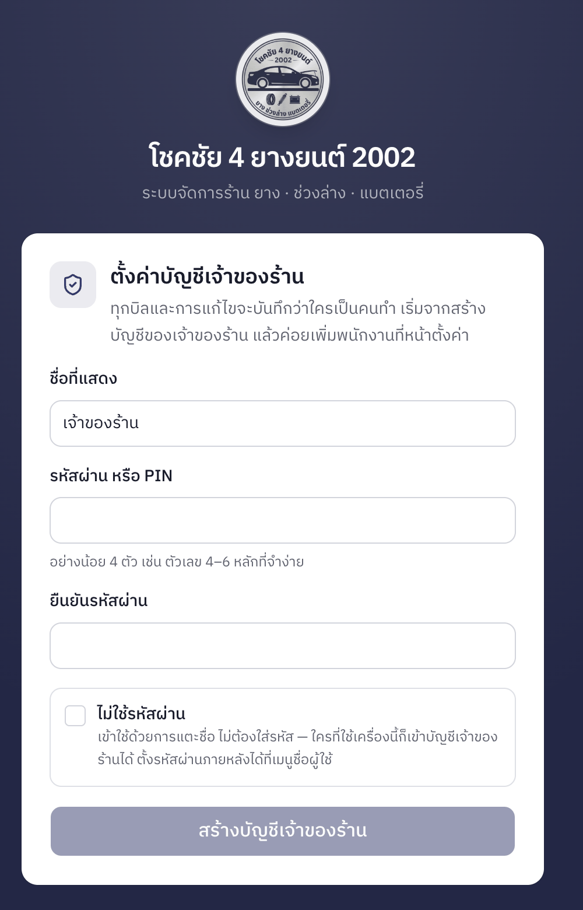

*ภาพ 2-1 หน้าตั้งค่าบัญชีเจ้าของร้าน (แสดงครั้งแรกที่เปิดโปรแกรมเท่านั้น)*

1. ช่อง **ชื่อที่แสดง** ใส่ชื่อที่จะแสดงในโปรแกรมและบนบิล (ค่าเริ่มต้นคือ "เจ้าของร้าน" เปลี่ยนเป็นชื่อจริงได้)
2. ช่อง **รหัสผ่าน หรือ PIN** ใส่อย่างน้อย 4 ตัว เช่น ตัวเลข 4–6 หลักที่จำง่าย แล้วใส่ซ้ำในช่อง **ยืนยันรหัสผ่าน**
3. ถ้าไม่ต้องการใช้รหัสผ่าน ให้ติ๊ก **ไม่ใช้รหัสผ่าน** (แตะชื่อที่หน้าเข้าสู่ระบบก็เข้าได้เลย) ตั้งรหัสผ่านภายหลังได้ที่เมนูชื่อผู้ใช้
4. กดปุ่ม **สร้างบัญชีเจ้าของร้าน**

> **ข้อควรระวัง:** ถ้าบัญชีเจ้าของร้านไม่ใช้รหัสผ่าน ใครก็ตามที่ใช้เครื่องนี้จะเข้าบัญชีเจ้าของร้านได้ และทำได้ทุกอย่าง รวมถึงดูเงินเดือนและลบข้อมูล แนะนำให้ตั้งรหัสผ่านไว้เสมอ

### 2.5 รหัสกู้คืน (สำคัญมาก)

ถ้าตั้งรหัสผ่านไว้ ระบบจะแสดง **รหัสกู้คืน** (รูปแบบ XXXX-XXXX-XXXX) ให้ **เพียงครั้งเดียว** รหัสนี้ใช้ตั้งรหัสผ่านใหม่เมื่อเจ้าของร้านลืมรหัสผ่าน

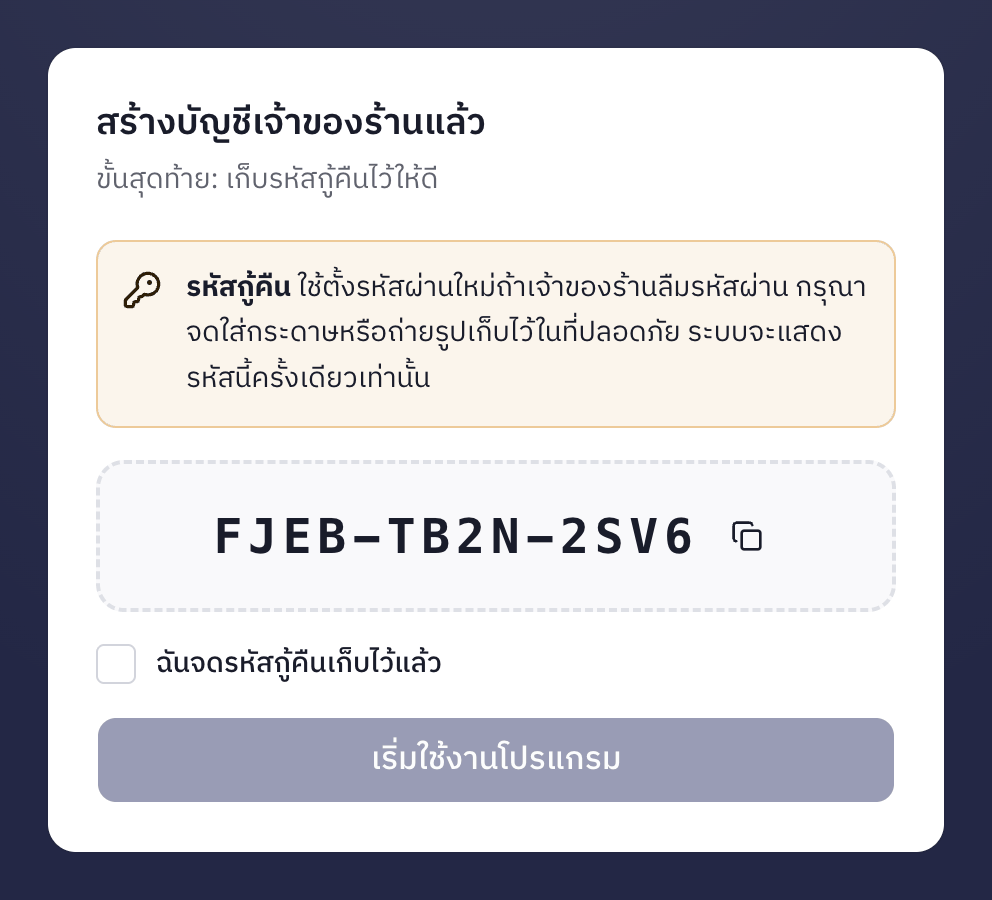

*ภาพ 2-2 รหัสกู้คืนที่แสดงหลังสร้างบัญชีเจ้าของร้าน*

1. จดรหัสกู้คืนใส่กระดาษ หรือถ่ายรูปเก็บไว้ในที่ปลอดภัย (กดไอคอนคัดลอกข้างรหัสเพื่อคัดลอกได้)
2. ติ๊ก **ฉันจดรหัสกู้คืนเก็บไว้แล้ว**
3. กด **เริ่มใช้งานโปรแกรม**

> **ข้อควรระวัง:** ถ้าเจ้าของร้านลืมรหัสผ่านและไม่มีรหัสกู้คืน จะเข้าบัญชีเจ้าของร้านไม่ได้ ถ้ารหัสกู้คืนหาย ให้ออกรหัสใหม่ทันทีที่ **ตั้งค่า → ผู้ใช้งาน → ออกรหัสกู้คืนใหม่** (หัวข้อ 18.5)

### 2.6 สิ่งที่ควรตั้งค่าก่อนเริ่มขาย

ทำตามรายการนี้ให้ครบก่อนเริ่มใช้งานจริง จะช่วยให้ใบเสร็จ สต็อก และรายงานถูกต้องตั้งแต่วันแรก

1. **ข้อมูลร้าน:** ชื่อร้าน ที่อยู่ เบอร์โทร เลขประจำตัวผู้เสียภาษี โลโก้ และข้อความท้ายใบเสร็จ (หัวข้อ 17.1)
2. **ภาษี (VAT):** เปิดเฉพาะเมื่อร้านจดทะเบียนภาษีมูลค่าเพิ่มแล้ว (หัวข้อ 17.2)
3. **การพิมพ์:** ขนาดกระดาษและเครื่องพิมพ์ที่ใช้ (หัวข้อ 17.4)
4. **หมวดหมู่และสินค้า:** เพิ่มสินค้าที่ขายพร้อมราคาทุน ราคาขาย และจำนวนที่มีอยู่ตอนนี้ (บทที่ 9)
5. **ราคาบริการ:** โปรแกรมเตรียมบริการที่ใช้บ่อยไว้ 10 รายการ แต่ราคายังเป็น 0 ให้ใส่ราคาของร้าน (บทที่ 10)
6. **บัญชีพนักงาน:** เพิ่มผู้ใช้งานให้พนักงานที่ใช้โปรแกรมและเลือกสิทธิ์ (บทที่ 18)
7. **พนักงานและเวลางาน** (ถ้าใช้ระบบลงเวลาและเงินเดือน): เพิ่มข้อมูลพนักงาน ตั้งเวลาเข้า-เลิกงาน วันทำงาน และกฎหักเงิน (บทที่ 12 และหัวข้อ 17.6)
8. **สำรองข้อมูล:** ตรวจว่าเปิดสำรองอัตโนมัติไว้ และลองสำรองลงแฟลชไดรฟ์หนึ่งครั้ง (บทที่ 19)

## 3. เข้าสู่ระบบและหน้าจอหลัก

### 3.1 เข้าสู่ระบบ

ทุกครั้งที่เปิดโปรแกรม (หรือหลังออกจากระบบ) จะพบหน้าเลือกชื่อผู้ใช้

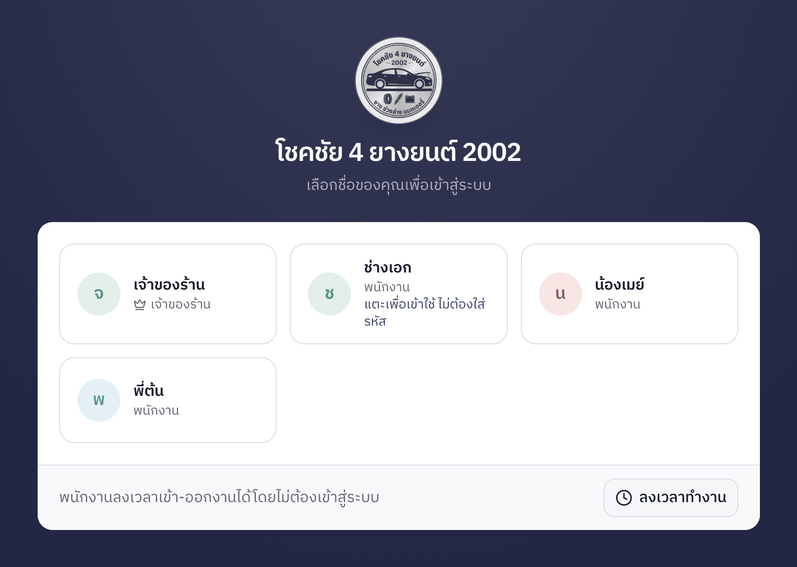

*ภาพ 3-1 หน้าเข้าสู่ระบบ เลือกชื่อของคุณ*

1. กดที่ชื่อของคุณ
   - ผู้ใช้ที่ **ไม่ใช้รหัสผ่าน** จะมีข้อความ "แตะเพื่อเข้าใช้ ไม่ต้องใส่รหัส" กดชื่อแล้วเข้าโปรแกรมได้ทันที
   - ผู้ใช้ที่ใช้รหัสผ่าน จะไปหน้าใส่รหัส
2. ใส่ **รหัสผ่าน / PIN** แล้วกด **เข้าสู่ระบบ** (หรือกด Enter)
3. ถ้าเลือกชื่อผิด กด **เปลี่ยนผู้ใช้** เพื่อกลับไปเลือกใหม่

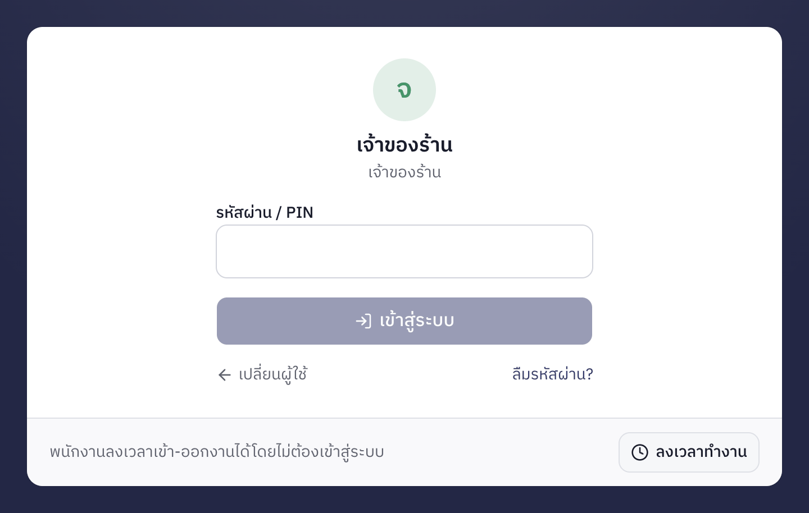

*ภาพ 3-2 หน้าใส่รหัสผ่าน / PIN*

- โปรแกรมจำผู้ใช้คนล่าสุดของเครื่องไว้ ถ้าคนนั้นใช้รหัสผ่าน จะเปิดหน้าใส่รหัสของคนนั้นให้ทันที (ถ้าไม่ใช่คุณ ให้กด **เปลี่ยนผู้ใช้**)
- ถ้าใส่รหัสผิดหลายครั้ง ระบบจะให้รอสักครู่ก่อนลองใหม่ (มีข้อความบอกจำนวนวินาทีที่ต้องรอ)
- ปุ่ม **ลงเวลาทำงาน** ที่ด้านล่าง ใช้ให้พนักงานลงเวลาเข้า-ออกงานได้โดยไม่ต้องเข้าสู่ระบบ (บทที่ 13)
- ปุ่ม **TH** ที่มุมขวาบนใช้เปลี่ยนภาษาของโปรแกรม

### 3.2 ลืมรหัสผ่าน

**พนักงานลืมรหัสผ่าน:** ให้เจ้าของร้านตั้งรหัสใหม่ให้ที่ **ตั้งค่า → ผู้ใช้งาน** (หัวข้อ 18.3) แล้วพนักงานเปลี่ยนเป็นรหัสของตัวเองภายหลังได้

**เจ้าของร้านลืมรหัสผ่าน:** ใช้รหัสกู้คืนที่จดไว้ตอนสร้างบัญชี

1. ที่หน้าเข้าสู่ระบบ กดชื่อเจ้าของร้าน แล้วกด **ลืมรหัสผ่าน?**
2. ใส่ **รหัสกู้คืน** ตั้ง **รหัสผ่านใหม่** และใส่ **ยืนยันรหัสผ่านใหม่**
3. กด **ตั้งรหัสผ่านใหม่**
4. ระบบจะแสดง **รหัสกู้คืนชุดใหม่** (รหัสเดิมใช้ไม่ได้แล้ว) ให้จดเก็บไว้ ติ๊กยืนยัน แล้วกด **เข้าสู่โปรแกรม**

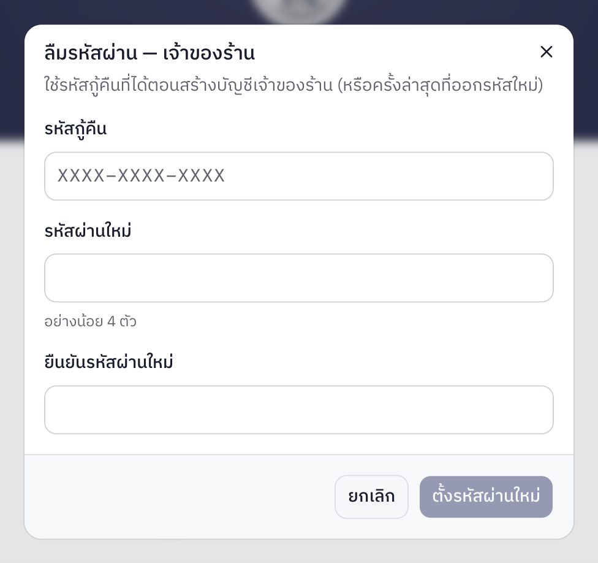

*ภาพ 3-3 หน้าต่างลืมรหัสผ่าน สำหรับบัญชีเจ้าของร้าน*

### 3.3 ส่วนประกอบของหน้าจอหลัก

หลังเข้าสู่ระบบจะพบหน้าจอหลัก ซึ่งแบ่งเป็นแถบเมนูด้านซ้าย แถบด้านบน และพื้นที่ทำงาน

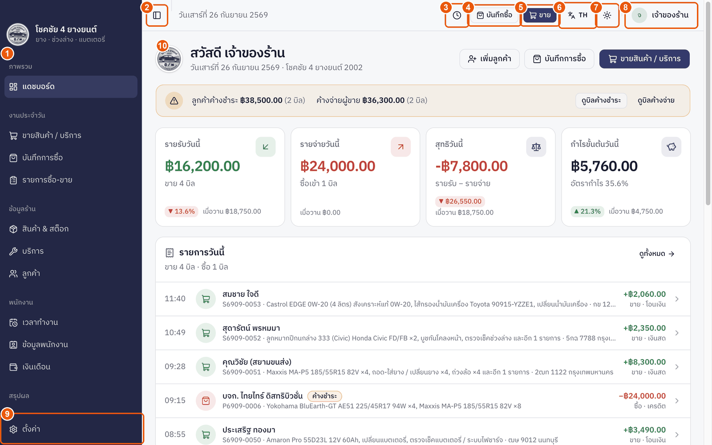

*ภาพ 3-4 ส่วนประกอบของหน้าจอหลัก*

1. **แถบเมนู** จัดเป็นกลุ่ม ได้แก่ ภาพรวม (แดชบอร์ด), งานประจำวัน (ขายสินค้า / บริการ, บันทึกการซื้อ, รายการซื้อ-ขาย), ข้อมูลร้าน (สินค้า & สต็อก, บริการ, ลูกค้า), พนักงาน (เวลาทำงาน, ข้อมูลพนักงาน, เงินเดือน) และสรุปผล (รายงาน, ประวัติการแก้ไข) ผู้ใช้แต่ละคนเห็นเฉพาะเมนูที่มีสิทธิ์
2. **ปุ่มย่อ / ขยายแถบเมนู** ย่อแล้วจะเหลือแต่ไอคอน ทำให้พื้นที่ทำงานกว้างขึ้น
3. **ลงเวลาเข้า-ออกงาน** เปิดหน้าลงเวลาของพนักงาน
4. **บันทึกซื้อ** ทางลัดไปหน้าบันทึกการซื้อ (แสดงเฉพาะผู้มีสิทธิ์บันทึกการซื้อ)
5. **ขาย** ทางลัดไปหน้าขายสินค้า / บริการ
6. **TH / EN** เปลี่ยนภาษาของโปรแกรม
7. **ธีม** เลือกสว่าง มืด หรือตามระบบ
8. **เมนูผู้ใช้** แสดงชื่อผู้ที่เข้าสู่ระบบอยู่ (หัวข้อ 3.4)
9. **ตั้งค่า**
10. **พื้นที่ทำงาน** แสดงเนื้อหาของเมนูที่เลือก

แถบด้านบนยังแสดงวันที่ของวันนี้ไว้ด้วย

### 3.4 เมนูผู้ใช้: เปลี่ยนรหัสผ่านและออกจากระบบ

กดที่ชื่อของคุณที่มุมขวาบนเพื่อเปิดเมนูผู้ใช้

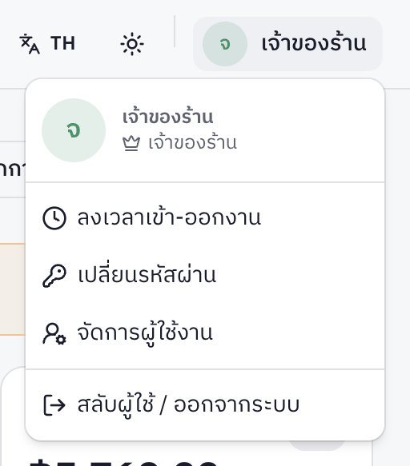

*ภาพ 3-5 เมนูผู้ใช้*

- **ลงเวลาเข้า-ออกงาน** ไปหน้าลงเวลา
- **เปลี่ยนรหัสผ่าน** ใส่รหัสผ่านปัจจุบัน รหัสผ่านใหม่ (อย่างน้อย 4 ตัว) และยืนยันรหัสผ่านใหม่ แล้วกด **บันทึก** ถ้าบัญชีของคุณยังไม่มีรหัสผ่าน เมนูนี้จะชื่อ **ตั้งรหัสผ่าน** (ไม่ต้องใส่รหัสปัจจุบัน) และหลังตั้งแล้วต้องใส่รหัสทุกครั้งที่เข้าสู่ระบบ
- **จัดการผู้ใช้งาน** (เฉพาะเจ้าของร้าน) ไปหน้า **ตั้งค่า → ผู้ใช้งาน**
- **สลับผู้ใช้ / ออกจากระบบ** กลับไปหน้าเลือกชื่อ ถ้ามีบิลที่เปิดค้างไว้และยังไม่บันทึก ระบบจะถามก่อนว่าจะออกหรือไม่

> **เคล็ดลับ:** เมื่อลุกจากเครื่อง ให้กด **สลับผู้ใช้ / ออกจากระบบ** ทุกครั้ง เพื่อไม่ให้คนอื่นเปิดบิลในชื่อของคุณ หรือให้เจ้าของร้านเปิด **ล็อกหน้าจออัตโนมัติ** (หัวข้อ 18.4)

### 3.5 เปลี่ยนภาษา ธีม และขนาดตัวอักษร

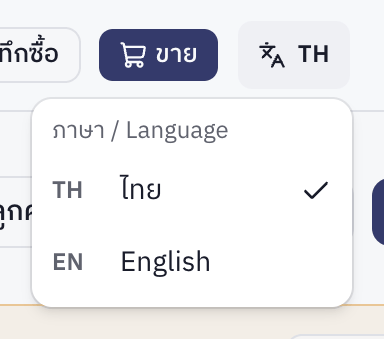

*ภาพ 3-6 เมนูเปลี่ยนภาษา*

- **ภาษา:** กดปุ่ม **TH / EN** แล้วเลือก **ไทย** หรือ **English** หน้าจอจะโหลดใหม่เป็นภาษาที่เลือก การตั้งภาษามีผลเฉพาะเครื่องนี้ ถ้ากำลังเปิดบิลที่ยังไม่บันทึก ระบบจะให้บันทึกหรือยกเลิกบิลก่อนจึงจะเปลี่ยนภาษาได้
- **ภาษาของใบเสร็จและสลิปเงินเดือน** ตั้งแยกได้ที่ **ตั้งค่า → การพิมพ์ → ภาษาในเอกสาร** เช่น ใช้หน้าจอภาษาไทยแต่พิมพ์ใบเสร็จภาษาอังกฤษให้ลูกค้าต่างชาติ
- **ธีม:** กดไอคอนดวงอาทิตย์ / พระจันทร์ แล้วเลือก **สว่าง**, **มืด** หรือ **ตามระบบ**
- **ขนาดตัวอักษร:** กด ⌘ กับ + เพื่อขยาย ⌘ กับ − เพื่อย่อ และ ⌘ กับ 0 เพื่อกลับขนาดปกติ (Windows ใช้ Ctrl) หรือใช้เมนู **มุมมอง** ของโปรแกรม

### 3.6 เมื่อไม่มีสิทธิ์ใช้หน้านั้น

ถ้าเปิดหน้าที่บัญชีของคุณไม่มีสิทธิ์ จะเห็นข้อความ **ไม่มีสิทธิ์เข้าถึงหน้านี้** พร้อมบอกว่าต้องมีสิทธิ์อะไร ให้ติดต่อเจ้าของร้านเพื่อเพิ่มสิทธิ์ที่ **ตั้งค่า → ผู้ใช้งาน**

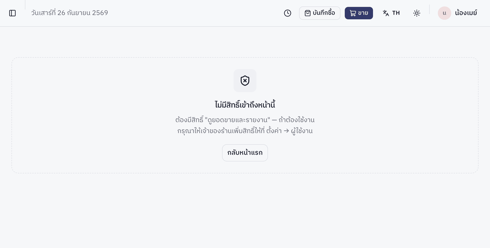

*ภาพ 3-7 ข้อความเมื่อบัญชีไม่มีสิทธิ์ใช้หน้านั้น*

### 3.7 ปุ่มลัดบนแป้นพิมพ์

| ปุ่ม (Mac / Windows) | ใช้ทำอะไร | ใช้ได้ที่ |
|---|---|---|
| F2 | ไปที่ช่องค้นหาสินค้าหรือบริการ | หน้าเปิดบิลขาย / บิลซื้อ |
| ⌘S / Ctrl+S | บันทึกบิล | หน้าเปิดบิลและหน้าแก้ไขบิล |
| ⌘P / Ctrl+P | เปิดหน้าต่างพิมพ์เอกสาร | หน้ารายละเอียดบิล |
| ↑ ↓ | เลื่อนเลือกผลการค้นหา | ช่องค้นหาสินค้า |
| Enter | เพิ่มรายการที่เลือกลงบิล / บันทึกฟอร์ม / ยืนยันเวลาที่พิมพ์ | ทั่วไป |
| Esc | ล้างคำค้นหา ปิดรายการค้นหา หรือปิดหน้าต่าง | ทั่วไป |
| ⌘+ / ⌘− / ⌘0 (Ctrl บน Windows) | ขยาย / ย่อ / ขนาดปกติ | ทุกหน้า |

## 4. แดชบอร์ด (หน้าแรก)

แดชบอร์ดคือหน้าแรกหลังเข้าสู่ระบบ สรุปสิ่งที่เกิดขึ้นในร้านวันนี้ กดเมนู **แดชบอร์ด** หรือกดโลโก้ร้านที่มุมซ้ายบนเพื่อกลับมาหน้านี้

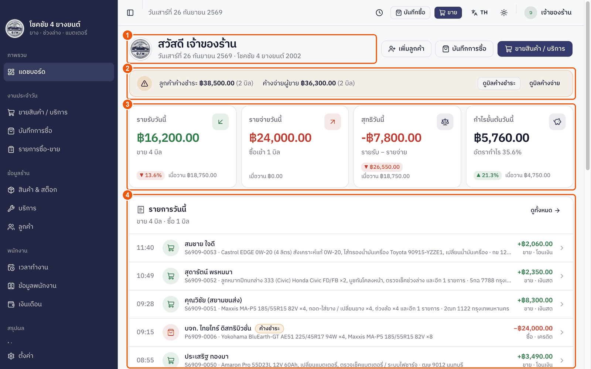

*ภาพ 4-1 แดชบอร์ด ส่วนบน*

1. **คำทักทายและปุ่มลัด** ปุ่ม **เพิ่มลูกค้า**, **บันทึกการซื้อ** และ **ขายสินค้า / บริการ**
2. **แถบเตือนยอดค้าง** แสดงยอดที่ลูกค้าค้างชำระ และยอดที่ร้านค้างจ่ายผู้ขาย (ทุกช่วงเวลา) กด **ดูบิลค้างชำระ** หรือ **ดูบิลค้างจ่าย** เพื่อดูรายการ แถบนี้จะหายไปเมื่อไม่มียอดค้าง
3. **ตัวเลขของวันนี้** 4 ช่อง
   - **รายรับวันนี้** ยอดบิลขายของวันนี้ และจำนวนบิล
   - **รายจ่ายวันนี้** ยอดบิลซื้อของวันนี้
   - **สุทธิวันนี้** รายรับลบรายจ่าย
   - **กำไรขั้นต้นวันนี้** และอัตรากำไร
   - ป้ายสีเขียว / แดงด้านล่างบอกว่าเพิ่มขึ้นหรือลดลงกี่เปอร์เซ็นต์เมื่อเทียบกับเมื่อวาน
4. **รายการวันนี้** บิลทุกใบของวันนี้ (ขาย ซื้อ และยกเลิก) ใบล่าสุดอยู่บนสุด แต่ละบรรทัดแสดงเวลา ชื่อลูกค้าหรือผู้ขาย เลขที่บิล รายการสินค้า ทะเบียนรถ ยอดเงิน และวิธีชำระ กดที่บิลเพื่อเปิดดู กด **ดูทั้งหมด** เพื่อไปหน้ารายการซื้อ-ขาย ถ้าวันนี้มีบิลมาก กด **แสดงอีก … รายการ** เพื่อดูทั้งหมด

เลื่อนลงมาด้านล่างจะพบ

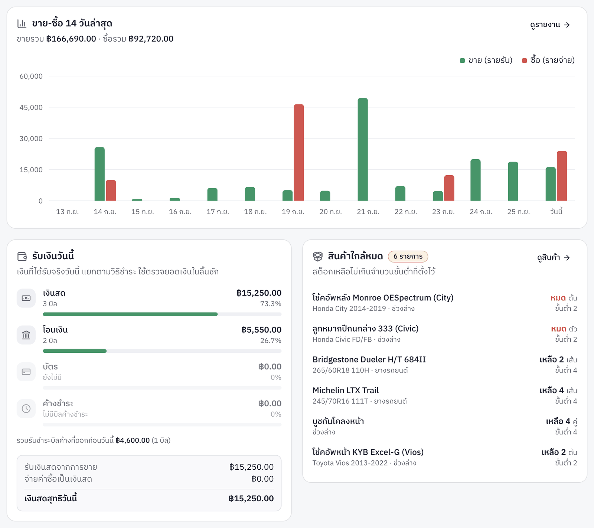

*ภาพ 4-2 แดชบอร์ด ส่วนล่าง: กราฟ 14 วัน รับเงินวันนี้ และสินค้าใกล้หมด*

- **ขาย-ซื้อ 14 วันล่าสุด** กราฟแท่งสีเขียวคือยอดขาย สีแดงคือยอดซื้อ ชี้ที่แท่งเพื่อดูยอดของวันนั้น กด **ดูรายงาน** เพื่อดูรายละเอียดเพิ่ม
- **รับเงินวันนี้** เงินที่ได้รับจริงวันนี้ แยกตามวิธีชำระ (เงินสด โอนเงิน บัตร) พร้อมยอดขายของวันนี้ที่ยังค้างชำระ ถ้ามีลูกค้ามาจ่ายบิลเชื่อที่ออกก่อนวันนี้ จะมีบรรทัด "รวมรับชำระบิลค้างที่ออกก่อนวันนี้" บอกไว้
  - กล่องด้านล่างใช้ **ตรวจเงินในลิ้นชัก**: รับเงินสดจากการขาย ลบ จ่ายค่าซื้อเป็นเงินสด เท่ากับ **เงินสดสุทธิวันนี้** ซึ่งควรตรงกับเงินสดที่เพิ่มขึ้นในลิ้นชัก
- **สินค้าใกล้หมด** สินค้าที่เหลือไม่เกินจำนวนขั้นต่ำที่ตั้งไว้ (แสดง 6 รายการแรก) กดที่สินค้าเพื่อเปิดดู หรือกด **ดูสินค้า** เพื่อดูทั้งหมด ถ้าสต็อกพอทุกรายการจะแสดง "สต็อกเพียงพอทุกรายการ"

> **หมายเหตุ:** "รายรับวันนี้" คือยอดขายตามบิลของวันนี้ ซึ่งรวมบิลเชื่อที่ยังไม่ได้เงินด้วย ส่วน "รับเงินวันนี้" คือเงินที่ได้รับจริง สองตัวเลขนี้จึงอาจไม่เท่ากัน

ผู้ใช้ที่ไม่มีสิทธิ์ **ดูยอดขายและรายงาน** จะไม่เห็นตัวเลขยอดขาย กำไร กราฟ และรับเงินวันนี้ แต่ยังเห็นคำทักทาย รายการวันนี้ และสินค้าใกล้หมด

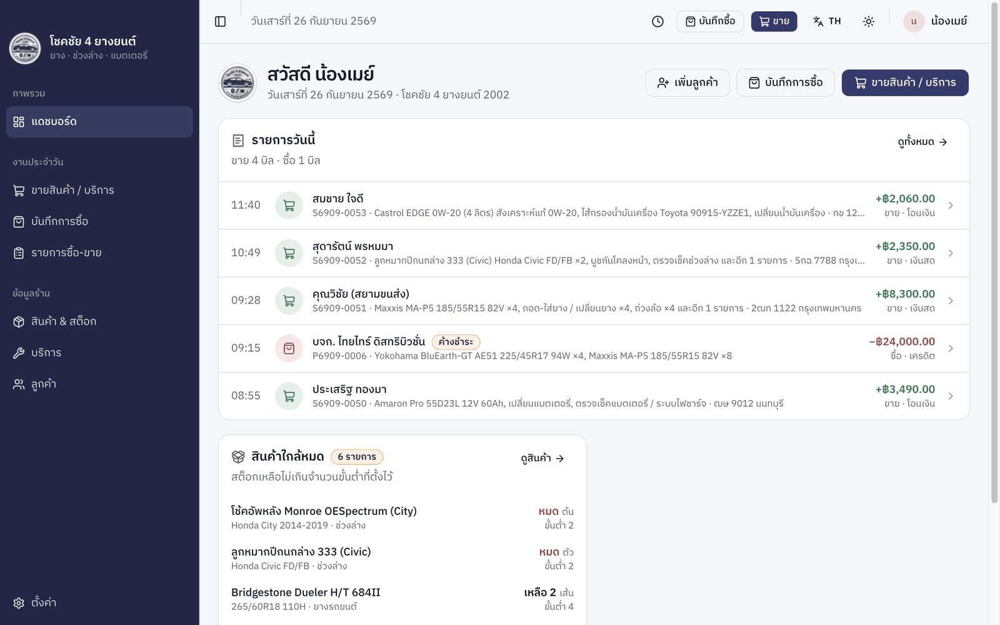

*ภาพ 4-3 แดชบอร์ดของพนักงานที่ไม่มีสิทธิ์ดูยอดขายและรายงาน*

## 5. ขายสินค้าและบริการ (เปิดบิลขาย)

ทุกคนที่เข้าสู่ระบบเปิดบิลขายได้ เปิดหน้าขายได้หลายทาง

- เมนู **ขายสินค้า / บริการ** ทางซ้าย
- ปุ่ม **ขาย** ที่แถบด้านบน (กดได้จากทุกหน้า)
- ปุ่ม **ขายสินค้า / บริการ** ที่แดชบอร์ด
- ปุ่ม **เปิดบิลขาย** ในหน้าข้อมูลลูกค้า (ใส่ชื่อลูกค้าให้อัตโนมัติ)

### 5.1 ส่วนประกอบของหน้าขาย

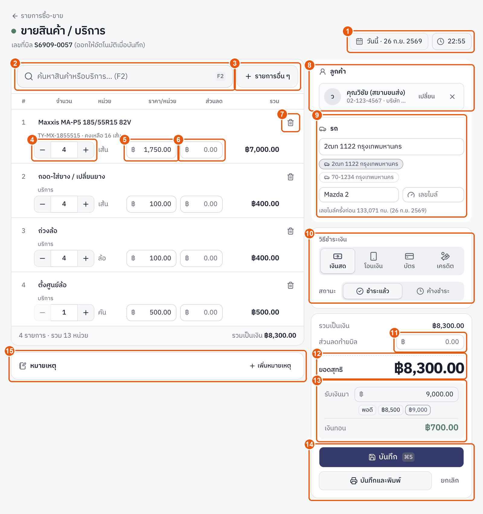

*ภาพ 5-1 หน้าขายสินค้า / บริการ*

1. **วันที่และเวลาของบิล** ปกติคือเวลาปัจจุบัน เปลี่ยนได้ถ้าบันทึกบิลย้อนหลัง (หัวข้อ 5.12)
2. **ช่องค้นหาสินค้าหรือบริการ** (กด F2 เพื่อมาที่ช่องนี้)
3. **รายการอื่น ๆ** เพิ่มรายการที่ไม่มีในระบบ โดยพิมพ์ชื่อเอง
4. **จำนวน** กด − / + หรือพิมพ์ตัวเลข
5. **ราคาต่อหน่วย** แก้ได้ทุกบิล
6. **ส่วนลดของรายการ** เป็นจำนวนเงิน (บาท)
7. **ลบรายการ**
8. **ลูกค้า**
9. **รถ** ทะเบียน รุ่นรถ และเลขไมล์
10. **วิธีชำระเงินและสถานะ**
11. **ส่วนลดท้ายบิล**
12. **ยอดสุทธิ** ยอดที่ลูกค้าต้องจ่าย
13. **ช่วยคิดเงินทอน** (แสดงเมื่อเลือกเงินสด)
14. ปุ่ม **บันทึก**, **บันทึกและพิมพ์** และ **ยกเลิก**
15. **หมายเหตุ**

ใต้หัวข้อ "ขายสินค้า / บริการ" มีเลขที่บิลที่จะได้ เช่น "เลขที่บิล S6909-0057 (ออกให้อัตโนมัติเมื่อบันทึก)"

### 5.2 ขั้นตอนขายแบบย่อ

1. กด **ขาย** ที่แถบด้านบน
2. พิมพ์ชื่อสินค้าหรือบริการในช่องค้นหา แล้วกด Enter เพื่อเพิ่มลงบิล ทำซ้ำจนครบ
3. ปรับจำนวน ราคา หรือส่วนลด ถ้าจำเป็น
4. เลือกลูกค้าและใส่ทะเบียนรถ (ไม่บังคับ แต่ควรใส่เพื่อดูประวัติย้อนหลังได้)
5. เลือกวิธีชำระเงิน ถ้าเป็นเงินสด ใส่จำนวนเงินที่รับมาเพื่อดูเงินทอน
6. กด **บันทึก** (หรือ ⌘S / Ctrl+S) หรือกด **บันทึกและพิมพ์** เพื่อพิมพ์ใบเสร็จต่อทันที

### 5.3 เพิ่มสินค้าหรือบริการลงบิล

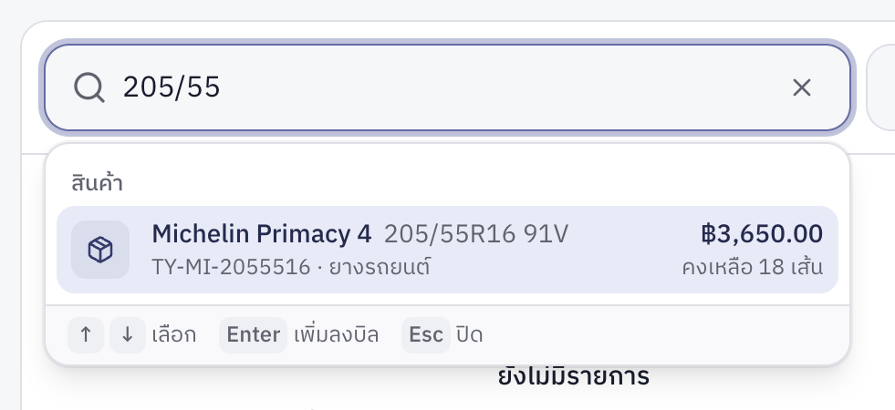

*ภาพ 5-2 พิมพ์ "205/55" แล้วระบบแสดงสินค้าที่ตรงกัน*

- กดที่ช่องค้นหา (หรือกด F2) แล้วพิมพ์ชื่อสินค้า ยี่ห้อ รุ่น ขนาดยาง รหัสสินค้า บาร์โค้ด หรือชื่อหมวดหมู่ พิมพ์ได้หลายคำโดยเว้นวรรค เช่น "แบต 55" จะหาแบตเตอรี่ที่มี 55
- ขนาดยางไม่ต้องพิมพ์เครื่องหมาย เช่น พิมพ์ **2055516** ก็เจอยางขนาด 205/55R16
- ถ้ายังไม่พิมพ์อะไร รายการจะแสดงบริการก่อน (เช่น ปะยาง ถ่วงล้อ) แล้วตามด้วยสินค้า
- แต่ละรายการแสดงราคาขายและจำนวนคงเหลือ ตัวเลขสีส้มคือใกล้หมด สีแดงคือหมดสต็อก บริการที่ยังไม่ตั้งราคาจะขึ้นว่า "กำหนดราคาเอง"
- ใช้ปุ่ม ↑ ↓ เลือก แล้วกด Enter (หรือคลิกที่รายการ) เพื่อเพิ่มลงบิล กด Esc เพื่อปิดรายการ
- ถ้าเพิ่มสินค้าที่มีในบิลอยู่แล้ว ระบบจะเพิ่มจำนวนของบรรทัดเดิมอีก 1 แทนการเพิ่มบรรทัดใหม่
- **เครื่องสแกนบาร์โค้ด:** คลิกที่ช่องค้นหาแล้วสแกน ระบบจะเพิ่มสินค้าที่บาร์โค้ดหรือรหัสสินค้าตรงกันลงบิลทันที

### 5.4 แก้จำนวน ราคา และส่วนลดของแต่ละรายการ

- **จำนวน:** กด − / + หรือพิมพ์ตัวเลข ใส่ทศนิยมได้ 2 ตำแหน่ง (เช่น 4.5 ลิตร)
- **ราคา/หน่วย:** ใส่ราคาที่ตกลงกับลูกค้าได้เลย ถ้าราคาต่างจากราคาปกติ ช่องราคาจะมีกรอบสี และมีปุ่มเล็ก **ราคาปกติ ฿…** ด้านล่าง กดเพื่อกลับไปใช้ราคาปกติ การแก้ราคาในบิลไม่เปลี่ยนราคาสินค้าในระบบ
- **ส่วนลด:** ใส่เป็นจำนวนเงินของทั้งบรรทัด (ไม่ใช่เปอร์เซ็นต์) เช่น ยาง 4 เส้น เส้นละ 1,750 บาท ลด 200 บาท รวมเป็น 6,800 บาท
- **รวม** ของบรรทัด = จำนวน × ราคาต่อหน่วย − ส่วนลด
- **ชื่อรายการ** กดที่ชื่อเพื่อแก้ไขได้ เช่น เพิ่มรายละเอียดให้ลูกค้าอ่านบนใบเสร็จ
- ใต้ชื่อสินค้าแสดงรหัสสินค้าและจำนวนคงเหลือ ถ้าขายมากกว่าที่มี บรรทัดนั้นจะเป็นสีส้มพร้อมข้อความ **สต็อกไม่พอ (เหลือ …)** (ดูหัวข้อ 5.14)
- กดไอคอนถังขยะเพื่อลบบรรทัด

### 5.5 รายการอื่น ๆ (พิมพ์ชื่อเอง)

ใช้กับสิ่งที่ไม่มีในรายการสินค้าหรือบริการ เช่น ค่าแรงพิเศษ ค่าขนส่ง อะไหล่ที่สั่งมาเฉพาะงาน

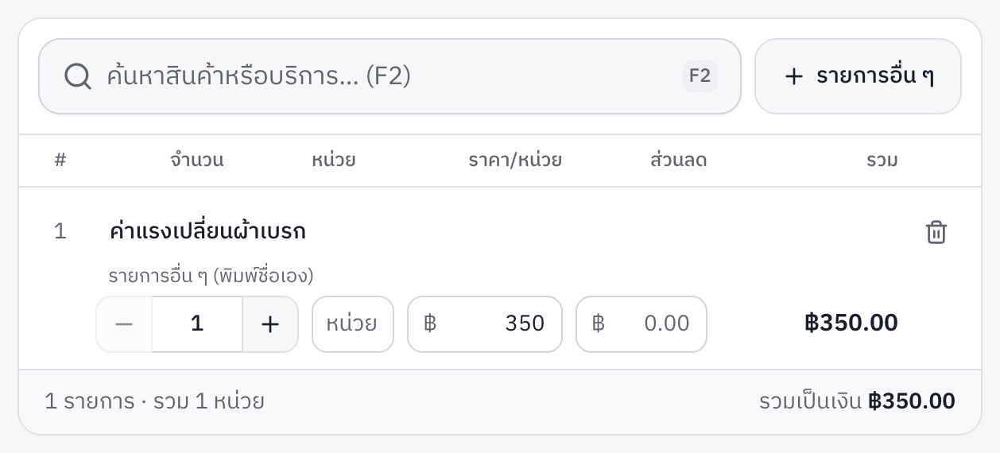

*ภาพ 5-3 รายการอื่น ๆ ที่พิมพ์ชื่อเอง*

1. กดปุ่ม **รายการอื่น ๆ**
2. พิมพ์ชื่อรายการ (ต้องมีชื่อ) หน่วย และราคา
3. ปรับจำนวนตามต้องการ

รายการอื่น ๆ ไม่ตัดสต็อกและไม่มีต้นทุน

> **เคล็ดลับ:** ถ้าขายรายการใดบ่อย ให้เพิ่มเป็นสินค้าหรือบริการในระบบ จะค้นหาได้เร็วกว่า ราคาไม่ผิด และรายงานสินค้าขายดีจะนับให้ด้วย

### 5.6 เลือกลูกค้า

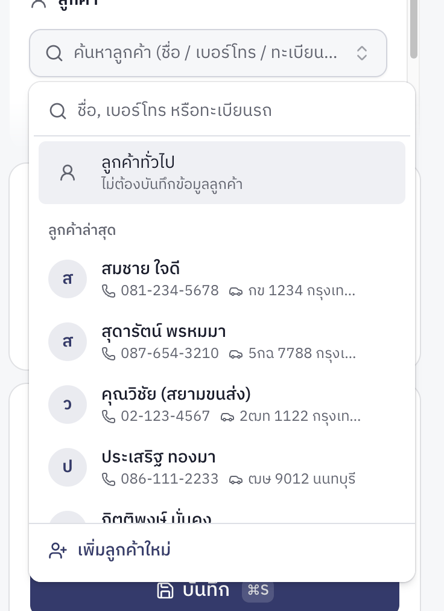

*ภาพ 5-4 ช่องค้นหาและเลือกลูกค้า*

- กดช่อง **ค้นหาลูกค้า (ชื่อ / เบอร์โทร / ทะเบียนรถ)** แล้วพิมพ์ชื่อ เบอร์โทร (พิมพ์แค่ตัวเลขก็ได้) หรือทะเบียนรถ ถ้ายังไม่พิมพ์จะแสดงลูกค้าล่าสุด
- **ลูกค้าทั่วไป** ใช้เมื่อไม่ต้องการบันทึกข้อมูลลูกค้า (ลูกค้าขาจร) และยังใส่ชื่อกับเบอร์โทรไว้ในบิลได้ในช่องใต้ช่องค้นหา โดยไม่สร้างเป็นลูกค้าในระบบ
- ถ้าไม่พบ กด **เพิ่มลูกค้าใหม่** ระบบจะเปิดฟอร์มลูกค้าใหม่ และนำคำที่พิมพ์ค้นหาไปใส่ในช่องชื่อ (หรือช่องเบอร์โทร ถ้าพิมพ์เป็นตัวเลข) ให้ บันทึกแล้วลูกค้าคนนั้นจะถูกเลือกในบิลทันที
- เมื่อเลือกลูกค้าแล้ว กด **เปลี่ยน** เพื่อเลือกคนอื่น หรือกด ✕ เพื่อไม่ระบุลูกค้า

### 5.7 ข้อมูลรถ

- ใส่ **ทะเบียนรถ** เช่น "กข 1234 กรุงเทพมหานคร" ถ้าลูกค้าเคยนำรถมา จะมีปุ่มทะเบียนรถที่เคยมาให้กดเลือก ถ้าลูกค้ามีรถคันเดียว ระบบใส่ทะเบียนและรุ่นรถให้อัตโนมัติ
- ใส่ **รุ่นรถ** เช่น Toyota Vios และ **เลขไมล์**
- ใต้ช่องเลขไมล์จะแสดง **เลขไมล์ครั้งก่อน** ของรถคันนั้น ช่วยดูระยะเปลี่ยนน้ำมันเครื่องหรือยาง
- ทะเบียนรถที่บันทึกในบิล ใช้ค้นหาลูกค้าและบิลย้อนหลังได้ และแสดงในหน้าข้อมูลลูกค้าหัวข้อ "รถที่เคยนำมา"

### 5.8 วิธีชำระเงินและสถานะ

- เลือกวิธีชำระ: **เงินสด**, **โอนเงิน**, **บัตร** หรือ **เครดิต**
- เลือก **เครดิต** (ขายเชื่อ) แล้วสถานะจะเปลี่ยนเป็น **ค้างชำระ** ให้อัตโนมัติ วิธีอื่นจะเป็น **ชำระแล้ว**
- เปลี่ยนสถานะเองได้ เช่น ลูกค้าบอกว่าจะโอนภายหลัง ให้เลือกโอนเงินแล้วกดสถานะเป็น **ค้างชำระ**
- บิลที่ค้างชำระจะแสดงในแถบเตือนที่แดชบอร์ด และในหน้ารายการซื้อ-ขาย จนกว่าจะกด **รับชำระแล้ว** (หัวข้อ 7.3)

### 5.9 ภาษีมูลค่าเพิ่ม (เฉพาะร้านที่จด VAT)

ส่วนนี้จะแสดงเฉพาะเมื่อเปิด **ร้านจดทะเบียนภาษีมูลค่าเพิ่ม (VAT)** ไว้ในการตั้งค่า (หัวข้อ 17.2) เลือกได้ทุกบิล

| ตัวเลือก | ความหมาย | ตัวอย่าง: สินค้าราคา 1,000 บาท |
|---|---|---|
| ไม่มี VAT | ไม่คิดภาษี | ลูกค้าจ่าย 1,000.00 |
| รวม VAT 7% | ราคาในบิลรวมภาษีแล้ว ระบบแยก VAT ออกให้ | ลูกค้าจ่าย 1,000.00 (ราคาก่อน VAT 934.58 + VAT 65.42) |
| แยก VAT 7% | บวก VAT เพิ่มจากราคาในบิล | ลูกค้าจ่าย 1,070.00 (1,000.00 + VAT 70.00) |

### 5.10 ส่วนลดท้ายบิลและยอดสุทธิ

- **ส่วนลดท้ายบิล** ใส่เป็นจำนวนเงิน หักจากยอดรวมทั้งบิล (ถ้ามี VAT ระบบคิดภาษีหลังหักส่วนลดแล้ว)
- **ยอดสุทธิ** คือยอดที่ลูกค้าต้องจ่าย แสดงตัวใหญ่เหนือปุ่มบันทึก

### 5.11 ช่วยคิดเงินทอน

เมื่อเลือกวิธีชำระเป็นเงินสด จะมีช่อง **รับเงินมา** ใต้ยอดสุทธิ

- พิมพ์จำนวนเงินที่ลูกค้าให้มา หรือกดปุ่มลัด **พอดี** หรือปุ่มยอดที่ปัดขึ้นเป็นหลักร้อย ห้าร้อย และพัน
- ระบบแสดง **เงินทอน** เป็นสีเขียว หรือ **ยังขาดอีก** เป็นสีแดงถ้าเงินที่รับมายังไม่พอ
- ตัวเลขนี้ใช้ช่วยทอนเงินเท่านั้น ไม่ได้บันทึกลงในบิล

### 5.12 วันที่และเวลาของบิล

- ปกติระบบใช้เวลาที่กดบันทึก ไม่ต้องแก้อะไร
- ถ้าบันทึกบิลย้อนหลัง (เช่น ลืมบันทึกเมื่อวาน) กดที่วันที่มุมขวาบนแล้วเลือกวันจากปฏิทิน (เลือกวันในอนาคตไม่ได้) และพิมพ์เวลาในช่องเวลา เช่น 14:30 หรือ 1430 แล้วกด Enter
- กด **ใช้เวลาปัจจุบัน** เพื่อกลับไปใช้เวลาตอนบันทึก
- เลขที่บิลนับแยกตามเดือนของวันที่ในบิล ถ้าเปลี่ยนวันที่เป็นเดือนก่อน เลขที่บิลจะเป็นเลขของเดือนนั้น

### 5.13 หมายเหตุ

กด **เพิ่มหมายเหตุ** เพื่อจดข้อความ เช่น "นัดรับรถ 17:00" หรือ "รับประกันยาง 1 ปี" หมายเหตุจะพิมพ์ออกไปในใบเสร็จด้วย

### 5.14 บันทึกบิล

- กด **บันทึก** (⌘S / Ctrl+S) ระบบจะออกเลขที่บิลและเปิดหน้ารายละเอียดบิล พร้อมข้อความ "บันทึกบิล … แล้ว"
- กด **บันทึกและพิมพ์** เพื่อบันทึกแล้วเปิดหน้าต่างพิมพ์ต่อทันที (ถ้าตั้งค่า "เปิดหน้าพิมพ์อัตโนมัติหลังบันทึกการขาย" ไว้ กด **บันทึก** อย่างเดียวก็เปิดหน้าพิมพ์ให้)
- กด **ยกเลิก** เพื่อออกโดยไม่บันทึก

ก่อนบันทึก ระบบตรวจว่า

- มีอย่างน้อย 1 รายการ
- รายการอื่น ๆ ทุกบรรทัดมีชื่อ
- จำนวนของทุกบรรทัดมากกว่า 0

ถ้ามีปัญหาจะแสดงข้อความสีแดงบอกว่าต้องแก้ตรงไหน

**สต็อกไม่พอ:** ถ้าการตั้งค่า **อนุญาตให้ขายเกินสต็อก** เปิดอยู่ (ค่าเริ่มต้น) จะบันทึกได้ แต่สต็อกของสินค้านั้นจะติดลบ ให้บันทึกการซื้อหรือปรับสต็อกภายหลัง ถ้าปิดไว้ ระบบจะไม่ให้บันทึกและแจ้งว่าสินค้าใดเหลือเท่าไร (หัวข้อ 17.5)

**กันข้อมูลหาย:** ถ้ากรอกบิลไว้แล้วกดไปหน้าอื่น ระบบจะถาม **ทิ้งบิลที่ยังไม่บันทึก?** ถ้าจะกรอกต่อให้กด **กลับไปกรอกต่อ** นอกจากนี้การล็อกหน้าจออัตโนมัติจะรอจนบิลถูกบันทึก และการปิดโปรแกรมจะถามก่อนเสมอ

### 5.15 เมื่อบันทึกบิลขายแล้ว ระบบทำอะไรให้บ้าง

- ตัดสต็อกสินค้าที่นับสต็อก ตามจำนวนที่ขาย
- นับยอดเป็นรายรับของวันที่ในบิล และถ้าชำระแล้ว นับเป็นเงินที่รับวันนั้นด้วย
- บันทึกชื่อผู้ใช้ที่เปิดบิล (ผู้บันทึก) และเวลาที่บันทึก
- เพิ่มบิลเข้าไปในประวัติของลูกค้า และจำทะเบียนรถ รุ่นรถ เลขไมล์ไว้ใช้ครั้งต่อไป

## 6. บันทึกการซื้อสินค้าเข้าร้าน (บิลซื้อ)

ใช้ทุกครั้งที่รับสินค้าเข้าร้าน เพื่อให้สต็อกเพิ่มขึ้น ราคาทุนถูกต้อง และรายจ่ายถูกนับในรายงาน ต้องมีสิทธิ์ **บันทึกการซื้อ**

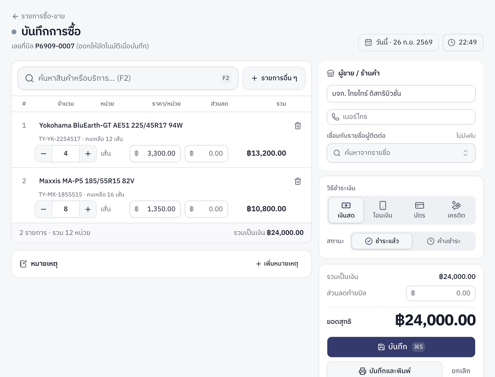

*ภาพ 6-1 หน้าบันทึกการซื้อ*

1. กดเมนู **บันทึกการซื้อ** (หรือปุ่ม **บันทึกซื้อ** ที่แถบด้านบน)
2. ส่วน **ผู้ขาย / ร้านค้า** พิมพ์ชื่อร้านหรือบริษัทที่ซื้อ (ระบบแนะนำชื่อผู้ขายที่เคยบันทึกไว้) และเบอร์โทร
   - ช่อง **เชื่อมกับรายชื่อผู้ติดต่อ** (ไม่บังคับ) ใช้ผูกบิลกับรายชื่อในเมนูลูกค้า เช่น ร้านค้าส่งที่เป็นทั้งผู้ขายและลูกค้า
3. ค้นหาสินค้าที่ซื้อเข้ามาในช่องค้นหา ราคาเริ่มต้นคือราคาทุนปัจจุบัน ให้แก้ราคาตามใบส่งของหรือใบกำกับภาษีของผู้ขาย
4. ใส่จำนวนและส่วนลด (ถ้ามี) ค่าใช้จ่ายอื่น เช่น ค่าขนส่ง ใช้ **รายการอื่น ๆ**
5. ถ้าร้านจด VAT เลือกรูปแบบ VAT ให้ตรงกับเอกสารของผู้ขาย
6. เลือกวิธีชำระเงิน ถ้าซื้อเชื่อให้เลือก **เครดิต** บิลจะเป็นค้างชำระ (ร้านค้างจ่าย)
7. ใส่หมายเหตุ เช่น เลขที่ใบกำกับของผู้ขาย วันครบกำหนดชำระ
8. กด **บันทึก**

เมื่อบันทึกแล้ว

- **สต็อกเพิ่มขึ้น** ตามจำนวนที่ซื้อ
- **ราคาทุนของสินค้าเปลี่ยนเป็นราคาซื้อครั้งล่าสุด** (เมื่อเปิดการตั้งค่า "อัปเดตราคาทุนตามราคาซื้อล่าสุด" ซึ่งเปิดไว้เป็นค่าเริ่มต้น) ราคาทุนคิดจากราคาต่อหน่วยหลังหักส่วนลดของบรรทัดและไม่รวม VAT ถ้าตัวเลขนี้ต่างจากราคาที่พิมพ์ จะแสดง **ต้นทุนสุทธิ** ไว้ใต้ชื่อสินค้า (ส่วนลดท้ายบิลไม่นำมาคิดในราคาทุน) การเปลี่ยนราคาทุนจะบันทึกไว้ในประวัติราคาของสินค้า
- **นับเป็นรายจ่าย** ของวันที่ในบิล ถ้าค้างจ่าย จะแสดงในแถบเตือนที่แดชบอร์ด

> **เคล็ดลับ:** บันทึกการซื้อทุกครั้งที่รับของ อย่าใช้ "ปรับสต็อก" แทน เพราะการปรับสต็อกไม่นับเป็นรายจ่ายและไม่ปรับราคาทุน ทำให้กำไรในรายงานคลาดเคลื่อน

## 7. รายการซื้อ-ขาย: ค้นหา ดู รับชำระ แก้ไข ยกเลิก

### 7.1 หน้ารายการซื้อ-ขาย

กดเมนู **รายการซื้อ-ขาย** เพื่อดูบิลขายและบิลซื้อทั้งหมดของร้าน

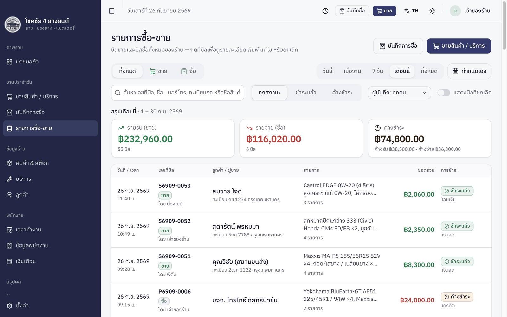

*ภาพ 7-1 หน้ารายการซื้อ-ขาย*

- **แท็บ** ทั้งหมด / ขาย / ซื้อ
- **ช่วงเวลา** วันนี้ / เมื่อวาน / 7 วัน / เดือนนี้ (ค่าเริ่มต้น) / ทั้งหมด หรือ **กำหนดเอง** แล้วเลือกวันเริ่มต้นและวันสิ้นสุดจากปฏิทิน แล้วกด **ตกลง**
- **ช่องค้นหา** ค้นได้จากเลขที่บิล ชื่อลูกค้าหรือผู้ขาย เบอร์โทร (พิมพ์แค่ตัวเลขก็ได้) ทะเบียนรถ หรือชื่อสินค้าในบิล ถ้าไม่พบในช่วงเวลาที่เลือก จะมีปุ่ม **ค้นหาทุกช่วงเวลา**
- **สถานะการชำระ** ทุกสถานะ / ชำระแล้ว / ค้างชำระ
- **ผู้บันทึก** ดูเฉพาะบิลที่ผู้ใช้คนใดคนหนึ่งเปิด
- **แสดงบิลที่ยกเลิก** ปกติบิลที่ยกเลิกจะถูกซ่อน เปิดสวิตช์นี้เพื่อแสดงด้วย
- **การ์ดสรุป** (เฉพาะผู้มีสิทธิ์ดูยอดขาย) รายรับ รายจ่าย และยอดค้างชำระของช่วงที่เลือก กดการ์ดค้างชำระเพื่อดูเฉพาะบิลที่ค้าง ยอดรวมไม่นับบิลที่ยกเลิก
- ตารางแสดงวันที่และเวลา เลขที่บิล (พร้อมชื่อผู้บันทึก) ลูกค้าหรือผู้ขาย ทะเบียนรถ รายการ ยอดรวม และการชำระ ถ้ามีบิลมาก กด **แสดงเพิ่ม** ด้านล่าง
- กดที่บิลเพื่อเปิดหน้ารายละเอียด

### 7.2 หน้ารายละเอียดบิล

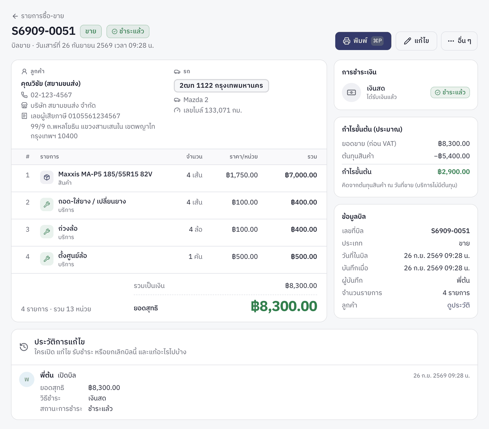

*ภาพ 7-2 หน้ารายละเอียดบิลขาย*

- **หัวบิล** เลขที่บิล ป้ายขาย / ซื้อ สถานะการชำระ วันที่และเวลาในบิล
- **ปุ่มคำสั่ง** **พิมพ์** (⌘P / Ctrl+P), **แก้ไข** และ **อื่น ๆ** (เปิดบิลใหม่จากบิลนี้, บิลทั้งหมดของลูกค้านี้, ยกเลิกบิล…) ปุ่มจะแสดงตามสิทธิ์ของผู้ใช้
- **ลูกค้า** ชื่อ เบอร์โทร ร้านค้า เลขผู้เสียภาษี ที่อยู่ และ **รถ** ทะเบียน รุ่น เลขไมล์
- **รายการ** สินค้า บริการ จำนวน ราคา ส่วนลด รวมเป็นเงิน ส่วนลดท้ายบิล VAT และยอดสุทธิ
- **การชำระเงิน** วิธีชำระและสถานะ
- **กำไรขั้นต้น (ประมาณ)** (เฉพาะผู้มีสิทธิ์ดูยอดขาย) ยอดขายก่อน VAT ลบต้นทุนสินค้า ณ วันที่ขาย
- **ข้อมูลบิล** เลขที่บิล ประเภท วันที่ในบิล บันทึกเมื่อ ผู้บันทึก แก้ไขล่าสุด (และโดยใคร) จำนวนรายการ และลิงก์ **ดูประวัติ** ของลูกค้า
- **ประวัติการแก้ไข** (เฉพาะผู้มีสิทธิ์ดูประวัติ) ใครเปิด แก้ไข รับชำระ หรือยกเลิกบิลนี้ และแก้อะไรไปบ้าง

### 7.3 รับชำระเงินบิลที่ค้างอยู่

เมื่อลูกค้ามาจ่ายบิลเชื่อ (หรือร้านจ่ายเงินผู้ขายแล้ว) ให้บันทึกว่าชำระแล้ว

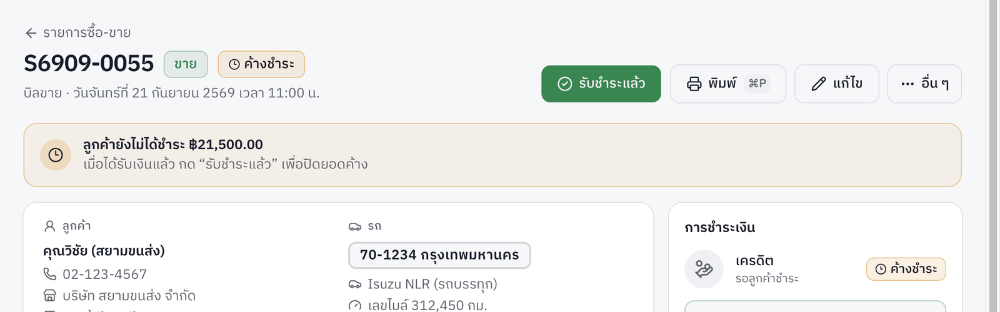

*ภาพ 7-3 บิลค้างชำระมีแถบแจ้งยอดค้าง และปุ่มรับชำระแล้ว*

1. เปิดบิลที่ค้างชำระ (จากแดชบอร์ด **ดูบิลค้างชำระ** หรือหน้ารายการซื้อ-ขายที่กรองสถานะค้างชำระ)
2. กดปุ่มสีเขียว **รับชำระแล้ว** (บิลซื้อจะเป็นปุ่ม **จ่ายแล้ว**)
3. เลือกว่าลูกค้าชำระด้วย **เงินสด**, **โอนเงิน** หรือ **บัตร**
4. กด **ยืนยันรับชำระแล้ว**

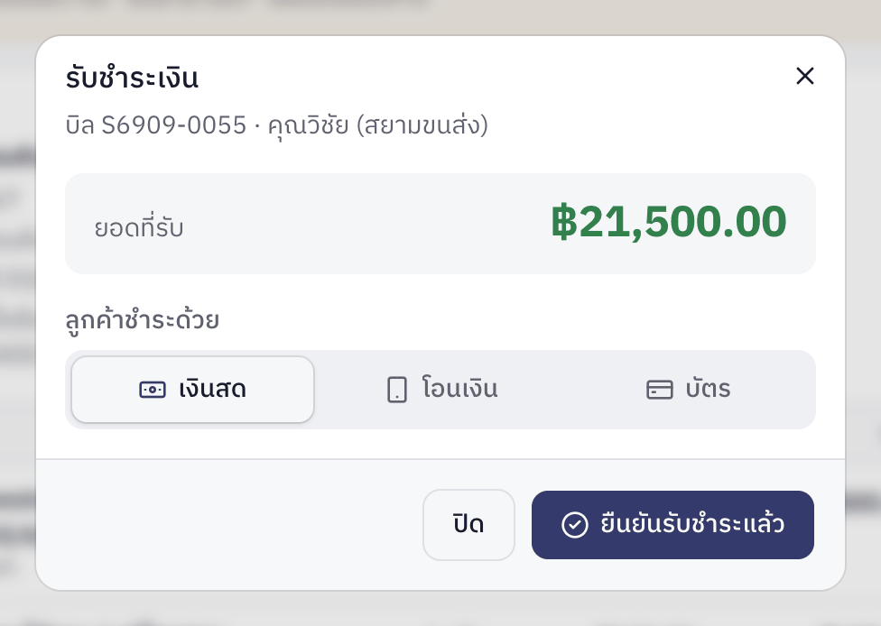

*ภาพ 7-4 หน้าต่างรับชำระเงิน*

- เงินที่รับจะนับเป็น "รับเงิน" ของวันที่กดยืนยัน ไม่ใช่วันที่ในบิล (ยอดขายยังนับตามวันที่ในบิลเหมือนเดิม)
- ทุกคนที่เข้าสู่ระบบรับชำระบิลขายได้ ส่วนบิลซื้อต้องมีสิทธิ์บันทึกการซื้อ

### 7.4 แก้ไขบิล

ใช้เมื่อบันทึกข้อมูลผิด เช่น จำนวน ราคา ลูกค้า หรือวิธีชำระ ต้องมีสิทธิ์ **แก้ไขบิล** (บิลซื้อต้องมีสิทธิ์ **บันทึกการซื้อ** ด้วย)

1. เปิดบิลแล้วกด **แก้ไข**
2. แก้ไขในหน้าจอเดียวกับตอนเปิดบิล
3. กด **บันทึกการแก้ไข**

- สต็อกจะถูกปรับตามรายการใหม่ให้อัตโนมัติ
- เลขที่บิลและผู้บันทึกเดิมไม่เปลี่ยน ระบบบันทึกผู้แก้ไขและสิ่งที่แก้ไว้ในประวัติ
- เปลี่ยนบิลขายเป็นบิลซื้อ (หรือกลับกัน) ไม่ได้ และบิลที่ยกเลิกแล้วแก้ไขไม่ได้

### 7.5 ยกเลิกบิล

ใช้เมื่อบิลนั้นไม่ควรนับอีกต่อไป เช่น ลูกค้ายกเลิก หรือเปิดบิลซ้ำ ต้องมีสิทธิ์ **ยกเลิกบิล**

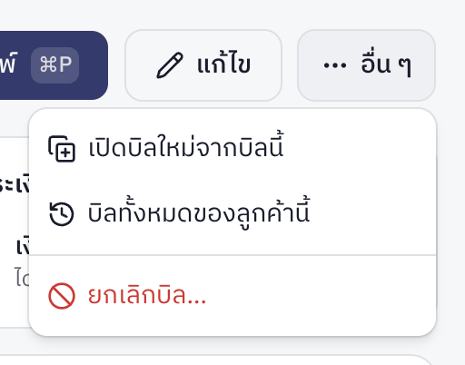

*ภาพ 7-5 เมนู "อื่น ๆ" ในหน้าบิล*

1. เปิดบิลแล้วกด **อื่น ๆ → ยกเลิกบิล…**
2. ใส่ **เหตุผลที่ยกเลิก** (ไม่บังคับ) หรือกดปุ่มเหตุผลที่ใช้บ่อย: ลูกค้ายกเลิก / บันทึกผิด / เปิดบิลซ้ำ
3. กด **ยกเลิกบิล**

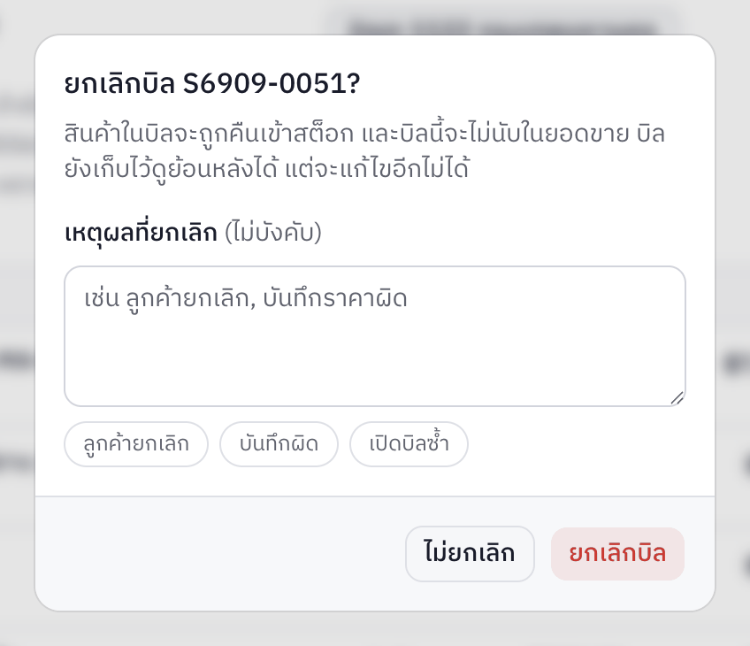

*ภาพ 7-6 หน้าต่างยืนยันการยกเลิกบิล*

ผลของการยกเลิกบิล

- **บิลขาย** สินค้าในบิลถูกคืนเข้าสต็อก และไม่นับในยอดขาย
- **บิลซื้อ** สต็อกที่รับเข้าจากบิลนี้ถูกหักออก และไม่นับในยอดซื้อ ถ้าเปิดการอัปเดตราคาทุนตามราคาซื้อล่าสุดไว้ ราคาทุนจะกลับไปตามบิลซื้อล่าสุดที่เหลืออยู่
- บิลยังเก็บไว้ดูย้อนหลังได้ พร้อมป้าย **ยกเลิกแล้ว** เวลาที่ยกเลิก ผู้ยกเลิก และเหตุผล แต่แก้ไขและพิมพ์อีกไม่ได้

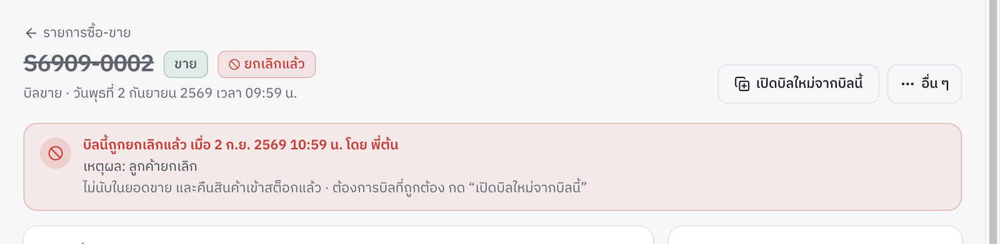

*ภาพ 7-7 บิลที่ถูกยกเลิกแล้ว*

> **ข้อควรระวัง:** การยกเลิกบิลย้อนกลับไม่ได้ ถ้าข้อมูลในบิลผิดเพียงเล็กน้อย ให้ใช้ **แก้ไข** แทน ถ้ายกเลิกไปแล้วแต่ต้องการบิลที่ถูกต้อง ให้กด **เปิดบิลใหม่จากบิลนี้** แล้วบันทึกเป็นบิลใหม่

### 7.6 เปิดบิลใหม่จากบิลนี้

คำสั่ง **อื่น ๆ → เปิดบิลใหม่จากบิลนี้** (บิลที่ยกเลิกแล้วจะเป็นปุ่มด้านบน) จะเปิดหน้าบิลใหม่ที่มีลูกค้า รถ รายการ และส่วนลดเหมือนบิลเดิม แต่ใช้วันที่ปัจจุบัน วิธีชำระเป็นเงินสด และไม่คัดลอกเลขไมล์กับหมายเหตุ เหมาะกับลูกค้าประจำที่ซื้อรายการเดิมซ้ำ หรือใช้แทนบิลที่ยกเลิกไป

### 7.7 ดูบิลทั้งหมดของลูกค้า

คำสั่ง **อื่น ๆ → บิลทั้งหมดของลูกค้านี้** (บิลซื้อ: **บิลทั้งหมดของผู้ติดต่อนี้**) เปิดหน้ารายการซื้อ-ขายที่กรองเฉพาะลูกค้าคนนั้นในทุกช่วงเวลา

## 8. พิมพ์ใบเสร็จ ใบแจ้งหนี้ และบันทึกเป็น PDF

### 8.1 พิมพ์เอกสารของบิล

เปิดบิลแล้วกด **พิมพ์** (⌘P / Ctrl+P) หรือกด **บันทึกและพิมพ์** ตอนเปิดบิล จะพบหน้าต่างพิมพ์เอกสารที่มีตัวอย่างอยู่ด้านซ้าย

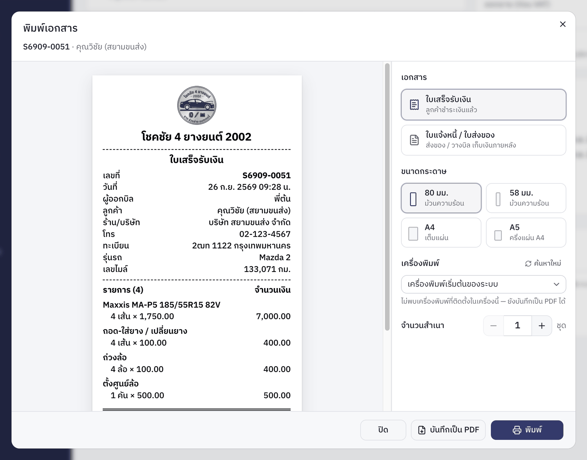

*ภาพ 8-1 หน้าต่างพิมพ์เอกสาร*

1. **เอกสาร**
   - บิลขาย: **ใบเสร็จรับเงิน** (ลูกค้าชำระเงินแล้ว) หรือ **ใบแจ้งหนี้ / ใบส่งของ** (ส่งของ วางบิล เก็บเงินภายหลัง)
   - บิลซื้อ: **ใบบันทึกการซื้อ** (เก็บเป็นหลักฐานการซื้อสินค้าเข้าร้าน)
2. **ขนาดกระดาษ** 80 มม. / 58 มม. (ม้วนความร้อน) หรือ A4 (เต็มแผ่น) / A5 (ครึ่งแผ่น A4)
3. **เครื่องพิมพ์** เลือกเครื่องพิมพ์ หรือใช้ **เครื่องพิมพ์เริ่มต้นของระบบ** ถ้าเพิ่งต่อเครื่องพิมพ์ ให้กด **ค้นหาใหม่**
4. **จำนวนสำเนา** 1–10 ชุด
5. กด **พิมพ์** หรือ **บันทึกเป็น PDF**

- ถ้าเปิด **พิมพ์ทันทีโดยไม่ถาม** ในการตั้งค่า เอกสารจะส่งเข้าเครื่องพิมพ์เลย ถ้าไม่เปิด จะมีหน้าต่างพิมพ์ของระบบให้ตรวจอีกครั้ง
- **บันทึกเป็น PDF** จะให้เลือกที่เก็บไฟล์ (ชื่อไฟล์คือเลขที่บิล) ใช้ส่งใบเสร็จให้ลูกค้าทาง LINE หรืออีเมล
- ถ้าไม่มีเครื่องพิมพ์ติดตั้งในเครื่อง จะมีข้อความ "ไม่พบเครื่องพิมพ์ที่ติดตั้งในเครื่องนี้ — ยังบันทึกเป็น PDF ได้"

### 8.2 ตัวอย่างเอกสาร

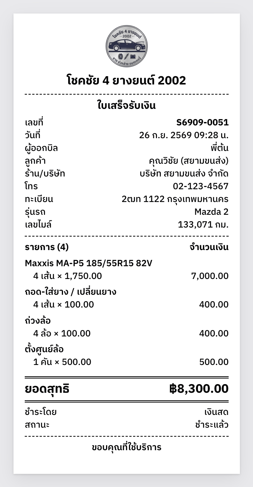

*ภาพ 8-2 ใบเสร็จรับเงินบนกระดาษความร้อน 80 มม.*

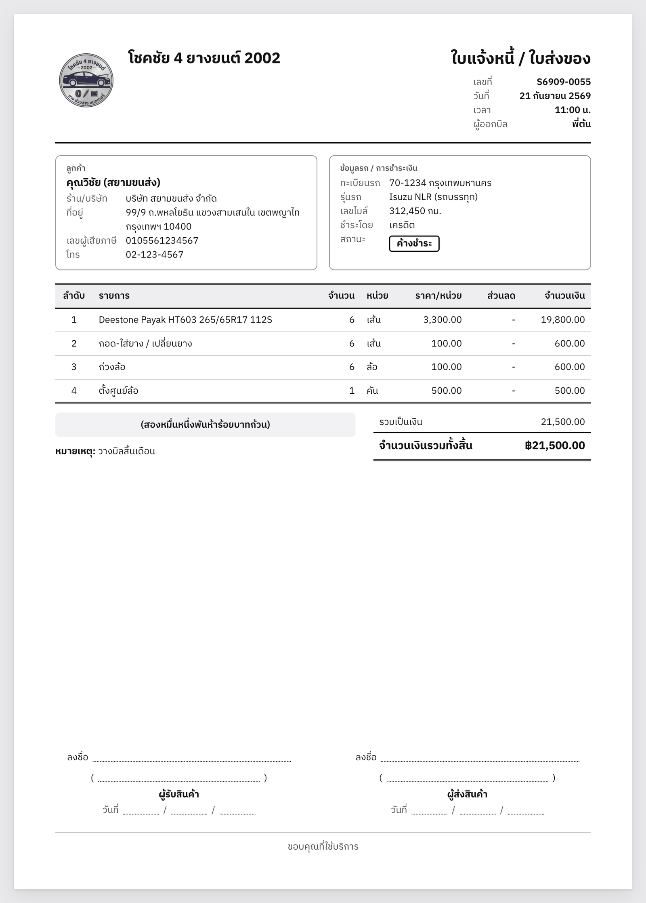

*ภาพ 8-3 ใบแจ้งหนี้ / ใบส่งของ ขนาด A4 ของบิลที่ค้างชำระ*

ข้อมูลบนเอกสาร

- **หัวเอกสาร** โลโก้ ชื่อร้าน สาขา ที่อยู่ เบอร์โทร LINE และเลขประจำตัวผู้เสียภาษี (ตั้งที่ **ตั้งค่า → ข้อมูลร้าน**)
- **เลขที่ วันที่ และผู้ออกบิล** (ปิดการพิมพ์ชื่อผู้ออกบิลได้ในการตั้งค่า)
- **ลูกค้าและรถ** ชื่อ ร้าน/บริษัท ที่อยู่ เลขผู้เสียภาษี โทร ทะเบียน รุ่นรถ เลขไมล์
- **รายการ ยอดรวม ส่วนลด VAT และยอดสุทธิ** เอกสาร A4 / A5 มีจำนวนเงินเป็นตัวหนังสือ และช่องลงชื่อผู้รับ-ผู้ส่ง
- **วิธีชำระและสถานะ** ถ้าบิลยังค้างชำระ จะมีกรอบแจ้งยอดค้างชำระ
- **หมายเหตุ** และ **ข้อความท้ายใบเสร็จ**

ชื่อเอกสารเปลี่ยนตามการตั้งค่าภาษี

- ร้านที่ไม่ได้จด VAT: "ใบเสร็จรับเงิน"
- ร้านที่จด VAT และบิลมี VAT: "ใบเสร็จรับเงิน/ใบกำกับภาษี" (บนกระดาษม้วนความร้อนเป็น "ใบเสร็จรับเงิน/ใบกำกับภาษีอย่างย่อ")

ภาษาของเอกสารตั้งได้ที่ **ตั้งค่า → การพิมพ์ → ภาษาในเอกสาร** (ไทย หรือ English)

### 8.3 ใช้กับเครื่องพิมพ์ใบเสร็จความร้อน 80 มม.

1. ติดตั้งไดรเวอร์ของเครื่องพิมพ์ และทดลองพิมพ์จากเครื่องคอมพิวเตอร์ให้ได้ก่อน
2. ไปที่ **ตั้งค่า → การพิมพ์** เลือก **ขนาดกระดาษเริ่มต้น** เป็น 80 มม. และเลือกเครื่องพิมพ์ แล้วกด **บันทึก**
3. ถ้าต้องการให้พิมพ์ทันทีโดยไม่ต้องกดยืนยันในหน้าต่างของระบบ ให้เปิด **พิมพ์ทันทีโดยไม่ถาม**
4. ถ้าต้องการให้หน้าพิมพ์เปิดเองทุกครั้งหลังขาย ให้เปิด **เปิดหน้าพิมพ์อัตโนมัติหลังบันทึกการขาย**

## 9. สินค้าและสต็อก

ทุกคนดูรายการสินค้าได้ การเพิ่ม แก้ไข และลบสินค้าต้องมีสิทธิ์ **จัดการสินค้าและบริการ** ส่วนการปรับยอดสต็อกต้องมีสิทธิ์ **ปรับยอดสต็อก**

### 9.1 หน้ารายการสินค้า

กดเมนู **สินค้า & สต็อก**

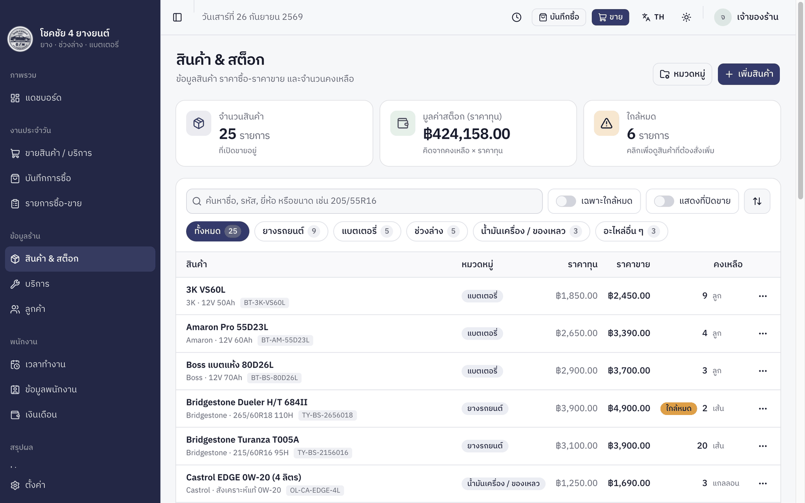

*ภาพ 9-1 หน้าสินค้า & สต็อก*

- **การ์ดสรุป**
  - **จำนวนสินค้า** ที่เปิดขายอยู่ (และจำนวนที่ปิดขาย)
  - **มูลค่าสต็อก (ราคาทุน)** คงเหลือ × ราคาทุน ของทุกสินค้า (เฉพาะผู้มีสิทธิ์ดูยอดขาย)
  - **ใกล้หมด** จำนวนสินค้าที่ต้องสั่งเพิ่ม กดการ์ดนี้เพื่อดูเฉพาะสินค้าใกล้หมด
- **ช่องค้นหา** ค้นจากชื่อ รหัส ยี่ห้อ รุ่น ขนาด หรือหมวดหมู่ ขนาดยางพิมพ์แบบไม่มีเครื่องหมายก็ได้ เช่น 2055516
- สวิตช์ **เฉพาะใกล้หมด** และ **แสดงที่ปิดขาย**
- ปุ่ม **เรียงลำดับ** (ไอคอนลูกศร) เลือกเรียงตาม ชื่อสินค้า (ก-ฮ) / คงเหลือน้อยก่อน / แก้ไขล่าสุด
- **ปุ่มหมวดหมู่** ใต้ช่องค้นหา กดเพื่อดูเฉพาะหมวด (มีจำนวนสินค้าของแต่ละหมวดกำกับ)
- **ตาราง** ชื่อสินค้า (ยี่ห้อ สเปก รหัส) หมวดหมู่ ราคาทุน ราคาขาย และคงเหลือ กดที่ชื่อสินค้าเพื่อเปิดหน้ารายละเอียด ปุ่ม ⋯ ท้ายแถวมีคำสั่ง **แก้ไข**, **ปรับสต็อก**, **ประวัติสต็อก** และ **ลบ**

ป้ายที่ช่องคงเหลือ

| ป้าย | ความหมาย |
|---|---|
| ใกล้หมด | คงเหลือไม่เกินจำนวน "แจ้งเตือนเมื่อเหลือ" ควรสั่งเพิ่ม |
| หมด | คงเหลือ 0 |
| ติดลบ | ขายไปมากกว่าที่บันทึกไว้ในสต็อก ควรบันทึกการซื้อที่ยังไม่ได้บันทึก หรือนับสต็อกแล้วปรับยอด |
| ไม่นับสต็อก | สินค้าที่ตั้งไว้ว่าไม่ต้องนับจำนวนคงเหลือ |

### 9.2 เพิ่มสินค้าใหม่

กดปุ่ม **เพิ่มสินค้า** กรอกข้อมูล แล้วกด **เพิ่มสินค้า** (หรือกด Enter)

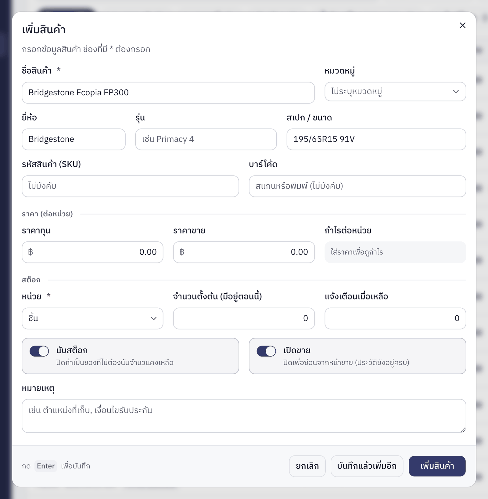

*ภาพ 9-2 ฟอร์มเพิ่มสินค้า*

| ช่อง | คำอธิบาย |
|---|---|
| ชื่อสินค้า * | ต้องกรอก เช่น Michelin Primacy 4 |
| หมวดหมู่ | เลือกหมวด หรือ "ไม่ระบุหมวดหมู่" |
| ยี่ห้อ / รุ่น | เช่น Michelin / Primacy 4 ใช้ค้นหาได้ |
| สเปก / ขนาด | เช่น 205/55R16 91V หรือ 12V 65Ah แสดงต่อท้ายชื่อในบิล |
| รหัสสินค้า (SKU) / บาร์โค้ด | ไม่บังคับ ใช้ค้นหาและสแกนตอนขาย |
| ราคาทุน / ราคาขาย | ราคาต่อหน่วย ระบบแสดง **กำไรต่อหน่วย** และเปอร์เซ็นต์ให้ทันที (ถ้าราคาขายต่ำกว่าทุนจะขึ้นว่า "ขาดทุน") |
| หน่วย * | เช่น เส้น ลูก ชิ้น ตัว ต้น ชุด คู่ ขวด แกลลอน ลิตร (กดลูกศรในช่องเพื่อเลือก) ถ้าชื่อสินค้ามีคำว่า "ยาง" ระบบเลือก "เส้น" ให้ ถ้ามี "แบต" เลือก "ลูก" |
| จำนวนตั้งต้น (มีอยู่ตอนนี้) | จำนวนที่มีในร้านตอนเพิ่มสินค้า (มีเฉพาะตอนเพิ่มสินค้าใหม่) |
| แจ้งเตือนเมื่อเหลือ | เมื่อคงเหลือเท่ากับหรือน้อยกว่าตัวเลขนี้ สินค้าจะขึ้นเป็น "ใกล้หมด" |
| นับสต็อก | ปิดสำหรับของที่ไม่ต้องนับจำนวน (เช่น ของสิ้นเปลืองในร้าน) |
| เปิดขาย | ปิดเพื่อซ่อนสินค้าจากหน้าขาย โดยประวัติยังอยู่ครบ |
| หมายเหตุ | เช่น ตำแหน่งที่เก็บ เงื่อนไขรับประกัน |

- กด **บันทึกแล้วเพิ่มอีก** เพื่อบันทึกแล้วเปิดฟอร์มว่างสำหรับสินค้าถัดไปทันที (สะดวกตอนเพิ่มสินค้าครั้งแรกหลายรายการ)

### 9.3 แก้ไขข้อมูลและราคาสินค้า

1. กด ⋯ ท้ายแถวสินค้า แล้วเลือก **แก้ไข** (หรือกด **แก้ไข** ในหน้ารายละเอียดสินค้า)
2. แก้ไขข้อมูลหรือราคา แล้วกด **บันทึก**

- ราคาใหม่ใช้กับบิลที่เปิดหลังจากนี้ บิลเก่ายังเป็นราคาเดิม
- ทุกการเปลี่ยนราคาขายและราคาทุนจะบันทึกไว้ใน **ประวัติราคา** ว่าใครเปลี่ยน จากเท่าไรเป็นเท่าไร เมื่อไหร่
- ฟอร์มแก้ไขเปลี่ยนจำนวนคงเหลือไม่ได้ ให้ใช้ **ปรับสต็อก** (หัวข้อ 9.5) หรือบันทึกการซื้อ

### 9.4 หมวดหมู่สินค้า

กดปุ่ม **หมวดหมู่** ที่หน้าสินค้า & สต็อก

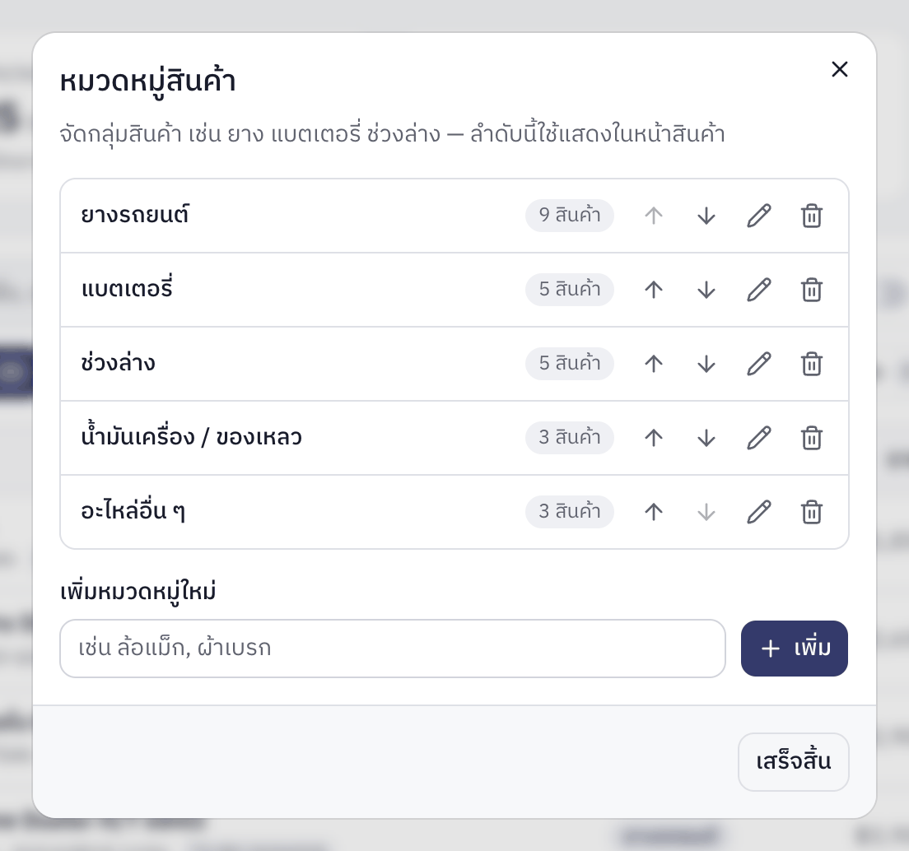

*ภาพ 9-3 หน้าต่างจัดการหมวดหมู่สินค้า*

- **เพิ่มหมวดหมู่ใหม่** พิมพ์ชื่อในช่องด้านล่าง แล้วกด **เพิ่ม**
- **เปลี่ยนชื่อ** กดไอคอนดินสอ (หรือดับเบิลคลิกที่ชื่อ) แก้ชื่อแล้วกด Enter
- **เลื่อนขึ้น / เลื่อนลง** จัดลำดับที่แสดงในหน้าสินค้า
- **ลบ** ลบได้เฉพาะหมวดที่ไม่มีสินค้าแล้ว ถ้ายังมีสินค้า ให้ย้ายสินค้าไปหมวดอื่น (หรือลบสินค้า) ก่อน
- โปรแกรมเตรียมหมวดไว้ให้ 5 หมวด: ยางรถยนต์, แบตเตอรี่, ช่วงล่าง, น้ำมันเครื่อง / ของเหลว, อะไหล่อื่น ๆ

### 9.5 ปรับสต็อก

ใช้เมื่อจำนวนในระบบไม่ตรงกับของจริง เช่น หลังนับสต็อก ของชำรุด หรือนำไปเป็นของแถม ต้องมีสิทธิ์ **ปรับยอดสต็อก**

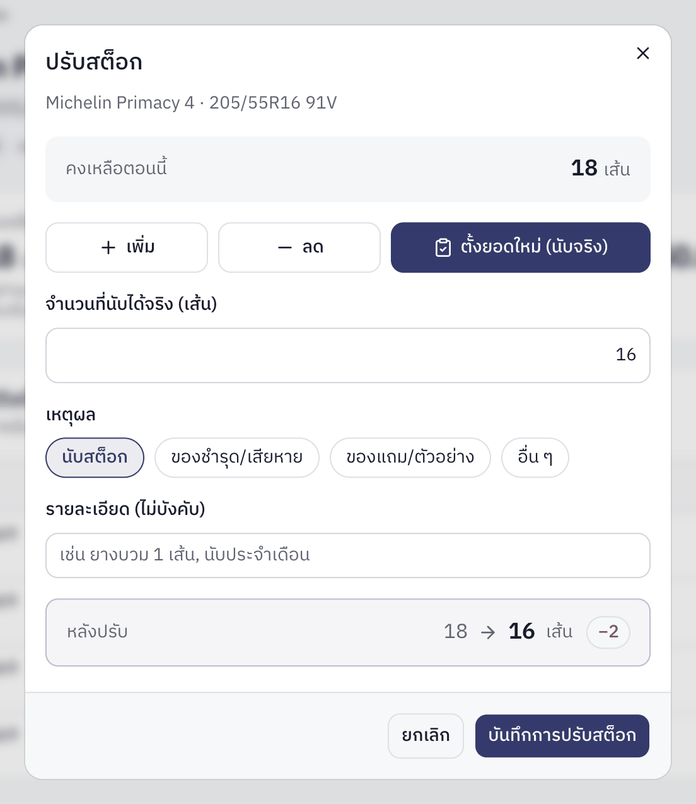

*ภาพ 9-4 หน้าต่างปรับสต็อก แบบตั้งยอดใหม่ตามที่นับได้จริง*

1. ที่หน้าสินค้า กด ⋯ ท้ายแถว แล้วเลือก **ปรับสต็อก** (หรือกดปุ่ม **ปรับสต็อก** ในหน้ารายละเอียดสินค้า)
2. เลือกวิธีปรับ
   - **เพิ่ม** ใส่จำนวนที่เพิ่ม
   - **ลด** ใส่จำนวนที่ลด
   - **ตั้งยอดใหม่ (นับจริง)** ใส่จำนวนที่นับได้จริง ระบบคำนวณส่วนต่างให้
3. เลือก **เหตุผล** นับสต็อก / ของชำรุด/เสียหาย / ของแถม/ตัวอย่าง / อื่น ๆ และใส่ **รายละเอียด** (ต้องใส่ถ้าเลือก "อื่น ๆ")
4. ตรวจยอด **หลังปรับ** (ยอดเดิม → ยอดใหม่) แล้วกด **บันทึกการปรับสต็อก**

- สินค้าที่ตั้งเป็น "ไม่นับสต็อก" ปรับยอดไม่ได้
- ทุกการปรับสต็อกแสดงในประวัติสต็อก พร้อมชื่อผู้ปรับและเหตุผล

### 9.6 หน้ารายละเอียดสินค้า

กดที่ชื่อสินค้าเพื่อเปิดหน้ารายละเอียด

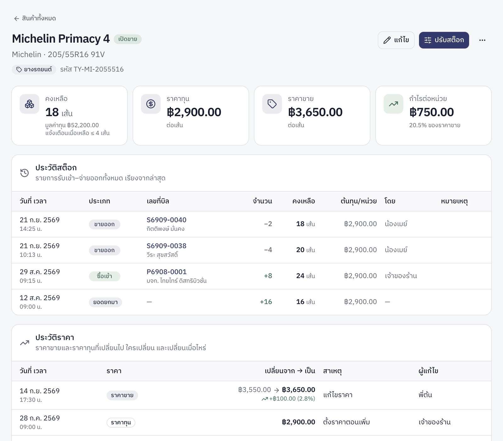

*ภาพ 9-5 หน้ารายละเอียดสินค้า*

- **การ์ด** คงเหลือ (มูลค่าทุน และจุดแจ้งเตือน) ราคาทุน ราคาขาย และกำไรต่อหน่วย
- **ประวัติสต็อก** (stock card) รายการรับเข้า-จ่ายออกทั้งหมด เรียงจากล่าสุด แต่ละบรรทัดมีวันที่เวลา ประเภท (ยอดยกมา คือจำนวนตั้งต้นตอนเพิ่มสินค้า / ซื้อเข้า / ขายออก / ปรับยอด) เลขที่บิล (กดเพื่อเปิดบิล) จำนวนที่เพิ่มหรือลด คงเหลือหลังรายการ ต้นทุนต่อหน่วย ผู้ทำ และหมายเหตุ ใช้ตรวจว่าสต็อกหายไปตอนไหน
- **ประวัติราคา** (เฉพาะผู้มีสิทธิ์จัดการสินค้าหรือดูประวัติ) ราคาขายและราคาทุนที่เปลี่ยนไป สาเหตุ (ตั้งราคาตอนเพิ่ม / แก้ไขราคา / ตามบิลซื้อ) และผู้แก้
- **ประวัติการแก้ไข** (เฉพาะผู้มีสิทธิ์ดูประวัติ) การเพิ่ม แก้ไขข้อมูลสินค้า และปรับสต็อก

### 9.7 ปิดขายและลบสินค้า

- **ปิดขาย** แก้ไขสินค้าแล้วปิดสวิตช์ **เปิดขาย** สินค้าจะไม่แสดงในหน้าขาย แต่ยังอยู่ในหน้าสินค้า (เปิด **แสดงที่ปิดขาย** เพื่อดู) เหมาะกับสินค้าเลิกขายชั่วคราว
- **ลบสินค้า** กด ⋯ → **ลบ** แล้วยืนยัน สินค้าจะถูกซ่อนจากรายการและหน้าขาย บิลเก่าที่เคยขายหรือซื้อยังแสดงชื่อสินค้านี้ครบเหมือนเดิม

### 9.8 สต็อกเปลี่ยนเมื่อไหร่

| เหตุการณ์ | ผลต่อสต็อก |
|---|---|
| บันทึกบิลขาย | ลดลงตามจำนวนที่ขาย |
| บันทึกบิลซื้อ | เพิ่มขึ้นตามจำนวนที่ซื้อ |
| แก้ไขบิล | ปรับตามจำนวนใหม่ในบิล |
| ยกเลิกบิลขาย | คืนกลับเข้าสต็อก |
| ยกเลิกบิลซื้อ | หักจำนวนที่รับเข้าออก |
| ปรับสต็อก | เปลี่ยนตามที่ปรับ |
| สินค้าที่ตั้งเป็น "ไม่นับสต็อก" | ไม่เปลี่ยน |

## 10. บริการ

บริการคือค่าแรงหรืองานของร้าน เช่น ถ่วงล้อ ตั้งศูนย์ล้อ ปะยาง บริการไม่มีสต็อกและไม่มีต้นทุน ราคาตั้งต้นจะใส่ให้อัตโนมัติตอนออกบิล และแก้ไขได้ทุกครั้ง

### 10.1 หน้ารายการบริการ

กดเมนู **บริการ**

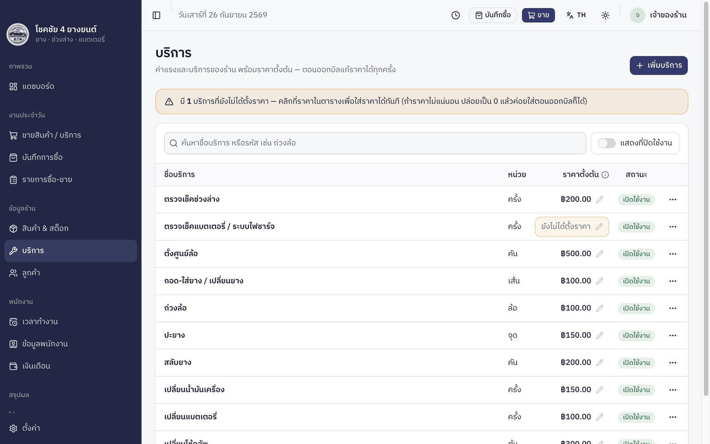

*ภาพ 10-1 หน้าบริการ*

- โปรแกรมเตรียมบริการไว้ให้ 10 รายการ: ถอด-ใส่ยาง / เปลี่ยนยาง, ปะยาง, ถ่วงล้อ, ตั้งศูนย์ล้อ, สลับยาง, เปลี่ยนแบตเตอรี่, ตรวจเช็คแบตเตอรี่ / ระบบไฟชาร์จ, เปลี่ยนโช้คอัพ, ตรวจเช็คช่วงล่าง และเปลี่ยนน้ำมันเครื่อง โดยราคาเริ่มต้นเป็น 0 ให้ร้านใส่ราคาของตัวเอง
- แถบสีเหลืองด้านบนบอกจำนวนบริการที่ยังไม่ได้ตั้งราคา
- **แก้ราคาอย่างเร็ว** คลิกที่ราคาในตาราง พิมพ์ราคาใหม่ แล้วกด Enter เพื่อบันทึก (Esc เพื่อยกเลิก) ต้องมีสิทธิ์จัดการสินค้าและบริการ
- ค้นหาจากชื่อหรือรหัสบริการ และเปิด **แสดงที่ปิดใช้งาน** เพื่อดูบริการที่ปิดไว้
- ปุ่ม ⋯ ท้ายแถวมีคำสั่ง **แก้ไข**, **ประวัติราคา** และ **ลบ**

> **เคล็ดลับ:** บริการที่ราคาไม่แน่นอน (เช่น ขึ้นกับขนาดรถ) ตั้งราคาเป็น 0 ไว้ได้ แล้วค่อยใส่ราคาตอนออกบิล

### 10.2 เพิ่มหรือแก้ไขบริการ

กดปุ่ม **เพิ่มบริการ** (หรือ ⋯ → **แก้ไข**)

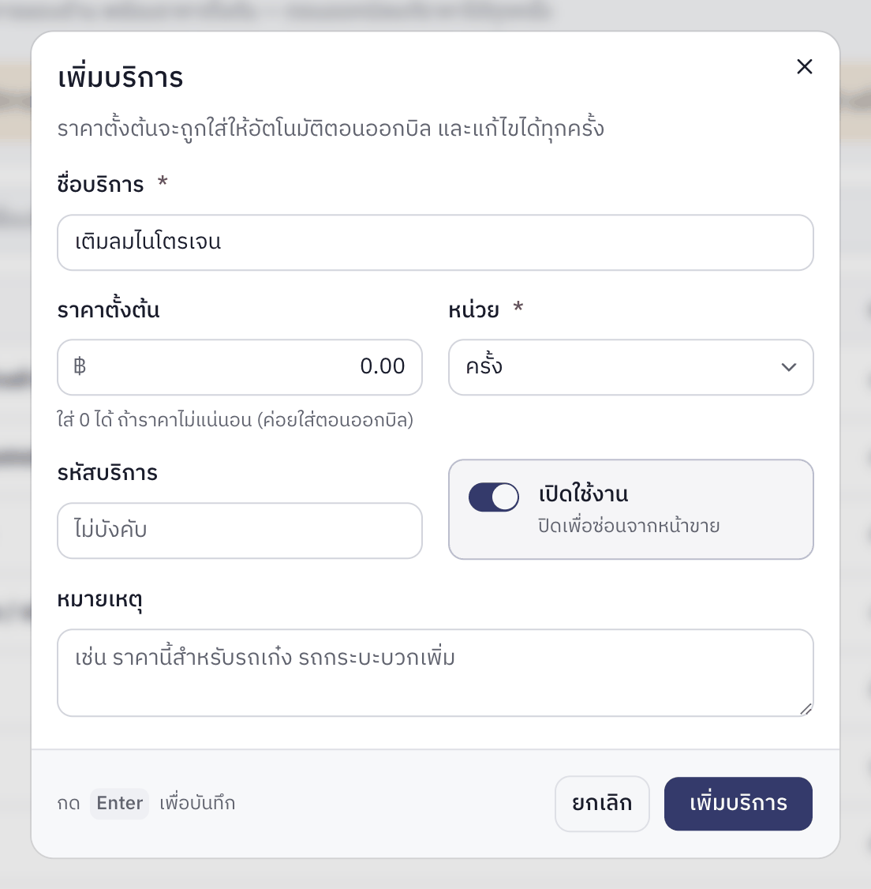

*ภาพ 10-2 ฟอร์มเพิ่มบริการ*

| ช่อง | คำอธิบาย |
|---|---|
| ชื่อบริการ * | เช่น ถ่วงล้อ ตั้งศูนย์ล้อ |
| ราคาตั้งต้น | ใส่ 0 ได้ถ้าราคาไม่แน่นอน |
| หน่วย * | เช่น ครั้ง คัน ล้อ เส้น จุด ต้น ชุด ชั่วโมง งาน |
| รหัสบริการ | ไม่บังคับ |
| เปิดใช้งาน | ปิดเพื่อซ่อนจากหน้าขาย |
| หมายเหตุ | เช่น "ราคานี้สำหรับรถเก๋ง รถกระบะบวกเพิ่ม" |

### 10.3 ประวัติราคาบริการ

กด ⋯ → **ประวัติราคา** เพื่อดูว่าราคาตั้งต้นเคยเปลี่ยนจากเท่าไรเป็นเท่าไร ใครเปลี่ยน และเปลี่ยนเมื่อไหร่ (เฉพาะผู้มีสิทธิ์จัดการสินค้าหรือดูประวัติ)

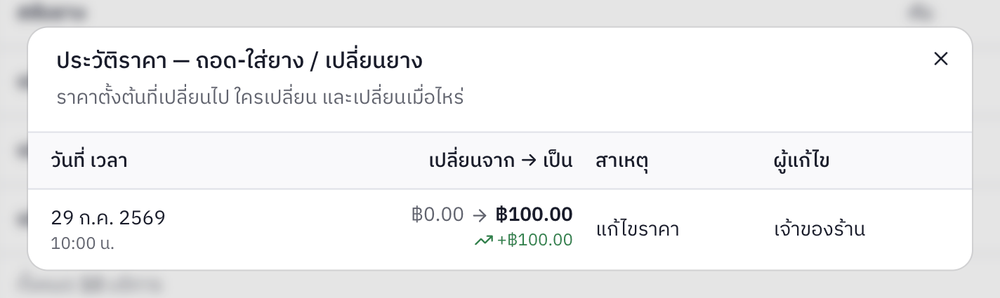

*ภาพ 10-3 ประวัติราคาของบริการ*

การลบบริการจะซ่อนบริการจากรายการและหน้าขาย บิลเก่ายังแสดงชื่อบริการเหมือนเดิม

## 11. ลูกค้า

ทุกคนดูข้อมูลลูกค้าและเพิ่มลูกค้าใหม่ได้ การแก้ไขและลบข้อมูลลูกค้าต้องมีสิทธิ์ **แก้ไข/ลบลูกค้า**

### 11.1 รายชื่อลูกค้า

กดเมนู **ลูกค้า**

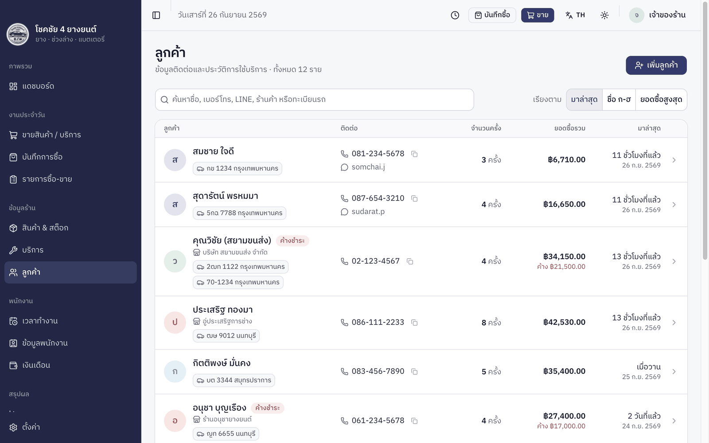

*ภาพ 11-1 หน้ารายชื่อลูกค้า*

- **ค้นหา** จากชื่อ เบอร์โทร (พิมพ์แค่ตัวเลขก็ได้) LINE ชื่อร้านค้า หรือทะเบียนรถ
- **เรียงตาม** มาล่าสุด / ชื่อ ก-ฮ / ยอดซื้อสูงสุด
- แต่ละแถวแสดงชื่อ ชื่อร้าน ทะเบียนรถที่เคยมา ป้าย **ค้างชำระ** (ถ้ามี) เบอร์โทรพร้อมปุ่มคัดลอก LINE จำนวนครั้งที่มา ยอดซื้อรวม และมาล่าสุดเมื่อไหร่
- กดที่แถวเพื่อเปิดข้อมูลลูกค้า

### 11.2 เพิ่มลูกค้า

กดปุ่ม **เพิ่มลูกค้า** (ที่หน้านี้หรือที่แดชบอร์ด) หรือเพิ่มจากช่องเลือกลูกค้าในหน้าขาย

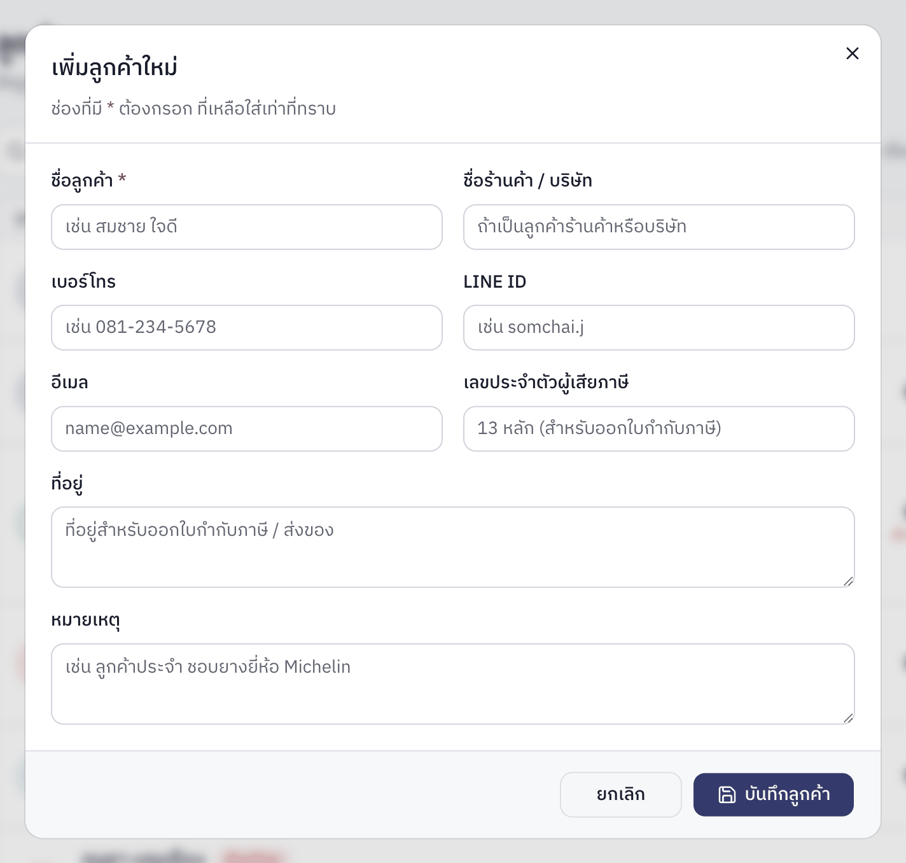

*ภาพ 11-2 ฟอร์มเพิ่มลูกค้าใหม่*

| ช่อง | คำอธิบาย |
|---|---|
| ชื่อลูกค้า * | ต้องกรอก เช่น สมชาย ใจดี |
| ชื่อร้านค้า / บริษัท | ถ้าเป็นลูกค้าร้านค้าหรือบริษัท |
| เบอร์โทร | เช่น 081-234-5678 ถ้าเบอร์นี้มีในระบบแล้ว จะมีคำเตือนบอกว่าเป็นเบอร์ของใคร (ยังบันทึกต่อได้) |
| LINE ID / อีเมล | ช่องทางติดต่อ |
| เลขประจำตัวผู้เสียภาษี | 13 หลัก สำหรับออกใบกำกับภาษี |
| ที่อยู่ | สำหรับออกใบกำกับภาษีหรือส่งของ |
| หมายเหตุ | เช่น ลูกค้าประจำ ชอบยางยี่ห้อ Michelin |

ทะเบียนรถไม่ต้องกรอกในฟอร์มนี้ ระบบจะจำจากบิลขายที่ใส่ทะเบียนรถไว้

### 11.3 ดูข้อมูลและประวัติการใช้บริการของลูกค้า

กดที่ชื่อลูกค้าเพื่อดูว่าลูกค้าคนนี้เคยมาใช้บริการหรือไม่ ทำอะไรไป และทำไปเมื่อไหร่

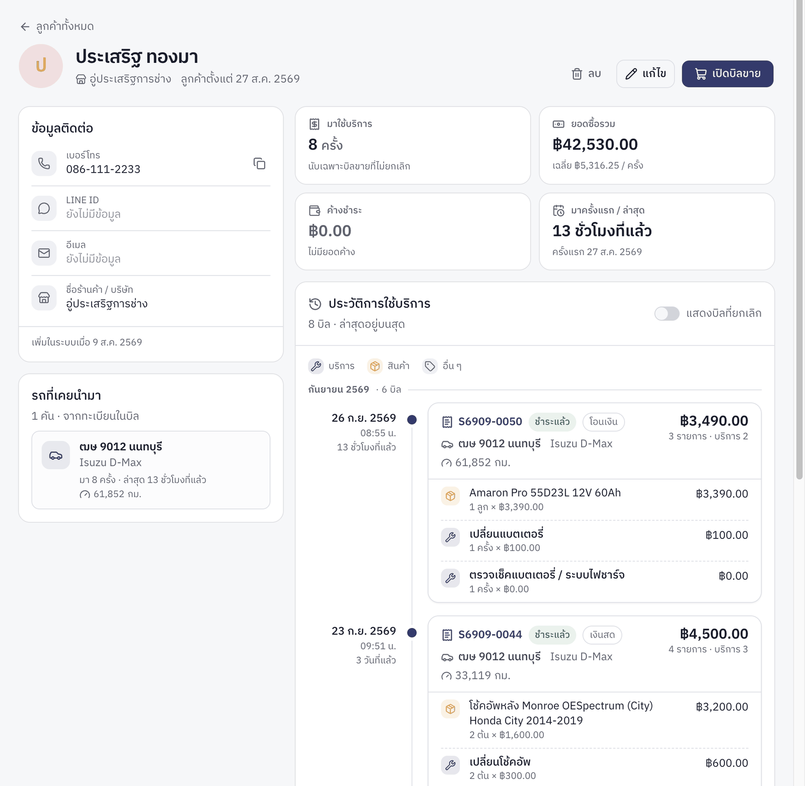

*ภาพ 11-3 หน้าข้อมูลลูกค้าและประวัติการใช้บริการ*

- **หัวหน้า** ชื่อ ร้าน ลูกค้าตั้งแต่เมื่อไหร่ ยอดค้างชำระ และปุ่ม **ลบ**, **แก้ไข**, **เปิดบิลขาย** (เปิดบิลขายโดยเลือกลูกค้าคนนี้ไว้ให้)
- **ข้อมูลติดต่อ** เบอร์โทร LINE อีเมล ร้าน เลขผู้เสียภาษี ที่อยู่ หมายเหตุ (กดไอคอนคัดลอกเพื่อคัดลอก)
- **ตัวเลขสรุป**
  - **มาใช้บริการ** จำนวนครั้ง (นับเฉพาะบิลขายที่ไม่ยกเลิก)
  - **ยอดซื้อรวม** และค่าเฉลี่ยต่อครั้ง
  - **ค้างชำระ** ยอดและจำนวนบิลที่ยังไม่ชำระ
  - **มาครั้งแรก / ล่าสุด**
- **รถที่เคยนำมา** ทะเบียน รุ่น จำนวนครั้งที่มา ครั้งล่าสุด และเลขไมล์ล่าสุด
- **ประวัติการใช้บริการ** บิลทั้งหมดของลูกค้า ล่าสุดอยู่บนสุด จัดกลุ่มตามเดือน แต่ละบิลแสดงวันเวลา ทะเบียนรถ เลขไมล์ รายการสินค้าและบริการพร้อมราคา สถานะการชำระ กดที่เลขที่บิลเพื่อเปิดบิล เปิดสวิตช์ **แสดงบิลที่ยกเลิก** เพื่อดูบิลที่ยกเลิกด้วย และกด **โหลดเพิ่ม** เพื่อดูบิลเก่า
- **ประวัติการแก้ไขข้อมูลลูกค้า** (เฉพาะผู้มีสิทธิ์ดูประวัติ)

### 11.4 แก้ไขและลบลูกค้า

- กด **แก้ไข** ที่หน้าข้อมูลลูกค้า แก้ไขแล้วกด **บันทึกการแก้ไข**
- กด **ลบ** แล้วยืนยัน ลูกค้าจะหายจากรายชื่อและการค้นหา แต่บิลเก่ายังอยู่ครบและยังแสดงชื่อลูกค้าตามบิลเหมือนเดิม

## 12. ข้อมูลพนักงาน

เก็บข้อมูลส่วนตัว ตำแหน่ง และค่าจ้างของพนักงานทุกคน ใช้กับระบบลงเวลาและเงินเดือน ต้องมีสิทธิ์ **ข้อมูลพนักงานและเงินเดือน**

> **หมายเหตุ:** "พนักงาน" ในบทนี้คือข้อมูลบุคคลสำหรับลงเวลาและจ่ายเงินเดือน ต่างจาก "ผู้ใช้งาน" ซึ่งคือบัญชีสำหรับเข้าโปรแกรม (บทที่ 18) พนักงานที่ไม่มีบัญชีผู้ใช้ก็ลงเวลาได้ และผูกบัญชีผู้ใช้เข้ากับพนักงานได้ที่ **ตั้งค่า → ผู้ใช้งาน** (ช่อง "เป็นพนักงานคนไหน")

### 12.1 รายชื่อพนักงาน

กดเมนู **ข้อมูลพนักงาน**

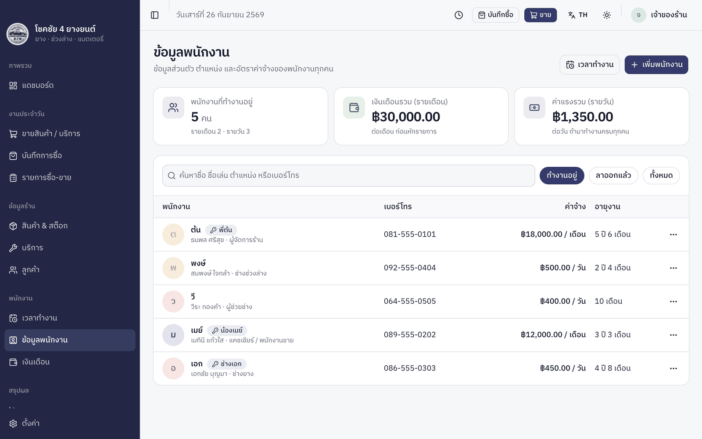

*ภาพ 12-1 หน้าข้อมูลพนักงาน*

- **การ์ดสรุป** จำนวนพนักงานที่ทำงานอยู่ (รายเดือน / รายวัน) เงินเดือนรวมของพนักงานรายเดือน และค่าแรงรวมต่อวันของพนักงานรายวัน
- **ค้นหา** จากชื่อ ชื่อเล่น ตำแหน่ง หรือเบอร์โทร และกรองสถานะ **ทำงานอยู่ / ลาออกแล้ว / ทั้งหมด**
- **ตาราง** ชื่อเล่น ชื่อ-นามสกุล ตำแหน่ง ป้ายชื่อบัญชีผู้ใช้ (ถ้ามี) เบอร์โทร ค่าจ้าง และอายุงาน กดที่ชื่อเพื่อเปิดหน้ารายละเอียด ปุ่ม ⋯ มีคำสั่ง **แก้ไขข้อมูล**, **บันทึกเบิกเงิน** และ **ลบ**

### 12.2 เพิ่มหรือแก้ไขพนักงาน

กดปุ่ม **เพิ่มพนักงาน** (หรือ ⋯ → **แก้ไขข้อมูล**)

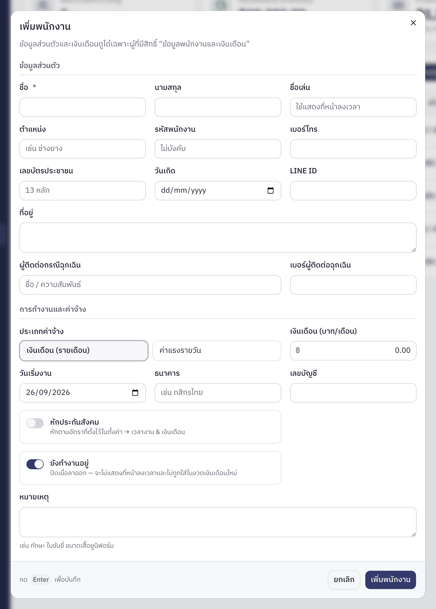

*ภาพ 12-2 ฟอร์มเพิ่มพนักงาน*

**ข้อมูลส่วนตัว**

| ช่อง | คำอธิบาย |
|---|---|
| ชื่อ * / นามสกุล | ชื่อจริง |
| ชื่อเล่น | ใช้แสดงที่หน้าลงเวลา (ถ้าไม่ใส่จะใช้ชื่อจริง) |
| ตำแหน่ง | เช่น ช่างยาง ช่างช่วงล่าง ช่างแบตเตอรี่ ผู้ช่วยช่าง แคชเชียร์ พนักงานขาย ผู้จัดการร้าน |
| รหัสพนักงาน / เบอร์โทร / เลขบัตรประชาชน / วันเกิด / LINE ID / ที่อยู่ | ไม่บังคับ |
| ผู้ติดต่อกรณีฉุกเฉิน / เบอร์ผู้ติดต่อฉุกเฉิน | ชื่อ ความสัมพันธ์ และเบอร์โทร |

**การทำงานและค่าจ้าง**

| ช่อง | คำอธิบาย |
|---|---|
| ประเภทค่าจ้าง | **เงินเดือน (รายเดือน)** หรือ **ค่าแรงรายวัน** |
| เงินเดือน (บาท/เดือน) หรือ ค่าแรง (บาท/วัน) | อัตราค่าจ้างตามประเภทที่เลือก |
| วันเริ่มงาน | ใช้คิดอายุงาน และคิดเงินเดือนตามวันที่ทำงานจริงในเดือนแรก |
| ธนาคาร / เลขบัญชี | บัญชีรับเงินเดือน แสดงในสลิป |
| หักประกันสังคม | เปิดเพื่อหักเงินสมทบประกันสังคมในสลิป ตามอัตราที่ตั้งไว้ (หัวข้อ 17.6) |
| ยังทำงานอยู่ | ปิดเมื่อพนักงานลาออก แล้วใส่ **วันทำงานวันสุดท้าย** |
| หมายเหตุ | เช่น ทักษะ ใบขับขี่ ขนาดเสื้อยูนิฟอร์ม |

> **เคล็ดลับ:** เมื่อพนักงานลาออก ให้ปิด **ยังทำงานอยู่** แทนการลบ พนักงานจะไม่แสดงในหน้าลงเวลาและไม่ถูกใส่ในงวดเงินเดือนใหม่ แต่เวลาทำงานและสลิปเงินเดือนเดิมยังเก็บไว้ครบ

### 12.3 หน้ารายละเอียดพนักงาน

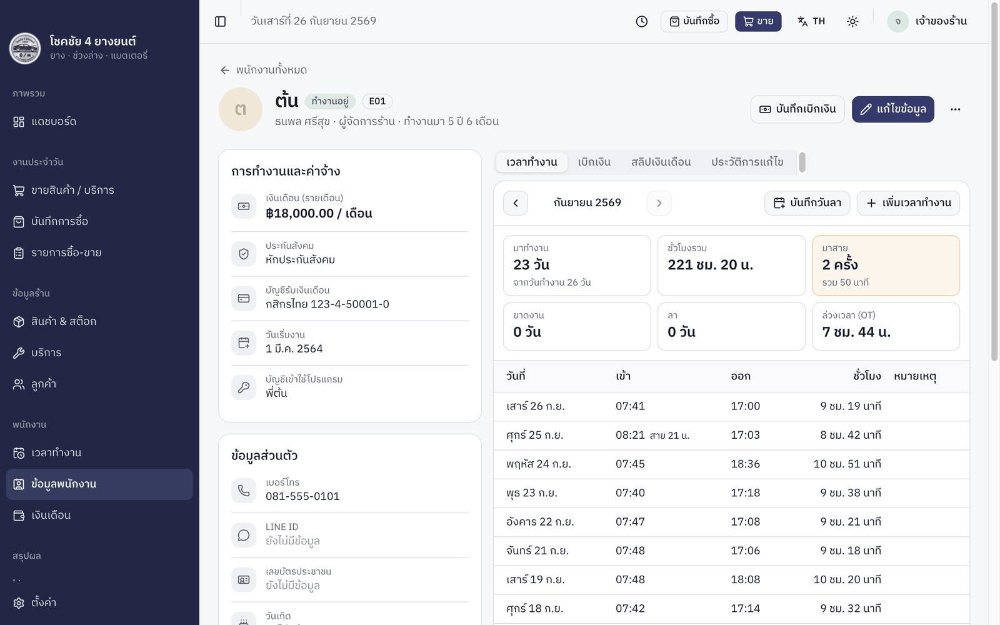

*ภาพ 12-3 หน้ารายละเอียดพนักงาน*

- **ปุ่มด้านบน** **บันทึกเบิกเงิน**, **แก้ไขข้อมูล** และ ⋯ → **ลบพนักงาน**
- **การทำงานและค่าจ้าง** ค่าจ้าง ประกันสังคม บัญชีรับเงินเดือน วันเริ่มงาน และบัญชีเข้าใช้โปรแกรม
- **ข้อมูลส่วนตัว** เบอร์โทร LINE เลขบัตรประชาชน วันเกิด (พร้อมอายุ) ที่อยู่ ผู้ติดต่อฉุกเฉิน
- **แท็บ**
  - **เวลาทำงาน** เลือกเดือนด้วยปุ่ม < > ดูสรุปมาทำงาน ชั่วโมงรวม มาสาย ขาดงาน ลา และ OT พร้อมเวลาเข้า-ออกรายวัน กดที่แถวเพื่อแก้ไข มีปุ่ม **บันทึกวันลา** และ **เพิ่มเวลาทำงาน**
  - **เบิกเงิน** ยอดที่ยังไม่ได้หัก และรายการเบิกทั้งหมด พร้อมสถานะ "รอหักงวดถัดไป" / "จะหักใน…" / "หักแล้วใน…"
  - **สลิปเงินเดือน** สลิปทุกงวดของพนักงานคนนี้ รายได้ รายการหัก รับสุทธิ และสถานะการจ่าย
  - **ประวัติการแก้ไข** การแก้ไขข้อมูลพนักงานและอัตราค่าจ้าง (เฉพาะผู้มีสิทธิ์ดูประวัติ)

### 12.4 บันทึกเงินเบิกล่วงหน้า

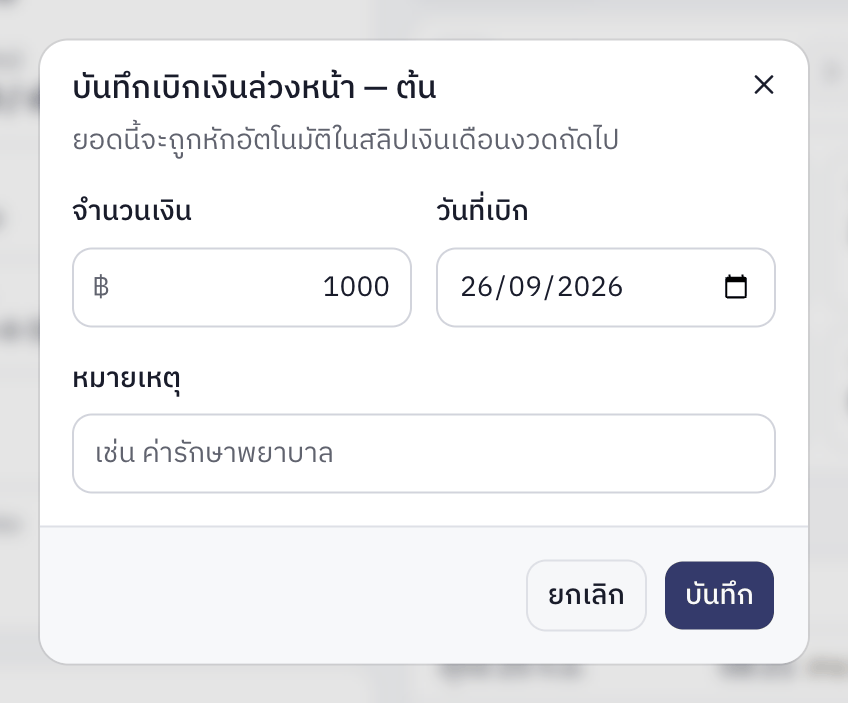

*ภาพ 12-4 หน้าต่างบันทึกเบิกเงินล่วงหน้า*

1. กด **บันทึกเบิกเงิน** (ที่หน้าพนักงาน หรือ ⋯ ในรายชื่อพนักงาน)
2. ใส่ **จำนวนเงิน**, **วันที่เบิก** และ **หมายเหตุ** (เช่น ค่ารักษาพยาบาล)
3. กด **บันทึก**

- เงินเบิกจะถูกหักอัตโนมัติในสลิปเงินเดือนงวดถัดไป คืองวดที่สร้างหลังจากบันทึกเบิก และวันสิ้นงวดตรงกับหรือหลังวันที่เบิก (สลิปที่ยังไม่จ่ายจะดึงเงินเบิกมาหักเมื่อกด **คำนวณใหม่**)
- ลบรายการเบิกได้ที่แท็บ **เบิกเงิน** ถ้ารายการนั้นอยู่ในสลิปที่ยังไม่จ่าย ยอดหักในสลิปจะปรับตามให้

## 13. ลงเวลาเข้า-ออกงาน และจัดการเวลาทำงาน

### 13.1 หน้าลงเวลา (สำหรับพนักงานทุกคน)

พนักงานลงเวลาได้โดย **ไม่ต้องเข้าสู่ระบบ** เปิดหน้าลงเวลาได้จาก

- ปุ่ม **ลงเวลาทำงาน** ที่หน้าเข้าสู่ระบบ
- ไอคอนนาฬิกาที่แถบด้านบน
- เมนูผู้ใช้ → **ลงเวลาเข้า-ออกงาน**

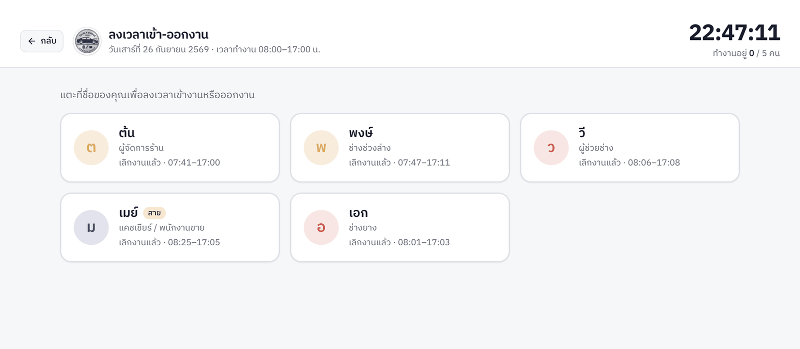

*ภาพ 13-1 หน้าลงเวลาเข้า-ออกงาน*

หน้านี้แสดงวันที่ เวลาทำงานของร้าน นาฬิกา และจำนวนคนที่ทำงานอยู่ การ์ดของแต่ละคนบอกสถานะ

- **ยังไม่ลงเวลาเข้างาน**
- **ทำงานอยู่ · เข้า 08:01** (มีจุดสีเขียว)
- **เลิกงานแล้ว · 08:01–17:03**
- **ลาป่วยวันนี้** (หรือประเภทลาอื่น) ถ้ามีวันลาบันทึกไว้
- ป้าย **สาย** ถ้าวันนี้เข้างานสาย และคำเตือน **ลืมลงเวลาออกเมื่อ …** ถ้ามีวันก่อนหน้าที่ยังไม่ได้ลงเวลาออก

**วิธีลงเวลา**

1. แตะที่ชื่อของตัวเอง
2. ตรวจชื่อและเวลา แล้วกดปุ่มใหญ่ **ลงเวลาเข้างาน** (สีเขียว) หรือ **ลงเวลาออกงาน**
3. ระบบแสดง "ลงเวลาเข้างานแล้ว" (ถ้าสายจะบอกว่าสายกี่นาที) หรือ "ลงเวลาออกงานแล้ว" (บอกว่าทำงานไปกี่ชั่วโมง) หน้าต่างจะปิดเองในไม่กี่วินาที
4. ถ้าแตะชื่อผิด กด **ไม่ใช่ชื่อของฉัน**
5. กด **กลับ** ที่มุมซ้ายบนเพื่อออกจากหน้าลงเวลา

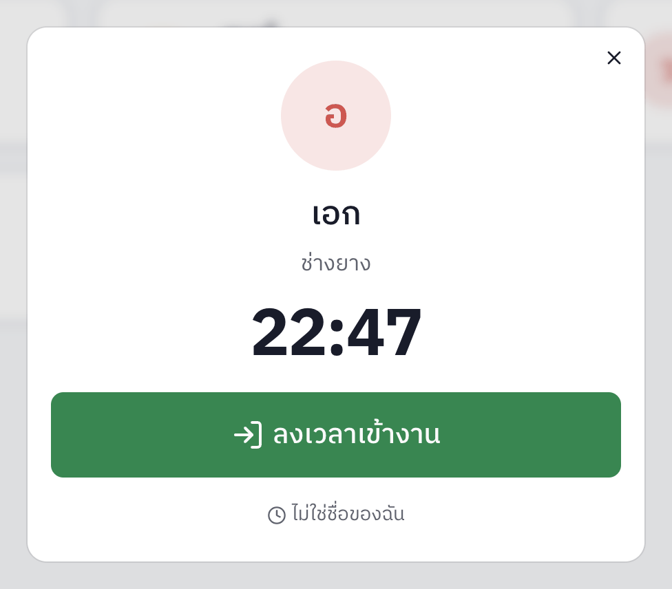

*ภาพ 13-2 หน้าต่างยืนยันการลงเวลาเข้างาน*

**กติกาที่ควรรู้**

- แตะซ้ำภายใน 1 นาทีไม่ได้ (กันการกดซ้ำโดยไม่ตั้งใจ) ระบบจะให้รอแล้วลองใหม่
- ออกไปธุระแล้วกลับมาทำงานต่อ ลงเวลาออกและเข้าได้หลายรอบในวันเดียว ชั่วโมงทำงานรวมทุกรอบ ส่วนการมาสายนับจากการเข้างานครั้งแรกของวัน
- ถ้าลืมลงเวลาออก และผ่านไปเกิน 16 ชั่วโมง การแตะครั้งต่อไปจะเป็นการเข้างานรอบใหม่ ผู้จัดการต้องแก้เวลาออกของวันที่ลืมให้ (หัวข้อ 13.3)
- หน้าลงเวลาไม่มีรหัส PIN ใครก็แตะแทนคนอื่นได้ แต่ทุกการลงเวลาถูกบันทึกไว้ และผู้จัดการตรวจและแก้ไขได้เสมอ
- พนักงานที่ลาออกแล้วจะไม่แสดงในหน้านี้

### 13.2 หน้าเวลาทำงาน (สำหรับผู้จัดการ)

กดเมนู **เวลาทำงาน** ต้องมีสิทธิ์ **จัดการเวลาทำงาน** หรือ **ข้อมูลพนักงานและเงินเดือน**

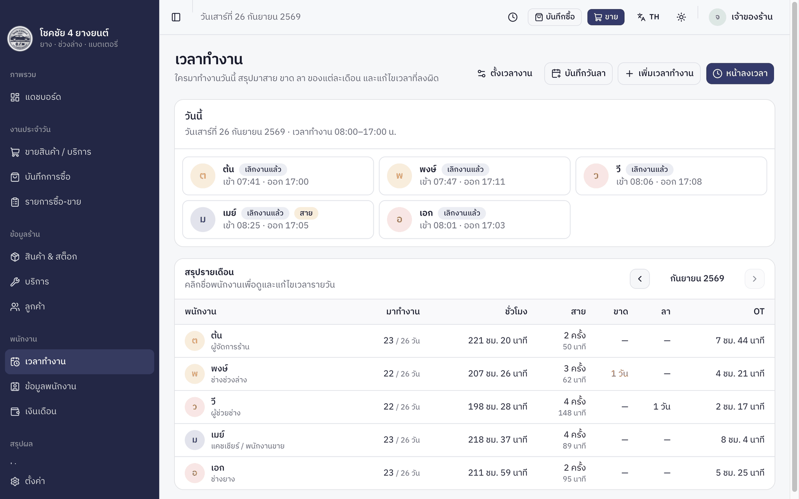

*ภาพ 13-3 หน้าเวลาทำงาน*

- **ปุ่มด้านบน** **ตั้งเวลางาน** (ไปหน้าตั้งค่าเวลางาน) **บันทึกวันลา**, **เพิ่มเวลาทำงาน** และ **หน้าลงเวลา**
- **แถบเตือนลืมลงเวลาออก** บอกชื่อพนักงานและวันที่ที่ยังไม่ได้ลงเวลาออก
- **วันนี้** การ์ดของแต่ละคน พร้อมสถานะ ทำงานอยู่ / เลิกงานแล้ว / ยังไม่มา ป้ายสาย และเวลาเข้า-ออก
- **สรุปรายเดือน** เลือกเดือนด้วยปุ่ม < > ตารางแสดงวันที่มาทำงานเทียบกับวันทำงาน ชั่วโมงรวม มาสาย (ครั้งและนาที) ขาดงาน ลา และ OT ของแต่ละคน สัญลักษณ์ ⚠ หลังชื่อหมายถึงมีวันที่ลืมลงเวลาออก

### 13.3 ดูและแก้ไขเวลารายวัน

กดที่ชื่อพนักงานในตารางสรุปรายเดือน จะเปิดหน้าต่างเวลาทำงานของเดือนนั้น

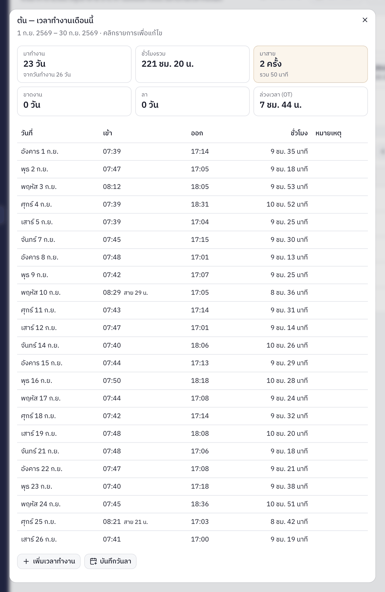

*ภาพ 13-4 เวลาทำงานรายวันของพนักงานในเดือนที่เลือก*

- ด้านบนเป็นตัวเลขสรุปของเดือน ด้านล่างเป็นรายการรายวัน: วันที่ เวลาเข้า (มีป้าย "สาย … น." ถ้าสาย) เวลาออก ชั่วโมง และหมายเหตุ รายการที่แก้ไขด้วยมือจะมีป้าย "แก้ไขโดย …"
- กดที่แถวเพื่อแก้ไขเวลา หรือกด **เพิ่มเวลาทำงาน** / **บันทึกวันลา** ที่ด้านล่าง

**เพิ่มหรือแก้ไขเวลาทำงาน** (ใช้เมื่อพนักงานลืมลงเวลา)

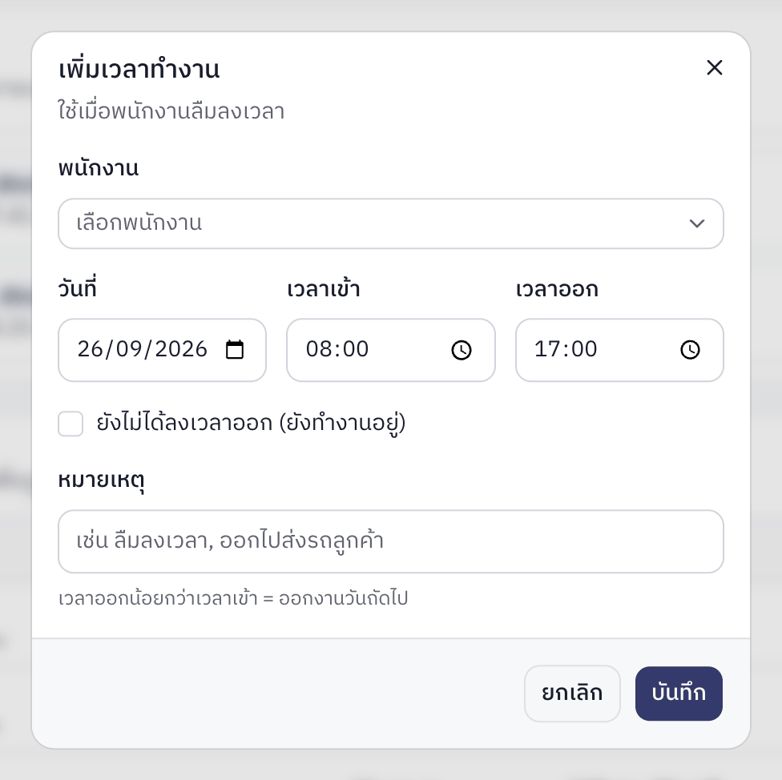

*ภาพ 13-5 หน้าต่างเพิ่มเวลาทำงาน*

1. เลือก **พนักงาน** และ **วันที่**
2. ใส่ **เวลาเข้า** และ **เวลาออก** ถ้าพนักงานยังทำงานอยู่ ให้ติ๊ก **ยังไม่ได้ลงเวลาออก (ยังทำงานอยู่)**
3. ใส่ **หมายเหตุ** เช่น "ลืมลงเวลา" หรือ "ออกไปส่งรถลูกค้า"
4. กด **บันทึก** (ถ้าเปิดรายการเดิม จะมีปุ่ม **ลบ** ด้วย)

- ถ้าเวลาออกน้อยกว่าเวลาเข้า ระบบถือว่าออกงานในวันถัดไป (เช่น ทำงานข้ามเที่ยงคืน)
- ช่วงเวลาที่ซ้อนกับเวลาที่บันทึกไว้แล้วจะบันทึกไม่ได้
- ทุกการแก้ไขถูกบันทึกในประวัติว่าใครแก้

### 13.4 บันทึกวันลา

กด **บันทึกวันลา**

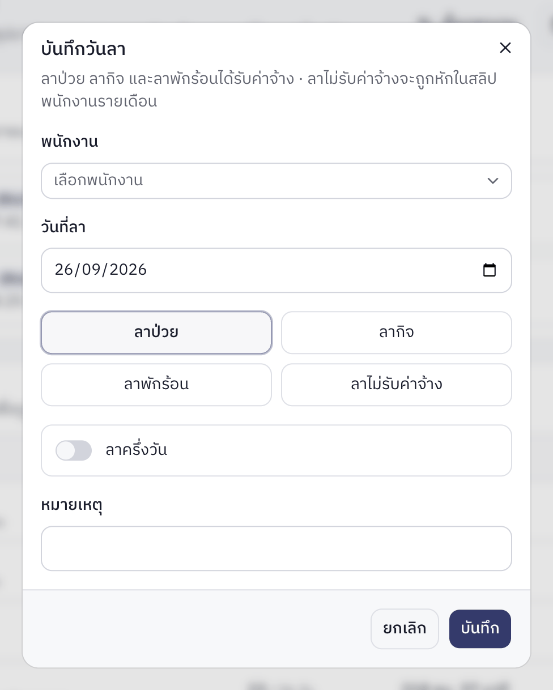

*ภาพ 13-6 หน้าต่างบันทึกวันลา*

1. เลือก **พนักงาน** และ **วันที่ลา**
2. เลือกประเภท **ลาป่วย**, **ลากิจ**, **ลาพักร้อน** หรือ **ลาไม่รับค่าจ้าง**
3. เปิด **ลาครึ่งวัน** ถ้าลาครึ่งวัน
4. ใส่หมายเหตุ แล้วกด **บันทึก**

- ลาป่วย ลากิจ และลาพักร้อน **ได้รับค่าจ้าง** ส่วนลาไม่รับค่าจ้างจะถูกหักในสลิปของพนักงานรายเดือน (พนักงานรายวันได้ค่าแรงเฉพาะวันที่มาทำงานอยู่แล้ว)
- บันทึกได้วันละ 1 รายการต่อคน ถ้าลาหลายวันให้บันทึกทีละวัน
- วันที่มีวันลาไม่นับเป็นวันขาดงาน

### 13.5 ระบบนับ มาสาย ขาดงาน และ OT อย่างไร

ระบบใช้ค่าที่ตั้งไว้ใน **ตั้งค่า → เวลางาน & เงินเดือน** (หัวข้อ 17.6)

- **วันทำงาน** คือวันในสัปดาห์ที่เลือกไว้ ยกเว้นวันหยุดร้านที่เพิ่มไว้
- **มาสาย** ถ้าการเข้างานครั้งแรกของวันทำงานช้ากว่า "เวลาเข้างาน + มาสายได้ไม่เกิน" จะนับนาทีสายตั้งแต่เวลาเข้างาน ตัวอย่าง เวลาเข้างาน 08:00 ผ่อนผัน 15 นาที: เข้า 08:14 ไม่สาย / เข้า 08:20 สาย 20 นาที
- **ขาดงาน** วันทำงานที่ผ่านมาแล้ว (ไม่รวมวันนี้) ในช่วงที่พนักงานยังทำงานอยู่ ซึ่งไม่มีการลงเวลาและไม่มีวันลา ลาครึ่งวันแล้วไม่มาทำงานเลย นับขาดครึ่งวัน
- **OT** เวลาที่ทำงานหลัง "เวลาเลิกงาน" ในวันทำงาน นับเมื่อรวมแล้วเกินอย่างน้อยตามที่ตั้งไว้ (ค่าเริ่มต้น 30 นาที)
- **ชั่วโมงทำงาน** รวมเวลาของทุกรอบที่ลงเวลาเข้า-ออก

## 14. เงินเดือน

สร้างงวดเงินเดือน ให้ระบบคำนวณสลิปจากค่าจ้าง เวลาทำงาน วันลา และเงินเบิก ตรวจแก้ แล้วบันทึกการจ่ายเงิน ต้องมีสิทธิ์ **ข้อมูลพนักงานและเงินเดือน**

### 14.1 หน้าเงินเดือน

กดเมนู **เงินเดือน**

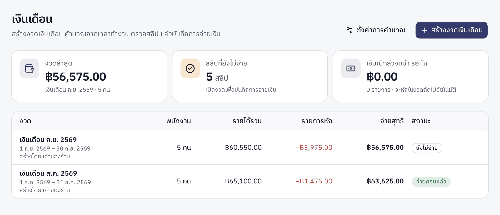

*ภาพ 14-1 หน้าเงินเดือน*

- **การ์ดสรุป** งวดล่าสุด (ยอดจ่ายสุทธิและจำนวนคน) สลิปที่ยังไม่จ่าย และเงินเบิกล่วงหน้าที่รอหัก
- **ตารางงวด** ชื่องวด ช่วงวันที่ ผู้สร้าง จำนวนพนักงาน รายได้รวม รายการหัก จ่ายสุทธิ และสถานะ (ยังไม่จ่าย / จ่ายแล้ว x/y / จ่ายครบแล้ว) กดที่งวดเพื่อเปิด
- ปุ่ม **ตั้งค่าการคำนวณ** และ **สร้างงวดเงินเดือน**

### 14.2 ขั้นตอนทำเงินเดือนแบบย่อ

1. ตรวจเวลาทำงานของเดือน แก้วันที่ลืมลงเวลาออก และบันทึกวันลาให้ครบ (บทที่ 13)
2. สร้างงวดเงินเดือน (หัวข้อ 14.3)
3. ตรวจสลิปของแต่ละคน เพิ่มโบนัสหรือรายการหักอื่น ๆ ถ้ามี (หัวข้อ 14.5)
4. โอนเงินหรือจ่ายเงินสดให้พนักงาน
5. บันทึกการจ่ายในโปรแกรม (หัวข้อ 14.6)
6. พิมพ์สลิปหรือบันทึกเป็น PDF ส่งให้พนักงาน (หัวข้อ 14.7)

### 14.3 สร้างงวดเงินเดือน

กด **สร้างงวดเงินเดือน**

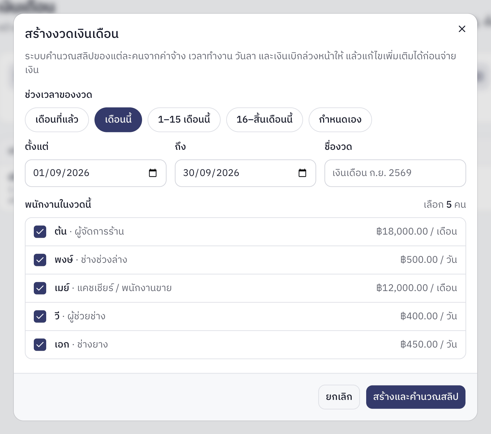

*ภาพ 14-2 หน้าต่างสร้างงวดเงินเดือน*

1. เลือก **ช่วงเวลาของงวด** เดือนที่แล้ว / เดือนนี้ / 1–15 เดือนนี้ / 16–สิ้นเดือนนี้ หรือ **กำหนดเอง** แล้วใส่วัน **ตั้งแต่** และ **ถึง**
2. **ชื่องวด** ระบบตั้งให้ เช่น "เงินเดือน ก.ย. 2569" แก้ได้
3. **พนักงานในงวดนี้** ติ๊กเลือกคนที่จะจ่าย (ระบบเลือกทุกคนที่ทำงานในช่วงนั้นไว้ให้) ถ้าพนักงานคนใดมีสลิปในงวดอื่นที่ช่วงวันซ้อนกันอยู่แล้ว จะมีคำเตือนและเลือกคนนั้นไม่ได้
4. กด **สร้างและคำนวณสลิป**

### 14.4 หน้างวดเงินเดือน

*ภาพ 14-3 หน้างวดเงินเดือนที่ยังไม่จ่าย*

- **การ์ดรวม** จำนวนพนักงาน รายได้รวม รายการหักรวม และจ่ายสุทธิรวม
- **ตาราง** พนักงาน (และบัญชีรับเงิน) วันที่มาทำงาน (พร้อมจำนวนวันขาดและครั้งที่สาย) รายได้ รายการหัก รับสุทธิ และสถานะ กดที่แถวเพื่อเปิดสลิป ปุ่ม ⋯ มีคำสั่ง **ดู / แก้ไขสลิป**, **พิมพ์สลิป**, **บันทึกจ่ายเงิน** และ **นำออกจากงวด**
- ปุ่ม **เพิ่มพนักงาน** เพิ่มคนที่ยังไม่อยู่ในงวด (ระบบคำนวณสลิปให้ทันที)
- ปุ่ม **จ่ายเงินทั้งหมด (… คน)** บันทึกจ่ายทุกสลิปที่ยังไม่จ่ายในครั้งเดียว
- ปุ่ม ⋯ มีคำสั่ง **แก้ไขชื่องวด / หมายเหตุ** และ **ลบงวดนี้**
- ช่วงวันที่ของงวดแก้ไม่ได้ ถ้าผิดให้ลบงวดแล้วสร้างใหม่ ลบงวดได้เฉพาะเมื่อยังไม่มีสลิปที่จ่ายแล้ว เมื่อลบ เงินเบิกที่หักไว้จะกลับไปรอหักในงวดถัดไป

### 14.5 ตรวจและแก้ไขสลิปเงินเดือน

กดที่ชื่อพนักงานในหน้างวด

*ภาพ 14-4 หน้าต่างสลิปเงินเดือน*

- ด้านบนเป็นสรุปเวลาทำงานของงวด (มาทำงาน ชั่วโมง สาย ขาด ลา OT)
- **รายได้** และ **รายการหัก** แต่ละบรรทัดมีป้าย **คำนวณอัตโนมัติ** หรือ **แก้ไขเอง**
  - แก้จำนวนเงินได้โดยพิมพ์ในช่อง บรรทัดนั้นจะเปลี่ยนเป็น "แก้ไขเอง"
  - **เพิ่มรายได้** เลือก โบนัส / เบี้ยขยัน, ค่าสวัสดิการ / ค่าเดินทาง, ค่าคอมมิชชัน, ค่าล่วงเวลา (OT) หรือ รายได้อื่น ๆ
  - **เพิ่มรายการหัก** เลือก รายการหักอื่น ๆ, หักมาสาย, หักขาดงาน หรือ หักประกันสังคม
  - กดไอคอนถังขยะเพื่อลบบรรทัด
- **รับสุทธิ** = รายได้ − รายการหัก และบัญชีที่ต้องโอนเข้า ถ้ายอดหักมากกว่ารายได้จะมีคำเตือน
- **หมายเหตุในสลิป** ข้อความที่จะพิมพ์ในสลิป
- ปุ่มด้านล่าง
  - **คำนวณใหม่** อ่านเวลาทำงาน วันลา และเงินเบิกล่าสุด แล้วคำนวณรายการอัตโนมัติใหม่ (รายการที่แก้ไขเองจะคงไว้) ใช้หลังแก้เวลาทำงานหรือบันทึกวันลาเพิ่ม
  - **บันทึกสลิป** / **ยกเลิกการแก้ไข** (แสดงเมื่อมีการแก้ไข)
  - **พิมพ์สลิป** และ **บันทึกจ่ายเงิน**

> **หมายเหตุ:** ระบบไม่คำนวณภาษีเงินได้หัก ณ ที่จ่าย (ภ.ง.ด.1) ถ้าต้องหัก ให้เพิ่มเป็น **รายการหักอื่น ๆ** แล้วแก้ชื่อรายการเป็น "ภาษีหัก ณ ที่จ่าย"

### 14.6 บันทึกการจ่ายเงินเดือน

*ภาพ 14-5 หน้าต่างบันทึกจ่ายเงินเดือน*

1. กด **บันทึกจ่ายเงิน** ในสลิป (จ่ายทีละคน) หรือ **จ่ายเงินทั้งหมด** ในหน้างวด
2. ตรวจ **ยอดจ่ายรวม** เลือกจ่ายโดย **โอนเงิน** หรือ **เงินสด** และ **วันเวลาที่จ่าย**
3. กด **ยืนยันจ่ายแล้ว**

- สลิปที่จ่ายแล้วแก้ไขไม่ได้ ถ้าต้องแก้ ให้เปิดสลิปแล้วกด **ยกเลิกการจ่าย** สลิปจะกลับเป็น "ยังไม่จ่าย" (การจ่ายและการยกเลิกถูกบันทึกในประวัติ)
- เงินเบิกล่วงหน้าที่อยู่ในสลิป จะถือว่า "หักแล้ว" เมื่อสลิปนั้นจ่ายแล้ว

### 14.7 พิมพ์สลิปเงินเดือน

กด **พิมพ์สลิป** ในสลิป หรือ ⋯ → **พิมพ์สลิป** ในหน้างวด

*ภาพ 14-6 หน้าต่างพิมพ์สลิปเงินเดือน พร้อมตัวอย่าง*

- เลือกขนาดกระดาษ 80 มม. / 58 มม. / A5 / A4 และเครื่องพิมพ์
- กด **พิมพ์** หรือ **บันทึกเป็น PDF** เพื่อส่งให้พนักงาน
- สลิปแสดงรายได้ รายการหัก รับสุทธิ (พร้อมจำนวนเงินเป็นตัวหนังสือ) บัญชีรับเงิน และสรุปเวลาทำงาน ภาษาของสลิปตาม **ตั้งค่า → การพิมพ์ → ภาษาในเอกสาร**

### 14.8 วิธีคำนวณรายการอัตโนมัติในสลิป

| รายการ | วิธีคิด |
|---|---|
| เงินเดือน (พนักงานรายเดือน) | ได้เต็มเดือนเมื่อทำงานตลอดงวด ถ้าเริ่มงานหรือลาออกกลางงวด คิดตามจำนวนวันตามปฏิทินที่ทำงาน (แสดงเป็น "เงินเดือน (ตามวันที่ทำงาน)") |
| ค่าแรงรายวัน (พนักงานรายวัน) | จำนวนวันที่มาทำงาน × ค่าแรงต่อวัน |
| วันลาที่ได้รับค่าจ้าง (พนักงานรายวัน) | จำนวนวันลาป่วย ลากิจ ลาพักร้อน × ค่าแรงต่อวัน |
| ค่าล่วงเวลา (OT) | เมื่อเปิด "คิดค่าล่วงเวลา (OT) อัตโนมัติ": ชั่วโมง OT × ค่าแรงต่อชั่วโมง × อัตรา OT (เช่น 1.5 เท่า) |
| หักมาสาย | ตามที่ตั้งไว้: ไม่หัก / นาทีที่สาย × (ค่าแรงต่อชั่วโมง ÷ 60) / จำนวนวันที่สาย × จำนวนเงินต่อครั้ง |
| หักขาดงาน (พนักงานรายเดือน) | เมื่อเปิด "หักเงินวันขาดงาน": จำนวนวันขาด × ค่าแรงต่อวัน |
| หักลาไม่รับค่าจ้าง (พนักงานรายเดือน) | จำนวนวันลาไม่รับค่าจ้าง × ค่าแรงต่อวัน |
| หักประกันสังคม | เฉพาะพนักงานที่เปิด "หักประกันสังคม": อัตรา (ค่าเริ่มต้น 5%) × ค่าจ้างที่ระบบคำนวณ (เงินเดือนหรือค่าแรง วันลาที่ได้รับค่าจ้าง และ OT) หลังหักสาย ขาด และลาไม่รับค่าจ้าง โดยใช้ฐานค่าจ้างไม่ต่ำกว่า 1,650 และไม่เกิน 17,500 บาท แล้วปัดเป็นบาทเต็ม (ตั้งแต่ 50 สตางค์ปัดขึ้น) จึงหักสูงสุด 875 บาทต่อเดือน |
| หักเงินเบิกล่วงหน้า | รวมเงินเบิกที่ยังไม่ถูกหัก ซึ่งวันที่เบิกไม่เกินวันสิ้นงวด |

- **ค่าแรงต่อวัน** ของพนักงานรายเดือน = เงินเดือน ÷ "วันต่อเดือน" (ค่าเริ่มต้น 30 วัน)
- **ค่าแรงต่อชั่วโมง** = ค่าแรงต่อวัน ÷ "ชั่วโมงทำงานต่อวัน" (ค่าเริ่มต้น 8 ชั่วโมง)

**ตัวอย่าง** พนักงานรายเดือน เงินเดือน 12,000 บาท (ค่าแรงต่อวัน 400 บาท ต่อชั่วโมง 50 บาท) หักประกันสังคม ในเดือนนั้นขาดงาน 1 วัน และทำ OT 2 ชั่วโมง (เปิด OT อัตรา 1.5 เท่า)

| รายการ | จำนวนเงิน |
|---|---|
| เงินเดือน | 12,000.00 |
| ค่าล่วงเวลา (OT) ×1.5 : 2 ชม. × 50 × 1.5 | 150.00 |
| หักขาดงาน : 1 วัน × 400 | −400.00 |
| หักประกันสังคม 5% : (12,000 + 150 − 400) × 5% = 587.50 ปัดเป็น 588 | −588.00 |
| **รับสุทธิ** | **11,162.00** |

> **ข้อควรระวัง:** อัตราเงินสมทบและฐานค่าจ้างประกันสังคมอาจเปลี่ยนตามประกาศของสำนักงานประกันสังคม ให้ตรวจสอบอัตราล่าสุด แล้วแก้ไขที่ **ตั้งค่า → เวลางาน & เงินเดือน**

## 15. รายงาน

สรุปรายรับ รายจ่าย กำไร และสินค้าขายดีตามช่วงเวลาที่เลือก ต้องมีสิทธิ์ **ดูยอดขายและรายงาน**

*ภาพ 15-1 หน้ารายงาน (ช่วงเวลา: เดือนนี้)*

### 15.1 เลือกช่วงเวลา

ปุ่มด้านบนเลือกได้ **วันนี้ / เมื่อวาน / 7 วันล่าสุด / 30 วันล่าสุด / เดือนนี้** (ค่าเริ่มต้น) **/ เดือนก่อน / ปีนี้** หรือ **กำหนดเอง** แล้วเลือกวันเริ่มต้นและวันสิ้นสุดจากปฏิทิน ด้านขวาแสดงช่วงวันที่และจำนวนวันที่กำลังดู

### 15.2 ตัวเลขสรุป

| การ์ด | ความหมาย |
|---|---|
| รายรับ (ยอดขาย) | ยอดบิลขายในช่วงนี้ จำนวนบิล และยอด VAT (ถ้ามี) |
| รายจ่าย (ซื้อเข้า) | ยอดบิลซื้อในช่วงนี้ |
| สุทธิ | รายรับ − รายจ่าย |
| กำไรขั้นต้น | ยอดขาย (ไม่รวม VAT) − ต้นทุนสินค้าที่ขาย และอัตรากำไร |
| จำนวนบิล | จำนวนบิลขาย บิลซื้อ บิลที่ยกเลิก และยอดเฉลี่ยต่อบิลขาย |
| ค้างชำระ (ขายเชื่อ) | ยอดบิลขายในช่วงนี้ที่ยังไม่ได้รับเงิน และยอดค้างจ่ายผู้ขาย |

ป้ายเปอร์เซ็นต์สีเขียว / แดงใต้ตัวเลข เปรียบเทียบกับช่วงก่อนหน้าที่ยาวเท่ากัน (เช่น ดูเดือนนี้ จะเทียบกับเดือนก่อนหน้า)

### 15.3 กราฟและตาราง

- **ยอดขาย-ซื้อรายวัน** แท่งซ้าย (เขียว) คือขาย แท่งขวา (แดง) คือซื้อ ชี้ที่แท่งเพื่อดูยอด ถ้าเลือก "ปีนี้" จะแสดงเป็นรายเดือน
- **สรุปรายวัน / รายเดือน** ตารางจำนวนบิลขาย ยอดขาย ยอดซื้อ และสุทธิของแต่ละวัน พร้อมแถวรวม กดที่วันที่เพื่อดูรายละเอียดของวันนั้น (เมื่อเลือกดูวันเดียว หน้ารายงานจะแสดงรายการบิลของวันนั้นด้วย)
- **ขายดี 10 อันดับ** แท็บ **สินค้าขายดี** และ **บริการยอดนิยม** เรียงตามยอดขาย พร้อมจำนวนที่ขายและจำนวนบิล
- **ซื้อเข้ามากที่สุด** รายการที่ใช้เงินซื้อมากที่สุดในช่วงนี้
- **รับเงินตามวิธีชำระ** เงินที่ได้รับจริงในช่วงนี้ แยกเงินสด โอนเงิน บัตร (นับตามวันที่รับเงิน) และยอดที่ยังค้างชำระ
- **ยอดขายตามผู้บันทึกบิล** ยอดขายของแต่ละผู้ใช้ที่เปิดบิล ใช้ดูผลงานการขายของพนักงาน
- **สัดส่วนรายได้ สินค้า / บริการ** เปรียบเทียบรายได้จากสินค้ากับรายได้จากบริการ (ก่อนหักส่วนลดท้ายบิล)

> **หมายเหตุ:** รายรับและรายจ่ายนับตามวันที่ในบิล รวมบิลที่ยังค้างชำระ และไม่รวมบิลที่ยกเลิก ส่วน "รับเงินตามวิธีชำระ" นับตามวันที่ได้รับเงินจริง กำไรขั้นต้นยังไม่ได้หักค่าใช้จ่ายอื่นของร้าน เช่น เงินเดือนพนักงาน ค่าเช่า ค่าไฟ

## 16. ประวัติการแก้ไข

ดูว่าใครทำอะไรในโปรแกรม เมื่อไหร่ ต้องมีสิทธิ์ **ดูประวัติการแก้ไข** กดเมนู **ประวัติการแก้ไข**

*ภาพ 16-1 หน้าประวัติการแก้ไข*

- **ค้นหา** จากเลขที่บิล ชื่อสินค้า ชื่อลูกค้า หรือชื่อผู้ใช้
- **ตัวกรอง** ประเภทข้อมูล (เช่น บิล สินค้า ลูกค้า พนักงาน การตั้งค่า) ผู้ใช้ และช่วงเวลา **วันนี้ / 7 วันล่าสุด / 30 วันล่าสุด / ทั้งหมด**
- แต่ละรายการบอกว่า **ใคร** ทำ **อะไร** (เช่น เปิดบิล แก้ไขบิล ยกเลิกบิล บันทึกการชำระเงิน เพิ่ม/แก้ไข/ลบข้อมูล ปรับสต็อก จ่ายเงินเดือน เข้าสู่ระบบ ใส่รหัสผ่านผิด แก้ไขการตั้งค่า สำรองข้อมูล กู้คืนข้อมูล) **เปลี่ยนจากอะไรเป็นอะไร** และ **เมื่อไหร่**
- ประวัติลบหรือแก้ไขไม่ได้ ใช้ตรวจสอบย้อนหลังได้เสมอ
- ประวัติเฉพาะเรื่องยังดูได้ที่ท้ายหน้าบิล หน้าสินค้า หน้าลูกค้า หน้าพนักงาน และหน้างวดเงินเดือน
- ผู้ใช้ที่ไม่มีสิทธิ์ข้อมูลพนักงานและเงินเดือน จะไม่เห็นประวัติเรื่องพนักงาน เงินเบิก และเงินเดือน และถ้าไม่มีสิทธิ์จัดการเวลาทำงานด้วย จะไม่เห็นประวัติเวลาทำงานและวันลา

## 17. ตั้งค่า

กดเมนู **ตั้งค่า** ที่ด้านล่างของแถบเมนู หน้าตั้งค่าแบ่งเป็นหัวข้อทางซ้าย แต่ละผู้ใช้เห็นเฉพาะหัวข้อที่มีสิทธิ์

| หัวข้อ | ใครเห็น |
|---|---|
| ข้อมูลร้าน, ภาษี (VAT), เลขที่เอกสาร, การพิมพ์, สต็อก, สำรองข้อมูล | ผู้มีสิทธิ์ **ตั้งค่าร้าน** |
| เวลางาน & เงินเดือน | ผู้มีสิทธิ์ **ข้อมูลพนักงานและเงินเดือน** |
| ผู้ใช้งาน | เจ้าของร้านเท่านั้น |
| การแสดงผล, เกี่ยวกับโปรแกรม | ทุกคน |

แต่ละหัวข้อมีปุ่ม **บันทึก** ของตัวเอง ถ้าแก้ไขแล้วยังไม่ได้บันทึก จะมีจุดสีเหลืองที่ชื่อหัวข้อ และข้อความ "มีการแก้ไขที่ยังไม่บันทึก" กด **ยกเลิกการแก้ไข** เพื่อกลับไปค่าเดิม

### 17.1 ข้อมูลร้าน

*ภาพ 17-1 ตั้งค่า → ข้อมูลร้าน*

- **ชื่อร้าน** (ต้องกรอก) **สาขา** (เว้นว่างได้ถ้ามีร้านเดียว) **ที่อยู่** **เบอร์โทร** **LINE** และ **เลขประจำตัวผู้เสียภาษี** (13 หลัก ใส่เมื่อต้องการให้แสดงบนใบเสร็จ / ใบกำกับภาษี)
- **ข้อความท้ายใบเสร็จ** เช่น คำขอบคุณ เงื่อนไขการรับประกัน หรือเลขบัญชีสำหรับโอนเงิน
- **โลโก้บนใบเสร็จ** กด **อัปโหลดรูปโลโก้…** เพื่อเลือกไฟล์ PNG หรือ JPG (ระบบย่อขนาดให้อัตโนมัติ รูปพื้นหลังโปร่งใสหรือพื้นขาวพิมพ์ออกมาสวยที่สุด) กด **ใช้โลโก้ของร้าน (ค่าเริ่มต้น)** เพื่อใช้โลโก้โชคชัย 4 ยางยนต์ หรือ **ลบโลโก้**
- ด้านขวามี **ตัวอย่างบนใบเสร็จ** ให้ดูก่อนบันทึก

### 17.2 ภาษี (VAT)

*ภาพ 17-2 ตั้งค่า → ภาษี (VAT)*

- **ร้านจดทะเบียนภาษีมูลค่าเพิ่ม (VAT)** เปิดเมื่อร้านจด VAT แล้วเท่านั้น ถ้ายังไม่ได้จด บิลขายทั้งหมดจะไม่มี VAT
- **อัตราภาษี** ปกติ 7%
- **ค่าเริ่มต้นของบิลขายใหม่** ไม่มี VAT / ราคารวม VAT แล้ว (ลูกค้าจ่ายเท่าราคาป้าย) / ราคายังไม่รวม VAT (บวกภาษีเพิ่มตอนคิดเงิน) มีตัวอย่างการคำนวณให้ดู ตอนขายยังเปลี่ยนได้ทุกบิล
- **ค่าเริ่มต้นของบิลซื้อใหม่** ตั้งตามใบกำกับภาษีที่ผู้ขายส่วนใหญ่ออกให้ ตอนบันทึกซื้อยังเปลี่ยนได้ทุกบิล

### 17.3 เลขที่เอกสาร

*ภาพ 17-3 ตั้งค่า → เลขที่เอกสาร*

เลขที่บิลมีรูปแบบ **คำนำหน้า + ปี 2 หลัก + เดือน 2 หลัก + "-" + ลำดับ 4 หลัก** เช่น **S6909-0057** คือบิลขาย ปี (25)69 เดือน 09 ลำดับที่ 57 ของเดือน

- **คำนำหน้าบิลขาย** (ค่าเริ่มต้น S) และ **คำนำหน้าบิลซื้อ** (ค่าเริ่มต้น P) ใช้ได้เฉพาะตัวอักษรภาษาอังกฤษ ตัวเลข และขีด (-) ยาวไม่เกิน 10 ตัว
- **ใช้ปี พ.ศ. ในเลขที่เอกสาร** เปิด = ใช้ 2 หลักท้ายของปี พ.ศ. ปิด = ใช้ปี ค.ศ.
- **ตัวอย่างเลขที่เอกสารถัดไป** แสดงเลขที่บิลขายและบิลซื้อใบต่อไป
- เลขลำดับเริ่มนับ 0001 ใหม่ทุกเดือน การเปลี่ยนรูปแบบมีผลกับบิลใหม่เท่านั้น บิลเก่ายังใช้เลขเดิม

### 17.4 การพิมพ์

*ภาพ 17-4 ตั้งค่า → การพิมพ์*

- **ขนาดกระดาษเริ่มต้น** ใบเสร็จความร้อน 80 มม. / 58 มม. / A4 / A5
- **เครื่องพิมพ์** เลือกเครื่องที่ใช้ หรือ "เครื่องพิมพ์หลักของระบบ" กดปุ่มหมุนเพื่อค้นหาเครื่องพิมพ์ใหม่
- **จำนวนสำเนา** พิมพ์ครั้งละกี่ใบ (1–10)
- **ภาษาในเอกสาร** ภาษาของใบเสร็จ ใบแจ้งหนี้ ใบบันทึกการซื้อ และสลิปเงินเดือน (แยกจากภาษาของโปรแกรม)
- **พิมพ์ทันทีโดยไม่ถาม** ส่งไปที่เครื่องพิมพ์ที่เลือกไว้ได้เลย โดยไม่เปิดหน้าต่างเลือกเครื่องพิมพ์ของระบบ
- **แสดงโลโก้บนใบเสร็จ** พิมพ์โลโก้ร้านไว้ที่หัวเอกสาร
- **เปิดหน้าพิมพ์อัตโนมัติหลังบันทึกการขาย** บันทึกบิลขายแล้วเปิดหน้าตัวอย่างก่อนพิมพ์ทันที
- **พิมพ์ชื่อผู้ออกบิลบนใบเสร็จ** แสดง "ผู้ออกบิล: ชื่อผู้ใช้" บนใบเสร็จ ใบแจ้งหนี้ และใบบันทึกการซื้อ

### 17.5 สต็อก

*ภาพ 17-5 ตั้งค่า → สต็อก*

- **อนุญาตให้ขายเกินสต็อก** (ค่าเริ่มต้น: เปิด) ขายได้แม้จำนวนในสต็อกไม่พอ สต็อกจะติดลบและมีคำเตือน เหมาะกับร้านที่รับของเข้าแล้วแต่ยังไม่ได้บันทึกการซื้อ ถ้าปิด จะต้องบันทึกการซื้อหรือปรับสต็อกก่อนจึงจะขายได้
- **อัปเดตราคาทุนตามราคาซื้อล่าสุด** (ค่าเริ่มต้น: เปิด) เมื่อบันทึกการซื้อ ราคาทุนของสินค้าจะเปลี่ยนเป็นราคาที่ซื้อครั้งล่าสุด ใช้คำนวณกำไรในรายงาน ถ้าปิด ราคาทุนจะเปลี่ยนเฉพาะเมื่อแก้ไขที่หน้าสินค้า

### 17.6 เวลางาน & เงินเดือน

*ภาพ 17-6 ตั้งค่า → เวลางาน & เงินเดือน*

การตั้งค่านี้ใช้ตัดสินการมาสาย ขาดงาน OT และคำนวณสลิปเงินเดือน แก้แล้วมีผลกับการคำนวณครั้งถัดไป (สลิปที่สร้างไว้แล้วต้องกด **คำนวณใหม่**)

| การตั้งค่า | ค่าเริ่มต้น | คำอธิบาย |
|---|---|---|
| เวลาเข้างาน / เวลาเลิกงาน | 08:00 / 17:00 | เวลาทำงานปกติของร้าน |
| มาสายได้ไม่เกิน | 15 นาที | เข้างานหลังเวลาเข้างานเกินกว่านี้นับว่าสาย (นับนาทีสายตั้งแต่เวลาเข้างาน) |
| วันทำงาน | จันทร์–เสาร์ | วันที่ไม่ได้เลือกเป็นวันหยุดประจำสัปดาห์ (ไม่นับขาดงาน) |
| วันหยุดร้าน (นักขัตฤกษ์ / หยุดพิเศษ) | ไม่มี | เลือกวันที่แล้วกด **เพิ่มวันหยุด** วันหยุดไม่นับเป็นวันขาดงาน |
| ชั่วโมงทำงานต่อวัน | 8 ชั่วโมง | ใช้คิดค่าแรงต่อชั่วโมง (OT / หักสาย) |
| วันต่อเดือน (พนักงานรายเดือน) | 30 วัน | ค่าแรงต่อวัน = เงินเดือน ÷ จำนวนนี้ (ใช้หักขาดงาน / ลาไม่รับค่าจ้าง) |
| การหักเงินเมื่อมาสาย | ไม่หักเงิน | ไม่หักเงิน / หักตามนาทีที่สาย / หักครั้งละเท่ากัน (ใส่จำนวนเงินต่อครั้ง) |
| หักเงินวันขาดงาน (พนักงานรายเดือน) | เปิด | วันทำงานที่ไม่มีการลงเวลาและไม่มีวันลา จะถูกหักตามค่าแรงต่อวัน |
| คิดค่าล่วงเวลา (OT) อัตโนมัติ | ปิด | เปิดแล้วกำหนด **อัตรา** (ค่าเริ่มต้น 1.5 เท่าของค่าแรงต่อชั่วโมง) และ **นับเมื่อเกินอย่างน้อย** (ค่าเริ่มต้น 30 นาที) ถ้าปิดไว้ ยังเพิ่ม OT เองในสลิปได้ |
| ประกันสังคม (ส่วนของลูกจ้าง) | 5% ฐาน 1,650–17,500 บาท | อัตราเงินสมทบ ฐานค่าจ้างต่ำสุด และสูงสุด หักเฉพาะพนักงานที่เปิด "หักประกันสังคม" |

### 17.7 ผู้ใช้งาน

เฉพาะเจ้าของร้าน ใช้เพิ่มบัญชีให้พนักงาน เลือกสิทธิ์ ตั้งรหัสผ่านใหม่ ล็อกหน้าจออัตโนมัติ และออกรหัสกู้คืน อ่านรายละเอียดในบทที่ 18

### 17.8 สำรองข้อมูล

สำรองข้อมูลตอนนี้ ตั้งค่าสำรองอัตโนมัติ ดูไฟล์สำรอง และกู้คืนข้อมูล อ่านรายละเอียดในบทที่ 19

### 17.9 การแสดงผล

*ภาพ 17-7 ตั้งค่า → การแสดงผล*

- **ภาษา** ไทย หรือ English (เฉพาะเครื่องนี้ เปลี่ยนแล้วหน้าจอจะโหลดใหม่)
- **ธีมสี** สว่าง (พื้นขาว อ่านง่ายในที่สว่าง) / มืด (ถนอมสายตาในที่แสงน้อย) / ตามระบบ (เปลี่ยนตามการตั้งค่าของเครื่อง) เลือกแล้วเปลี่ยนทันที ไม่ต้องกดบันทึก
- **ขนาดตัวอักษร / ขยายหน้าจอ** ปุ่มลัดสำหรับขยาย ย่อ และกลับขนาดปกติ

### 17.10 เกี่ยวกับโปรแกรม

*ภาพ 17-8 ตั้งค่า → เกี่ยวกับโปรแกรม*

แสดงชื่อโปรแกรม เวอร์ชัน ระบบปฏิบัติการ เวลาที่สำรองอัตโนมัติล่าสุด ตำแหน่งข้อมูล และไฟล์ฐานข้อมูล ปุ่ม **เปิดโฟลเดอร์ข้อมูล** เปิดโฟลเดอร์ที่เก็บข้อมูลของร้าน (เฉพาะผู้มีสิทธิ์ตั้งค่าร้าน) และมีทางลัดไปจัดการหมวดหมู่สินค้าและรายการบริการ

## 18. ผู้ใช้งานและสิทธิ์การใช้งาน

### 18.1 เจ้าของร้านกับพนักงานต่างกันอย่างไร

| ระดับผู้ใช้ | ทำอะไรได้ |
|---|---|
| **เจ้าของร้าน** | ทำได้ทุกอย่าง รวมถึงจัดการผู้ใช้งาน ดูและจ่ายเงินเดือน กู้คืนข้อมูล และออกรหัสกู้คืน |
| **พนักงาน** | งานพื้นฐานที่ทุกคนทำได้ บวกกับสิทธิ์ที่เจ้าของร้านติ๊กให้ทีละคน |

**งานพื้นฐานที่ผู้ใช้ทุกคนทำได้** ขายสินค้าและบริการ ดูบิลทั้งหมด ดูสินค้า บริการ และลูกค้า เพิ่มลูกค้าใหม่ รับชำระบิลขายที่ค้าง และพิมพ์เอกสาร

### 18.2 เพิ่มผู้ใช้งาน

ไปที่ **ตั้งค่า → ผู้ใช้งาน** (หรือเมนูผู้ใช้ → **จัดการผู้ใช้งาน**)

*ภาพ 18-1 ตั้งค่า → ผู้ใช้งาน*

รายชื่อผู้ใช้แสดงระดับผู้ใช้ ป้าย "คุณ" (บัญชีที่เข้าสู่ระบบอยู่) ป้าย "ไม่ใช้รหัสผ่าน" หรือ "ปิดใช้งาน" สิทธิ์ที่มี พนักงานที่ผูกไว้ และเวลาเข้าใช้ล่าสุด

กดปุ่ม **เพิ่มผู้ใช้**

*ภาพ 18-2 ฟอร์มเพิ่มผู้ใช้งาน และการเลือกสิทธิ์*

1. **ชื่อที่แสดง** ชื่อที่จะแสดงที่หน้าเข้าสู่ระบบและบนบิล (ห้ามซ้ำกับผู้ใช้อื่น)
2. **เป็นพนักงานคนไหน** (ไม่บังคับ) ผูกบัญชีกับข้อมูลพนักงาน พนักงานหนึ่งคนมีได้หนึ่งบัญชี
3. **ระดับผู้ใช้** พนักงาน หรือ เจ้าของร้าน
4. **สิทธิ์ของพนักงานคนนี้** ติ๊กเลือกสิทธิ์ที่ต้องการ (ดูตารางในหัวข้อ 18.6) ค่าเริ่มต้นของพนักงานใหม่คือ บันทึกการซื้อ แก้ไขบิล และแก้ไข/ลบลูกค้า
5. **ใช้รหัสผ่าน / PIN** เปิด แล้วตั้งรหัสอย่างน้อย 4 ตัว (แจ้งรหัสให้พนักงาน แล้วให้เปลี่ยนเองภายหลังได้) หรือปิด เพื่อให้แตะชื่อที่หน้าเข้าสู่ระบบแล้วเข้าได้เลย
6. กด **เพิ่มผู้ใช้**

### 18.3 แก้ไขผู้ใช้ ตั้งรหัสผ่านใหม่ ปิดใช้งาน และลบ

กด ⋯ ท้ายชื่อผู้ใช้

- **แก้ไขชื่อ / สิทธิ์** เปลี่ยนชื่อ พนักงานที่ผูก ระดับผู้ใช้ สิทธิ์ และสวิตช์ **เปิดใช้งาน** (ปิดเมื่อพนักงานลาออก บัญชีจะเข้าสู่ระบบไม่ได้ แต่บิลและประวัติเดิมยังแสดงชื่อนี้)
- **ตั้งรหัสผ่านใหม่ / ไม่ใช้รหัส** ใช้เมื่อพนักงานลืมรหัส เลือก **ตั้งรหัสผ่านใหม่** แล้วใส่รหัสใหม่ หรือเลือก **ไม่ใช้รหัสผ่าน** ให้แตะชื่อเข้าได้เลย
- **ลบผู้ใช้** ผู้ใช้นั้นจะเข้าสู่ระบบไม่ได้อีก บิลและประวัติที่เคยทำไว้ยังแสดงชื่อนี้เหมือนเดิม

กฎที่ระบบบังคับ

- ต้องมีเจ้าของร้านที่เปิดใช้งานอยู่อย่างน้อย 1 คนเสมอ
- เปลี่ยนระดับ ปิดใช้งาน หรือลบบัญชีของตัวเองไม่ได้

### 18.4 ล็อกหน้าจออัตโนมัติ

ในหน้า **ตั้งค่า → ผู้ใช้งาน** มีการ์ด **ล็อกหน้าจออัตโนมัติ** เลือก **ออกจากระบบเมื่อไม่ได้ใช้งาน** หลังจาก 5 / 10 / 15 / 30 / 60 นาที หรือ **ไม่ล็อกอัตโนมัติ** แล้วกด **บันทึก** ช่วยกันคนอื่นใช้ชื่อของคุณเปิดบิลเมื่อลืมออกจากระบบ ถ้ากำลังเปิดบิลที่ยังไม่บันทึก ระบบจะยังไม่ล็อก

### 18.5 รหัสกู้คืนของเจ้าของร้าน

การ์ด **รหัสกู้คืนของเจ้าของร้าน** ใช้เมื่อรหัสกู้คืนเดิมหายหรืออาจรั่วไหล กด **ออกรหัสกู้คืนใหม่** แล้วยืนยัน ระบบจะแสดงรหัสใหม่ครั้งเดียว ให้จดเก็บไว้ รหัสเดิมจะใช้ไม่ได้ทันที

### 18.6 ตารางสิทธิ์

| สิทธิ์ | ทำอะไรได้ |
|---|---|
| **บันทึกการซื้อ** | เปิดบิลซื้อสินค้าเข้าร้าน และบันทึกจ่ายเงินบิลซื้อ (การแก้ไขหรือยกเลิกบิลซื้อต้องมีสิทธิ์นี้ร่วมด้วย) |
| **แก้ไขบิล** | แก้ไขรายการ ราคา และลูกค้า ในบิลที่บันทึกแล้ว |
| **ยกเลิกบิล** | ยกเลิกบิลขาย / บิลซื้อ (คืนสต็อก ไม่นับยอด) |
| **แก้ไข/ลบลูกค้า** | แก้ไขหรือลบข้อมูลลูกค้า (เพิ่มลูกค้าใหม่ทำได้ทุกคน) |
| **จัดการสินค้าและบริการ** | เพิ่ม แก้ไข ลบ สินค้า บริการ หมวดหมู่ และเปลี่ยนราคา |
| **ปรับยอดสต็อก** | แก้จำนวนสินค้าคงเหลือหลังนับสต็อก |
| **ดูยอดขายและรายงาน** | ตัวเลขในแดชบอร์ด ยอดรวม กำไร รับเงินวันนี้ และหน้ารายงาน |
| **ดูประวัติการแก้ไข** | ดูว่าใครแก้ไขอะไร เมื่อไหร่ และประวัติราคา |
| **จัดการเวลาทำงาน** | ดูตารางเวลาทุกคน แก้ไขเวลาเข้า-ออก และบันทึกวันลา |
| **ข้อมูลพนักงานและเงินเดือน** | ดู/แก้ไขข้อมูลพนักงาน เงินเดือน เบิกเงิน และจ่ายเงินเดือน รวมถึงตั้งค่าเวลางาน & เงินเดือน |
| **ตั้งค่าร้าน** | ข้อมูลร้าน ภาษี เลขที่เอกสาร การพิมพ์ สต็อก และสำรองข้อมูล |

> **หมายเหตุ:** โปรแกรมซ่อนปุ่มและเมนูที่ผู้ใช้ไม่มีสิทธิ์ และตรวจสิทธิ์อีกครั้งทุกครั้งที่บันทึกข้อมูล ผู้ใช้จึงทำสิ่งที่ไม่มีสิทธิ์ไม่ได้แม้จะพยายามเปิดหน้านั้นโดยตรง ส่วนราคาทุนของสินค้ายังแสดงให้ผู้ใช้ทุกคนเห็นในหน้าสินค้าและบิลซื้อ

## 19. สำรองข้อมูลและกู้คืน

ข้อมูลทั้งหมดของร้านอยู่ในเครื่องนี้เครื่องเดียว ถ้าเครื่องเสีย ฮาร์ดดิสก์พัง หรือเครื่องหาย ข้อมูลจะหายไปด้วย การสำรองข้อมูลจึงสำคัญที่สุด

*ภาพ 19-1 ตั้งค่า → สำรองข้อมูล*

### 19.1 ข้อมูลเก็บอยู่ที่ไหน

| เครื่อง | ตำแหน่งไฟล์ฐานข้อมูล |
|---|---|
| Mac | `~/Library/Application Support/Chokchai 4 Yangyont 2002 ERP/chokchai4.db` |
| Windows | `%APPDATA%\Chokchai 4 Yangyont 2002 ERP\chokchai4.db` |

ไฟล์สำรองอัตโนมัติอยู่ในโฟลเดอร์ `backups` ข้างกัน ดูตำแหน่งจริงของเครื่องได้ที่การ์ด **ตำแหน่งเก็บข้อมูล** ในหน้า **ตั้งค่า → สำรองข้อมูล** (กดไอคอนคัดลอกเพื่อคัดลอกตำแหน่ง หรือกด **เปิดโฟลเดอร์ข้อมูล**)

### 19.2 สำรองข้อมูลอัตโนมัติ

- เมื่อเปิด **สำรองข้อมูลอัตโนมัติทุกวัน** (ค่าเริ่มต้น: เปิด) โปรแกรมจะสำรองข้อมูลไว้ในเครื่องทุกครั้งที่เปิดโปรแกรม วันละไม่เกินหนึ่งครั้ง
- **เก็บไฟล์สำรองอัตโนมัติย้อนหลัง** (ค่าเริ่มต้น 30 วัน เลือกได้ 1–365 วัน) ไฟล์ที่เก่ากว่านี้จะถูกลบเอง แต่เก็บไว้อย่างน้อย 3 ไฟล์ล่าสุดเสมอ
- การ์ดด้านบนบอกสถานะ เช่น "ข้อมูลได้รับการสำรองแล้ว · สำรองอัตโนมัติล่าสุด 17 นาทีที่แล้ว"
- การ์ด **ไฟล์สำรองในเครื่องนี้** แสดงไฟล์สำรองทั้งหมด พร้อมป้ายชนิดไฟล์: สำรองอัตโนมัติ / สำรองด้วยตนเอง / สำเนาก่อนกู้คืน

> **ข้อควรระวัง:** ไฟล์สำรองอัตโนมัติอยู่ในเครื่องเดียวกับข้อมูลจริง ถ้าเครื่องเสียหรือหาย ไฟล์สำรองจะหายไปด้วย จึงต้องสำรองออกไปเก็บนอกเครื่องตามหัวข้อ 19.3 เป็นประจำ

### 19.3 สำรองข้อมูลเก็บนอกเครื่อง (แนะนำอย่างน้อยสัปดาห์ละครั้ง)

1. เสียบแฟลชไดรฟ์ (หรือเตรียมโฟลเดอร์ Google Drive / OneDrive)
2. ไปที่ **ตั้งค่า → สำรองข้อมูล** แล้วกด **สำรองข้อมูลตอนนี้**
3. เลือกตำแหน่งที่จะเก็บไฟล์ (เช่น แฟลชไดรฟ์) ชื่อไฟล์จะเป็น `chokchai4-backup-วันที่-เวลา.db` แล้วกด **บันทึกไฟล์สำรอง**
4. รอข้อความ "สำรองข้อมูลเรียบร้อยแล้ว" พร้อมตำแหน่งไฟล์
5. เก็บแฟลชไดรฟ์ไว้คนละที่กับเครื่องคอมพิวเตอร์

ต้องมีสิทธิ์ **ตั้งค่าร้าน** จึงจะสำรองข้อมูลได้

### 19.4 กู้คืนข้อมูล (เฉพาะเจ้าของร้าน)

ใช้เมื่อย้ายไปเครื่องใหม่ หรือต้องการย้อนข้อมูลกลับไปเป็นของวันที่สำรองไว้

**กู้คืนจากไฟล์สำรองในเครื่อง:** ที่การ์ด **ไฟล์สำรองในเครื่องนี้** กด **กู้คืน** ท้ายไฟล์ที่ต้องการ แล้วกด **กู้คืนและเริ่มโปรแกรมใหม่**

**กู้คืนจากไฟล์ที่เก็บไว้ (เช่น แฟลชไดรฟ์):** ที่การ์ด **กู้คืนข้อมูลจากไฟล์** กด **กู้คืนจากไฟล์…** กด **เลือกไฟล์และกู้คืน** แล้วเลือกไฟล์ `.db` ที่สำรองไว้

สิ่งที่เกิดขึ้นเมื่อกู้คืน

- ข้อมูลปัจจุบันทั้งหมดจะถูกแทนที่ด้วยข้อมูลในไฟล์ รายการขาย ซื้อ สินค้า และลูกค้าที่บันทึกหลังวันที่ของไฟล์นั้นจะหายไป
- ระบบเก็บสำเนาข้อมูลปัจจุบันไว้ให้ก่อนเสมอ (ชื่อ "สำเนาก่อนกู้คืน") ถ้าเลือกไฟล์ผิด ก็กู้กลับจากสำเนานี้ได้
- โปรแกรมจะปิดและเปิดใหม่เองโดยอัตโนมัติ ระหว่างนี้อย่าปิดโปรแกรม

> **ข้อควรระวัง:** โปรแกรมไม่ยอมกู้คืนไฟล์ที่ไม่ใช่ไฟล์สำรองของโปรแกรมนี้ ไฟล์ที่สร้างจากโปรแกรมเวอร์ชันใหม่กว่า หรือไฟล์จากตัวทดลองรุ่นก่อน 0.1.0

### 19.5 ย้ายโปรแกรมไปเครื่องใหม่

1. ที่เครื่องเดิม กด **สำรองข้อมูลตอนนี้** แล้วบันทึกไฟล์ลงแฟลชไดรฟ์
2. ติดตั้งโปรแกรมที่เครื่องใหม่ (บทที่ 2) และสร้างบัญชีเจ้าของร้านชั่วคราว
3. ไปที่ **ตั้งค่า → สำรองข้อมูล → กู้คืนจากไฟล์…** แล้วเลือกไฟล์จากแฟลชไดรฟ์
4. หลังโปรแกรมเปิดใหม่ ข้อมูลทั้งหมดรวมถึงผู้ใช้งานและรหัสผ่านจะเหมือนเครื่องเดิม ให้เข้าสู่ระบบด้วยบัญชีเดิม
5. ตรวจการตั้งค่าการพิมพ์และเครื่องพิมพ์ของเครื่องใหม่อีกครั้ง

## 20. งานประจำที่แนะนำ

### 20.1 เปิดร้าน

1. เปิดโปรแกรมและเข้าสู่ระบบ (โปรแกรมจะสำรองข้อมูลอัตโนมัติของวันนี้ให้)
2. พนักงานลงเวลาเข้างานที่หน้าลงเวลา
3. ดู **สินค้าใกล้หมด** และแถบยอดค้างที่แดชบอร์ด

### 20.2 ระหว่างวัน

- เปิดบิลขายทุกครั้งที่ขาย ใส่ลูกค้าและทะเบียนรถเมื่อทำได้
- รับของเข้าร้าน ให้ **บันทึกการซื้อ** ทันที
- ลูกค้ามาจ่ายบิลเชื่อ ให้เปิดบิลแล้วกด **รับชำระแล้ว**
- ลุกจากเครื่อง ให้ **สลับผู้ใช้ / ออกจากระบบ**

### 20.3 ปิดร้าน

1. นับเงินในลิ้นชัก เทียบกับ **เงินสดสุทธิวันนี้** ในการ์ด **รับเงินวันนี้** ที่แดชบอร์ด
2. ตรวจ **รายการวันนี้** ว่าบิลครบและถูกต้อง
3. พนักงานลงเวลาออกงาน
4. ออกจากระบบและปิดโปรแกรม

### 20.4 ทุกสัปดาห์

- **สำรองข้อมูลตอนนี้** ลงแฟลชไดรฟ์ หรือ Google Drive (หัวข้อ 19.3)
- ดูรายงาน 7 วันล่าสุด และสินค้าขายดี

### 20.5 ทุกเดือน

1. นับสต็อกสินค้าหลัก แล้ว **ปรับสต็อก** แบบ "ตั้งยอดใหม่ (นับจริง)" ให้ตรงกับของจริง
2. ตรวจบิลค้างชำระและค้างจ่าย
3. ตรวจเวลาทำงานของเดือน แล้วทำเงินเดือน (หัวข้อ 14.2)
4. ดูรายงานเดือนนี้เทียบกับเดือนก่อน

## 21. คำถามที่พบบ่อยและการแก้ปัญหา

#### ขายไปแล้วแต่ใส่ราคาผิด ทำอย่างไร

เปิดบิลแล้วกด **แก้ไข** แก้ราคาแล้วกด **บันทึกการแก้ไข** (ต้องมีสิทธิ์แก้ไขบิล) ถ้าพิมพ์ใบเสร็จไปแล้ว ให้พิมพ์ใหม่

#### ลูกค้าคืนของ หรือยกเลิกงาน ทำอย่างไร

ถ้ายกเลิกทั้งบิล ใช้ **อื่น ๆ → ยกเลิกบิล…** สินค้าจะคืนเข้าสต็อก ถ้าคืนบางรายการ ใช้ **แก้ไข** แล้วลดจำนวนหรือลบรายการนั้น

#### สต็อกติดลบ แปลว่าอะไร

ขายสินค้าไปมากกว่าที่บันทึกไว้ในสต็อก มักเกิดจากรับของเข้าแล้วยังไม่ได้บันทึกการซื้อ ให้บันทึกการซื้อที่ตกหล่น หรือนับของจริงแล้ว **ปรับสต็อก** ถ้าไม่ต้องการให้ขายเกินสต็อกได้ ให้ปิด **อนุญาตให้ขายเกินสต็อก** (หัวข้อ 17.5)

#### ทำไมรายรับวันนี้ไม่เท่ากับเงินในลิ้นชัก

รายรับนับยอดขายทั้งหมดของวันนี้ รวมบิลเชื่อ โอนเงิน และบัตร ให้ดูการ์ด **รับเงินวันนี้** ที่แยกตามวิธีชำระ และใช้บรรทัด **เงินสดสุทธิวันนี้** เทียบกับเงินในลิ้นชัก

#### ค้นหาลูกค้าจากเบอร์โทรไม่เจอ

พิมพ์เฉพาะตัวเลขของเบอร์ (ไม่ต้องมีขีด) หรือพิมพ์บางส่วนก็ได้ เช่น 5678 ถ้ายังไม่พบ ลองค้นจากชื่อหรือทะเบียนรถ ลูกค้าที่ถูกลบจะไม่แสดงในการค้นหา

#### พิมพ์ใบเสร็จไม่ออก

ตรวจว่าเครื่องพิมพ์เปิดอยู่และพิมพ์จากโปรแกรมอื่นได้ ที่หน้าต่างพิมพ์ กด **ค้นหาใหม่** แล้วเลือกเครื่องพิมพ์อีกครั้ง ตรวจขนาดกระดาษให้ตรงกับเครื่อง (80 มม. หรือ 58 มม.) ระหว่างรอแก้ไข ใช้ **บันทึกเป็น PDF** ส่งให้ลูกค้าแทนได้

#### ข้อความบนใบเสร็จเล็กหรือถูกตัด

ตรวจว่าเลือกขนาดกระดาษตรงกับม้วนกระดาษจริง ถ้าชื่อสินค้ายาวมากบนกระดาษ 58 มม. ให้แก้ชื่อรายการในบิลให้สั้นลง หรือใช้กระดาษ 80 มม.

#### พนักงานลืมรหัสผ่าน

เจ้าของร้านไปที่ **ตั้งค่า → ผู้ใช้งาน** กด ⋯ ท้ายชื่อพนักงาน → **ตั้งรหัสผ่านใหม่ / ไม่ใช้รหัส** (หัวข้อ 18.3)

#### เจ้าของร้านลืมรหัสผ่าน

ที่หน้าเข้าสู่ระบบ กดชื่อเจ้าของร้าน → **ลืมรหัสผ่าน?** แล้วใช้รหัสกู้คืน (หัวข้อ 3.2)

#### หน้าจอออกจากระบบเอง

เปิดล็อกหน้าจออัตโนมัติไว้ (หัวข้อ 18.4) เข้าสู่ระบบใหม่ได้เลย ข้อมูลที่บันทึกแล้วไม่หาย

#### ไม่เห็นเมนูบางเมนู หรือขึ้นว่า "ไม่มีสิทธิ์เข้าถึงหน้านี้"

บัญชีของคุณยังไม่มีสิทธิ์นั้น ให้เจ้าของร้านเพิ่มสิทธิ์ที่ **ตั้งค่า → ผู้ใช้งาน** (หัวข้อ 18.6)

#### พนักงานลืมลงเวลาออก

ผู้จัดการเปิดเมนู **เวลาทำงาน** กดชื่อพนักงานในสรุปรายเดือน แล้วกดวันที่ลืม ใส่เวลาออกที่ถูกต้อง แล้วกด **บันทึก** (หัวข้อ 13.3)

#### ลงเวลาแล้วขึ้นว่า "เพิ่งลงเวลาไปเมื่อสักครู่"

ระบบกันการแตะซ้ำภายใน 1 นาที รอสักครู่แล้วลองใหม่ ถ้าตั้งใจจะลงเวลาออกจริง

#### แก้สลิปเงินเดือนที่จ่ายแล้วไม่ได้

เปิดสลิปแล้วกด **ยกเลิกการจ่าย** ก่อน แก้ไขแล้วบันทึก จากนั้นบันทึกจ่ายเงินอีกครั้ง

#### แก้เวลาทำงานหรือบันทึกวันลาหลังสร้างงวดเงินเดือนแล้ว สลิปไม่เปลี่ยน

เปิดสลิปที่ยังไม่จ่ายแล้วกด **คำนวณใหม่** ระบบจะอ่านเวลาทำงานและวันลาล่าสุด

#### เปิดโปรแกรมบน Mac ไม่ได้ ขึ้นว่าเปิดไม่ได้เพราะไม่รู้จักผู้พัฒนา

คลิกขวาที่โปรแกรม → **Open** หรือไปที่ **System Settings → Privacy & Security → Open Anyway** (หัวข้อ 2.2)

#### ติดตั้งบน Windows แล้วขึ้นหน้าต่างสีฟ้า "Windows protected your PC"

กด **More info** แล้วกด **Run anyway** (หัวข้อ 2.3)

#### เปลี่ยนภาษาไม่ได้

ถ้ามีบิลที่เปิดค้างไว้และยังไม่บันทึก ระบบจะไม่ให้เปลี่ยนภาษา ให้บันทึกหรือยกเลิกบิลก่อน

#### เครื่องเสีย ข้อมูลจะหายไหม

ถ้ามีไฟล์สำรองที่เก็บไว้นอกเครื่อง (หัวข้อ 19.3) ติดตั้งโปรแกรมที่เครื่องใหม่แล้วกู้คืนจากไฟล์นั้นได้ (หัวข้อ 19.5) ข้อมูลจะกลับมาถึงวันที่สำรองไว้ล่าสุด จึงควรสำรองเป็นประจำ
